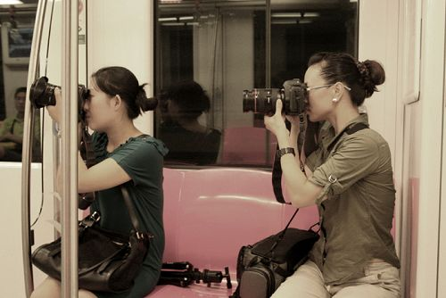
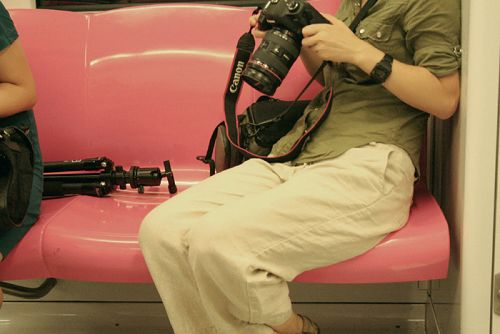
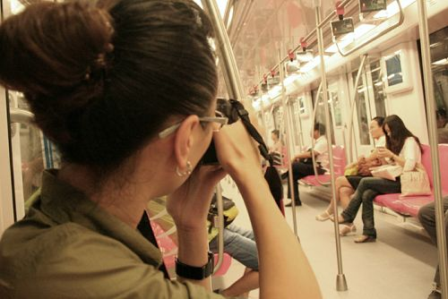
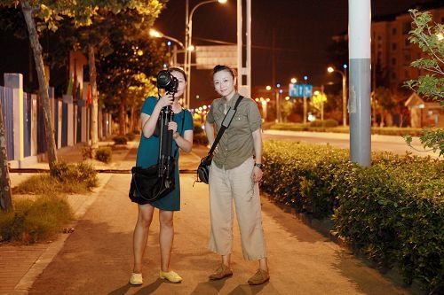
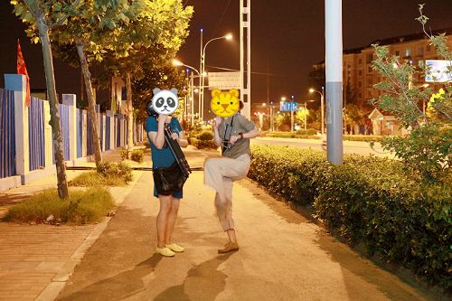

# @南京地铁2号线

最喜欢第一张，和爱好摄影的女孩子一起外出拍照，觉得很过瘾。  
  
photo by Chen wenwen  
   
   
   
   
  
这张很有意思，对吧。她们称之为“恶少遇到少女图”。  
当时的情形是这样的，相机后面的问问说：“哎，你们还能放松点儿啊？”  
于是箱子姑娘和我便开始活动筋骨，一瞬间被拍下如此有喜感的画面。  
这哪里是恶少，分明是一只鸡爪猴儿，呵呵~  

---

## 评论（3）

**angie** · 2010-08-13

Happy birthday :)

**nokia2100** · 2010-08-14

茶小姐，明天生日快乐。  
潜茶第五年。

**Chrisitna** · 2010-08-15

非常感谢~

