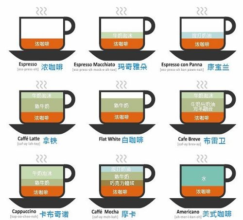

# 一杯浓咖啡的演变.

卡布奇诺、玛奇雅朵、拿铁、摩卡、意式咖啡、美式咖啡.....去咖啡店点咖啡，总是被这些咖啡名称弄得有点晕？其实他们都是在一杯浓咖啡的基础上演变出来的。  
  

---

## 评论（15）

**sususu** · 2010-08-16

等于说拿铁和卡布奇诺就是牛奶泡沫的多少的区别了

**Xiaona W.** · 2010-08-16

我也是每次点咖啡犯晕的人，这组图让我顿开茅塞，下次进咖啡店心里就有谱了，谢谢分享。

By the way, hope it is not too late to say “Happy Birthday to You!”

**喜刷刷** · 2010-08-16

这下非常清楚了,不象以前盲打.只是名字太多我现在还记不住,有机会我先试试布雷卫.

**[三月四月](http://11)** · 2010-08-16

终于明白拿铁和摩卡，还有卡布奇诺的区别了！  
所以我知道，我最爱的还是拿铁啊

**zq** · 2010-08-16

看图，貌似拿铁=卡布基诺？

**zq** · 2010-08-16

再看图，哦，还是有区别滴，呵呵。虽然迟到，但还是要问候一声：生日快乐，天天快乐，享受生命每一天！

**njlh** · 2010-08-16

latte意大利语里是牛奶的意思。实际在欧洲，美洲不知道，分cafe latte 和 latte macchiato两种，第一种只是普通的咖啡加奶用大杯子装，并且没有厚奶泡，而后一种是Espresso加奶装在高玻璃杯里，有奶泡，最底下一层是牛奶，中间是咖啡，上面是泡沫，它的总量就比cappucino多不少。其中牛奶几乎占了大部分。咖啡种类和不同的做法还是蛮有意思的。够学上一时半会儿的。

**itsmin** · 2010-08-16

的确很复杂，所以每次俺们只是告诉店员来杯咖啡！什么咖啡？随便给我来一杯！。。。这样，无论如何俺们都能喝到咖啡，管它是拿铁还是拿钢。

**Christina** · 2010-08-17

njlh，谢谢你分享咖啡的知识，学习了。

**scarlett** · 2010-08-17

啊哈，终于明白了！

**njlh** · 2010-08-18

不客气，茶。

在咖啡店打过工。用大机器打出奶泡可是要技术的。呵呵

**Christina** · 2010-08-18

那么，有过在咖啡店工作的经验，在家也能自制咖啡了？按此推想，如果在甜品店工作过，那自制甜品也难不倒咱。经历果真很重要啊。

**Vodka** · 2010-08-18

这张图非常好

**Christina** · 2010-08-18

以后去咖啡店，直接点杯浓咖啡就好了，嘿嘿~

**Anyayaya** · 2010-08-19

我念书的时候也是在咖啡店打过工的。在家里炮制相同的咖啡，最主要的就是有一个可以打奶泡的咖啡机，咖啡豆要现磨现制。各种花样其实就是在奶的多少，有无奶泡，有无奶油，咖啡分量（比如long black或short black），要不要加酒一般是威士忌（比如irish coffee)等等，难度其实并不大，只是看你有没有这个心思折腾还有咖啡是不是你生活的一部分。当时还在吧台工作过，只是各种鸡尾酒在家整好像就没那么简便了，再说每天喝咖啡总比每天喝酒好：）

