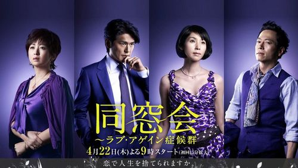

# EX-LOVER

女友不约而同谈论日剧[**《同窗会》**](http://movie.douban.com/subject/4307384/) ，极少看日剧的我忍不住好奇，买了DVD回家。昨晚看到午夜才爬上床睡觉。才看到第三集。恩，是连续剧。。。一般看连续剧就象磕瓜子，会上瘾，有停不下来的趋势。还是喜欢看电影，当天就能了结。  
  
开始三集大致讲述一群45岁的中年人，参加初中同学聚会后产生的情感波澜，貌似中年危机？故事煽情，既有贵妇家庭生活的落寞，也有传统女性的情感挣扎。。。受不了黑木瞳的表演方式。看《同窗会》不禁想起周末和几个朋友吃午饭，其中一个有外遇，且不断有外遇，到了时间一定要赶回家送老婆孩子去上课，送完再赶回来继续吃。他说这是内疚综合症的表现。如果你对你的家庭生活有说不出的失落和无奈，便给了虚弱机会。  
  
大久保君说：“爱情，有着惊人的破坏力，爱情可以改变一个人的，这种觉悟都没有，只想稍稍品尝爱情的甜美，在酿成苦果前迅速抽身而退，这样只不过是肮脏的男女关系而已。”  
  
虽然现实生活的确没有看上去那么美好，却也对此片无法产生更多的共鸣，对于没有情感困惑的我来说。既然有权利折腾，重新选择，为何要虚伪苟且地度日？《同窗会》片尾曲的旋律很好听，歌名[**《ex-lover》**](http://v.youku.com/v_show/id_XMTcyMjgyMzI4.html)。日剧里还是最喜欢《东京爱情故事》，[**分享一下93年补拍的新结局**](http://v.youku.com/v_show/id_XMTkxMjA4NDA=.html)。  
  

---

## 评论（14）

**caicai** · 2010-08-17

我是沙发？呵呵。  
有时间上MSN，和我聊聊。

**njlh** · 2010-08-18

莉香还蛮让人怜爱的，真是可爱。那个里美，是叫里美吧，肉人一个。让人喜欢不起来。

不计得失的爱情难得啊

有家室的中年男女的婚外恋，就别提了，纯属互相利用。宽容点说就是填补婚姻里的灰色地带。唉。

**[安蓝](http://sueanr.blogbus.com)** · 2010-08-18

我也要去找来看。

恩，20号晚上搭朋友顺风车到苏州，21号在苏州玩一天，22,23号在南京。  
我想走小时候走过的路，也许我都忘完了。  
我想去3 咖坐坐，旧店都没有去过，她就搬了新址，  
我还想去扑妈店里，看能否巧遇你们。  
哎呀，好激动啊。。。

**[光光](http://gaoguangguang.blogbus.com)** · 2010-08-18

黑目瞳什么表现？

**Christina** · 2010-08-18

TO:安蓝 扑店近期不宜拜访，里面东西太多，我们基本也不去了。如果有需要，可以发邮件到我的信箱：tecinese@gmail.com

光光，黑木瞳的表演我一直都觉得做作，做作到让人受不了，太TMD装了，作为演员形象也不咋滴。和她演对手戏的男主角倒还行。喜欢大久保君那一对，爽快。这部《同窗会》看着也是索然无味，就是部生活八卦。充分体现了小日本欲罢不能，欲擒故纵的风格，闷得那叫一个。。。

**[光光](http://gaoguangguang.blogbus.com)** · 2010-08-18

呵呵，好像她那个风格叫闷骚，以前看过她演的《失乐园》，我也不喜欢。我想她要是跟Samantha碰到一起会是什么样子。

**Christina** · 2010-08-18

估计Samantha会豪不留情把黑木瞳讽得一塌糊涂，让她喘不过气儿来，蛮期待这样两个人见面的情形，嘿嘿~那部《失乐园》的编剧也是够变态。

**[光光](http://gaoguangguang.blogbus.com)** · 2010-08-18

我觉得也是。通常日本的那种风格在美国无厘头的大傻文化里就会变得特别可笑，包括日本恐怖片，本来很恐怖，但你和美国人一起看完全就成了搞笑片。可能他们需要特定的气场，否则就拗得太牵强。我能想像Samantha对黑目瞳说话的样子。“honey…”

**Vodka** · 2010-08-18

黑木瞳，怕是演《失乐园》的那个吧？好像很适合这种婚内出轨的角色~

**lululu** · 2010-08-18

看指间沙的博客就提到过N次这个剧集，说是太拖沓了，而且很纯情的中年人之爱

**mandy** · 2010-08-18

在匆忙的上班人群中，穿着白色短大衣的莉香大声的喊着：完治~~那双会笑的眼睛，那头披肩的中发，音乐响起~~

**[安蓝](http://sueanr.blogbus.com)** · 2010-08-19

哎呀，那不是巧遇不了你们了。  
恩，邮箱记下了。谢啦。

**okdata** · 2010-08-19

外遇是一种态度，不是多彩的必然，而是对平淡婚姻的抗议。  
合股经营需要同步协调，坐等分红就变成投资客了。  
不赞同“肮脏的男女关系”这种说法，很中性的东西，犯不着弄得如此色彩激昂。如此这般对很多年轻人的青涩期要求太高了。道德宣教应润于成长细微，责任感更为重要  
当然感情很重要，幸福婚姻的必要元素

**箱子** · 2010-08-20

我觉得好看，不过我喜欢的是高桥这个演员，以及大久保那对，更真实，更凌厉啊。

