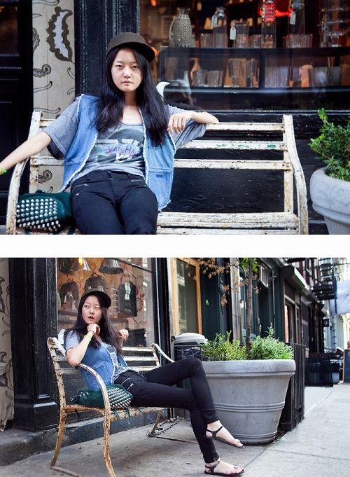
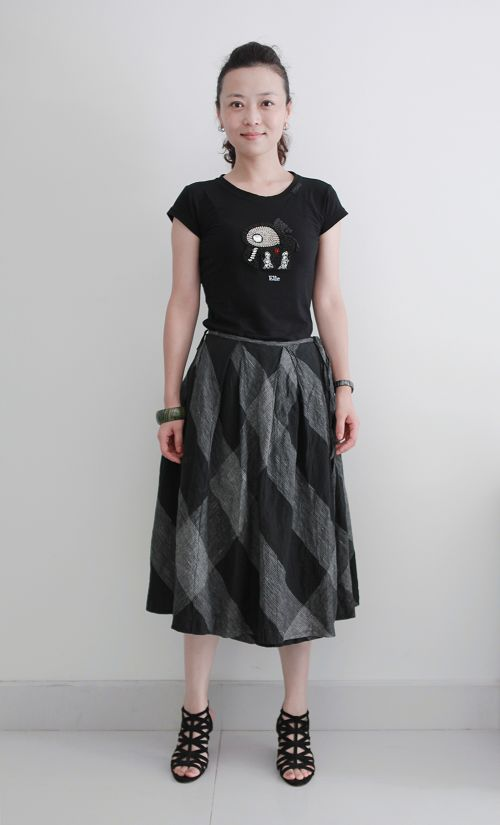

# DRESS BLOG

中午下班回家，在小区里遇到一位女孩儿，当时真想跳下车走到她面前对她说：“我能给你拍张照吗？”我摸着包里的手机和bloggie，暗自思付着。她穿着藏青色碎花收脚裤，中袖天蓝色衬衫塞在裤子里，披着头发，戴着一顶素色的帽子，与照片里的女孩风格相似，但更好看。  
  
  
N年前DECOSTER棉麻长裙，复古吗？昨天晚上居然梦见这个品牌，价格涨到上万一件，挑啊挑啊，梦止于“迷你宝蓝色小拎包”，醒来后好生奇怪。  

---

## 评论（11）

**rebecca** · 2010-09-01

这张发型好像弄的不太合适，显得有点“岁月”，身材和搭配合适的没有话说！

**Chrisitna** · 2010-09-01

已经岁月了，哈哈哈~

**itsmin** · 2010-09-01

已经到了看山还是山看水还是水的境界了是吧？

**箱子** · 2010-09-01

中午没注意到鞋子，好看的。

**[至清](http://www.yangziqing.net)** · 2010-09-02

哈哈，有点复古，不过显得更粗犷。  
问好茶姑娘。

**涔伊沁** · 2010-09-02

觉得这裙子有点衣不称身的感觉，大了

**Christina** · 2010-09-02

确切的说是裹裙，想大就大，想小就小，完全看你需要。

**mandy** · 2010-09-02

太素了~~还是年轻人能穿~~这裹裙也就你能穿了，我穿就一苏联大妈。

**njlh** · 2010-09-02

鞋子有点SM的劲儿。五花大绑。

**sophie** · 2010-09-04

茶能说说相机的型号和镜头配置吗？

相片都好美

**Chrisitna** · 2010-09-04

CANON 5D MARK II+CANON 24-70MM F2.8

