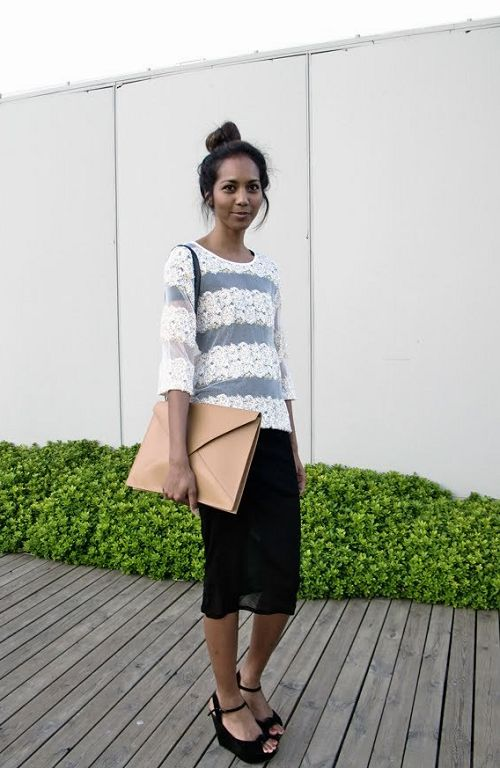
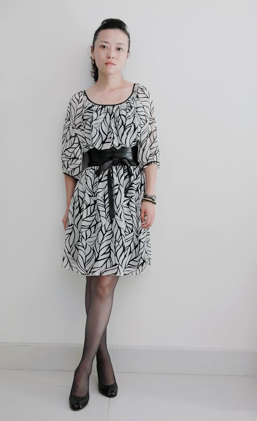

# DRESS BLOG

一条过膝黑色连衣裙，外套白色透明蕾丝状的中袖圆领衫，长度在髋部。挺大方的，让我这个对蕾丝避而远之的人，也有了好感。  
  
  
今天不宜出门，不咬嘴唇，脸要拖到地上了。  
出门很容易跟别人干起仗来。  

---

## 评论（13）

**rebecca** · 2010-09-02

今天又是我坐沙发啊，呵呵！  
茶，你的身材真是好，真的让人羡慕啊！！！

**Anyayaya** · 2010-09-02

裙子好看，这种花色款式也能穿到在镜头前这么苗条，你是不是比去东欧的时候还要瘦？

**[光光](http://gaoguangguang.blogbus.com)** · 2010-09-02

第一张照片上那个女的怎么看起来那么。。。怪啊，披头散发的，那个发型一般是我做完瑜伽以后随便一拢头发的样子，并不是一般意义上能见人的发型吧。你比她好看多了。

**JasonChen** · 2010-09-03

油画式的表情,期待你的达芬奇! btw:搭的真不错!

**truecolour** · 2010-09-03

不喜欢鱼嘴鞋穿袜，不过好像穿在你身上可以接受。这身很漂亮

**Ralph** · 2010-09-03

Nice Picture

**mandy** · 2010-09-03

腰带好看

**ALENA** · 2010-09-04

这一身很美

**fs-kitty** · 2010-09-04

我喜欢前面棉麻长裙那张, 我觉得这条裙子在你身上, 让人显老气了! 象个中年的老师, 建议配一条颜色鲜艳丰富一点的雪纺或真丝长巾.

**Frank** · 2010-09-04

What age is considered as middle aged people? For female, between 30 to 40 years old, but for male, over 40 year old.

**Vodka** · 2010-09-05

还是那个问题啊，腰上有，手腕上还有~~

**fs-kitty** · 2010-09-05

HA,” middle aged” ：严肃，呆板一点的意思而已，不用紧张呕，不过我看茶也差不多十年了，SHE KEEPS VERY WELL.  
象这种简单的裙子，还有那个灯笼袖子，除非印花和面料非常特别，建议不要采用。  
还有鞋子，太过行政感觉了。

**scarlett** · 2010-09-05

对于fs-kitty 看法我感觉很奇怪，圆领灯笼袖的造型算是简单么？倒很想看看你眼中的完美搭配是什么样的，只是单方面挑刺，太没意思了吧。

