# 一场美食，一场旅行。

想吃日本料理，可以[**在丁丁网上搜到一堆信息**](http://www.ddmap.com/map/25----%C8%D5%B1%BE%C1%CF%C0%ED----pvs/)，传说中的多佐餐厅，打了几个电话过去没人接，最后保守地选择在中央饭店一楼的浩之源，价格涨了！！！是不是最正宗的日本料理店在古南都饭店？（叹气）南京的餐饮界被川菜霸占了半壁江山。  
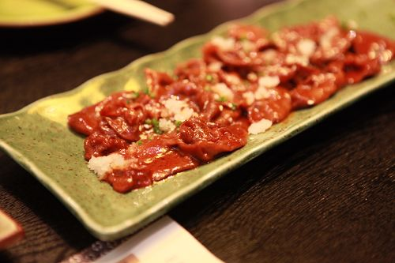   
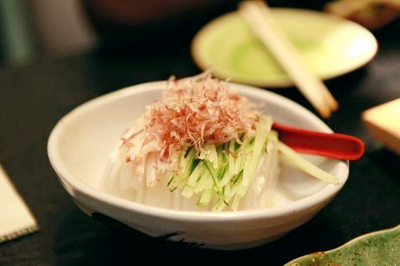   
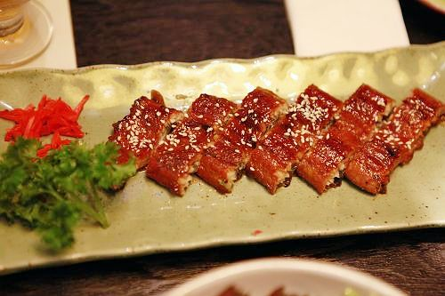   
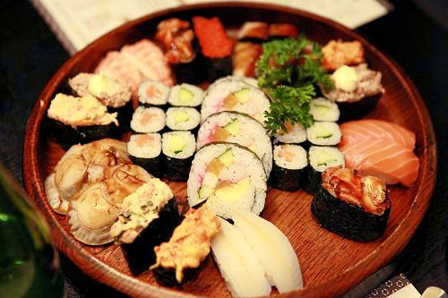   
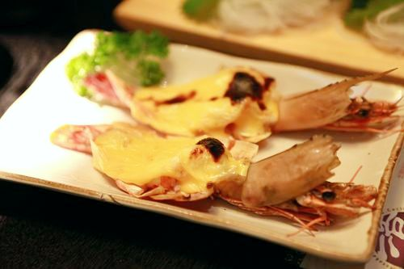   
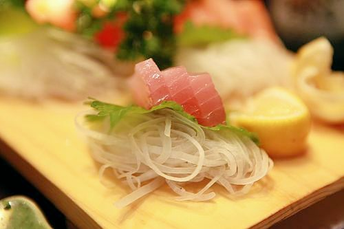   
  
邻居尼日利亚人周五晚上举办PARTY，被邀请加入。中国人的聚会一般以吃为主，所以我是冲着尼日利亚美食去的。自助餐形式，他们的牛奶酒喝起来不错哦。这份类似米粉状的食物据说不是米粉做的，具体是什么他们无法说得清楚，和米粉的制作过程一样，先要研磨成粉状再进行烹饪。左边食物微辣，细碎的象磨碎了的豆腐，但不是豆腐，掺杂着细碎的蔬菜颗粒。传统的尼日利亚方式是用手抓着吃的。  
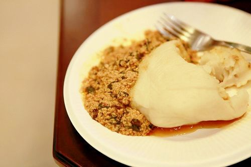  
  
番茄加辣椒做的汤。   
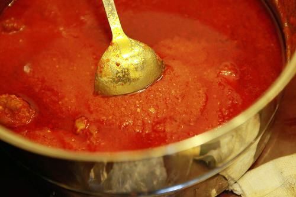  
  
炸鸡腿，炸鸡肉....可以被称之为国际化食品了。  
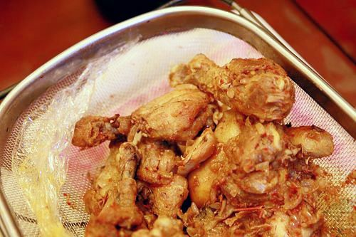  
  
聚会上究竟来了多少人，没数得过来，来的人很多。有在房间里打游戏的，有听歌的，有聊天的，有跳舞的，有看电视的。。。聚会中的人们并不都相互熟识，比较闷的人在这种场合里可能会比较郁闷，看着也让人感到无趣吧？有个中国女孩儿从进门坐在沙发上到离开就没起身走动过，几乎一直坐着一言不发。我们好心地找她讲了几句，她是朋友的朋友，而她的朋友没有来，一张口满嘴地道的南京话。  
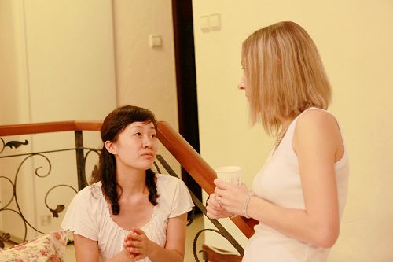  
  
信奉基督教的留学生周日早晨会去中山北路华美达酒店做礼拜，政府规定外国人不能与中国人在一起做礼拜。尼日利亚有两个教派，伊斯兰教和基督教，这两个教派之间时常会发生冲突，原因可能很愚蠢，一般被贯于“不清楚”来结束此话题。网络新闻报道过尼日利亚偏远村落出现过种族屠杀事件。而巴基斯坦邻居信奉的是伊斯兰教，晚上下班早的话，透过虚掩的门缝可以看见他们面向东方安静地跪在毯子上，我对宗教totally不了解。  
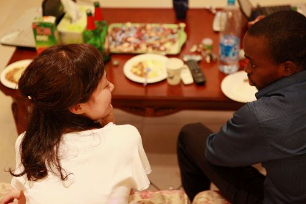  
  
外国女孩进门大方地走一圈与视线接触到或陌生或认识的人打招呼，中国女孩进来大多比较沉默，有三个同时进门的女孩儿居然很惊慌地面壁几秒，为啥？可以理解为“害羞”，也可以理解为缺乏基本的社交礼仪。  
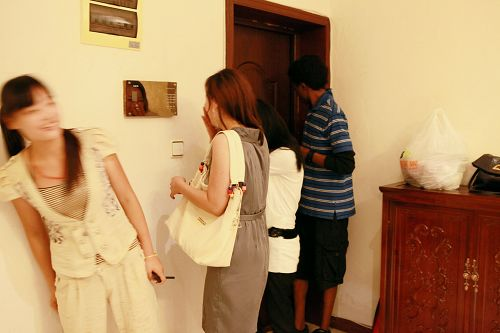  
  
尼日利亚男性的民族帽，不同国家帽子不一样。帽子是他们地位财富的象征。看过介绍尼日利亚的照片，有位中年男人头戴帽子，手持拐杖，衣饰华丽，穿得象中国清朝的贵族。尼日利亚官方语言是英语，来中国的尼日利亚人英语都不赖。他们过了16岁便可结婚，农村结婚的平均年龄比较小，城市则不同。有个25岁尼日利亚男孩说：“我们那儿的女孩同时会交往N个BF，看哪个有钱就嫁给哪个。”绝对了吧？世界是圆的，虽然我并不了解他国民情，但相信不同价值观的人都会有。据说有经济来源，工作和车，（请注意，他们没有提到房子是结婚必需品）那么就可以组建自己的家庭了。  
  
  
非洲女孩儿衣着鲜艳，穿着高跟鞋，戴夸张的耳环饰品，目不暇接，很漂亮，看得出她们是为party准备的着装，中国人在这方面还是挺“自由的”。在我看来无论来自哪里，何种肤色与信仰，不要以对方的背景和标签去判断，接触了解了，对方就是一个独立的“人”，那些背景和标签不重要。与不同人，外地的、外国的乃至于火星人的接触的过程，仿佛就是一场旅行的过程。  
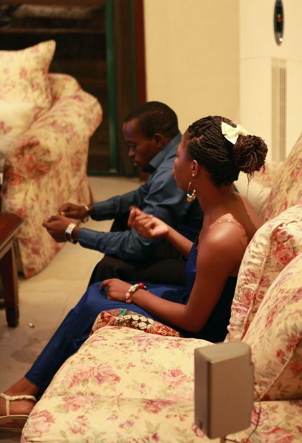

---

## 评论（11）

**jolycai** · 2010-09-04

哈哈，看了真舒服

**Xiaona W.** · 2010-09-05

喜欢这组照片和旁白，犹如身临其境。

**[至清](http://www.yangziqing.net)** · 2010-09-05

路边社最新线报：郑州的餐饮界也几乎被川菜霸占。貌似开饭店要是不带个川字或者成都、重庆之类的字眼，生意都不会好似的。

**joanna** · 2010-09-05

以前在法国时，邻居办party，会在公寓的楼道提前一两天贴个纸条，大意是何时要在家办party，为此带来的影响向邻居们表示歉意，并希望理解。老法虽然阴柔，但这点习惯让人觉得很好:-)

**winny** · 2010-09-05

图中的沙发很可爱，喜欢。

**Christina** · 2010-09-06

joanna，如果邻居经常开party经常贴条子呢？那一定很搞笑~

**okdata** · 2010-09-06

上周一位老先生，那种能辨识正宗澳龙和法式大餐的食客说：正宗日本菜在古兰都

**Frank** · 2010-09-06

You don’t like my comment, but you will agree with   
me if you contact them more.

**少爷** · 2010-09-07

那三个面壁女孩的描写，很特别。真有这样的女孩子，太在意自我了吧？

**Christina** · 2010-09-07

Frank，感谢您的好意。有时您的话给我的感受就象指甲刮在硬物上的声音。

美国总统也是黑人，你貌似也很享受在黑人领导下的生活啊？对于另一种族群体的歧视，在我看来都是非常愚蠢与极端的行为。你可以说某人，而不能直指某某群体。就象你和我是不同的两种人，我们俩能代表整个中国人吗？我更愿意将对方当作一个个体去看待，而不是贯以某某种群，虽然各种群都受其历史文化的影响。

中国人的国际形象就完美吗？评判他人之前先认识一下自己！相互尊重是必要的。

**itsmin** · 2010-09-07

道德不是批判他人，而是反省自我。对任何企图站在道德制高点对他人指指点点的，我们都要警惕。

