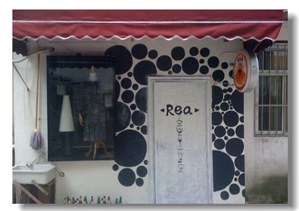
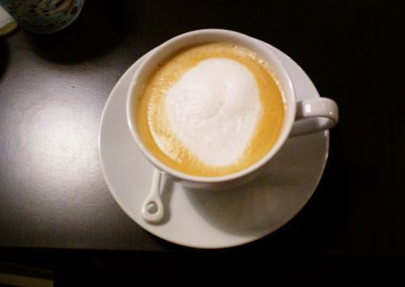
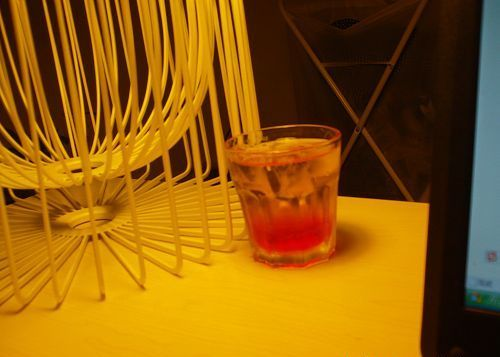
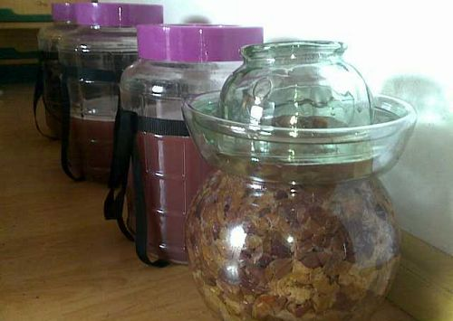
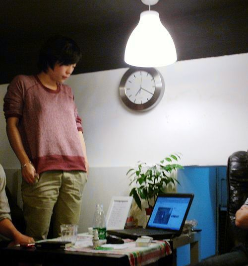
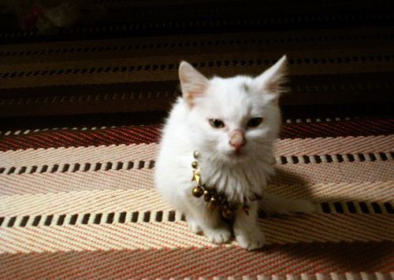

# 这微醺的下午。

星期六几乎成了每个周末的外出日。为了偷懒，摘抄众JM的微博，从不同角度感受那个微醺的下午，也好。  
  
龙竞：昨午后携闺女在REA与小原子、树娃、问问她们扎堆儿，后来茶和扑土也来了。姑娘们都很耐斯，也很亲密，我光是坐着听她们唠磕儿就觉得有意思极了。小满和我一直磨蹭到好晚才回家。小满在回家的的士上睡着了。本次还近距离欣赏到了茶生缝的包包，用料之考究手工之精细让人汗颜。  
  
  
陈问问：今天呆掌柜的二楼小空间，幽暗光下试了T2。对焦了戚风的笑脸、小满的鼻子，龙竞的眉梢，茶的长卷发，小草帽里的白展堂，PUTOOO的醉脸，乡村花布小包裹……纷纷都是美物。但是我很忐忑，不知道成像效果如何。我对新机器的弱光拍摄，心存担忧，好在美好时刻，也不是非要靠相机来记录。  
  
  
tecinese：今天喝到putoo用玫瑰红葡萄自酿的葡萄酒，更爱不加冰的口感，甜中带着让人微醺的劲儿。扑土喝着喝着脸就红了，人也散了，醉了一般。之前看她和龙竞制作葡萄酒的过程，很有意思，还是自己酿的酒好，不是外面用葡萄浓缩汁勾兑出的涩口的感觉。爱，很爱，大爱，我要学习酿葡萄酒！  
  
  
putoo:上午过滤葡萄，明白粒粒皆辛苦。大概是80、90年代往后，大家都开始在饮用外面的饮料、泡菜、包子，现在觉得，我们贪图便利的同时，给无良商人制造了机会，现在自己养奶牛挤奶给小孩喝已经不可能，以后糟糕的环境更无望~ 。是不是买到了便利，就赔上了乐趣和健康？弄了两坛，一大一小，小的在店里，那地方暖和（你们知道~）便早早发酵。大的在家，放在卧室里，有空调恒温慢酿，今天液体开始出现红色，天天都晃动一下，放点气，酒香已经出来点儿咯~我琢磨再去搞一坛子继续酿。。 哦，对了，我开始研究酿啤酒了。。。  
  
  
shuwua：龙竞是个巧人儿，今天带小满来阿呆店里玩。她用好看的深粉紫布裹了个包袱，里面是丹麦曲奇饼干桶罩下的戚风蛋糕，一来就把我美呆了。盘子是多年前在沃尔玛买的，英国博物系的，喜欢极了。小满从网络来到眼前，小女王，嗲啊，可爱啊，不足以形容。与一旁大嚼肉食的我们相比，她是小清新 。  
  
  
阿呆掌柜的宠物“白展堂”，瘦骨嶙峋，脖子上不知被哪位好心的MM戴上根与它体型不符的颈链。。。它与皮蛋打架的样子也很搞笑，我家土豆不愧是成熟滴的长辈，闻闻它就走开了，端坐在我们中间，又安静又幸福的样子。  
  
  
真的很想说，很爱这样边喝酒边聊天边吃东西，席地而坐的下午啊~

---

## 评论（6）

**陈问** · 2010-09-13

各种角度生动极了。唯独的遗憾，胶片比起数码来，要滞后好多啊。好在有你的那个SONY，一睹为快。

**喜刷刷** · 2010-09-13

等你酿酒了。等等等等等。。。。。

**Mandy** · 2010-09-14

哇，你们会自己酿酒，真是了不起。这样的下午多么让人羡慕啊，我也很陶醉与女性朋友在一起的时光呢。

**不羁之舟** · 2010-09-14

可去的地方 可做的事情越来越多啊……姑娘们真可爱：）

**okdata** · 2010-09-14

“自酿的葡萄酒。。。不加冰的口感”  
用专用杯，口感更好。  
不过，一只300多

**纸鸢** · 2010-09-15

看得我也跟着醉了每周有这么一天的好时光，面对枯燥的工作一定会很有抵抗力吧

