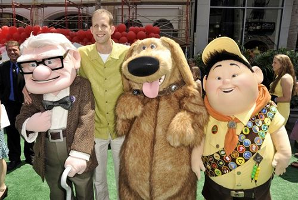
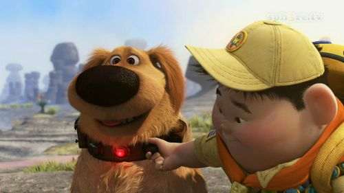
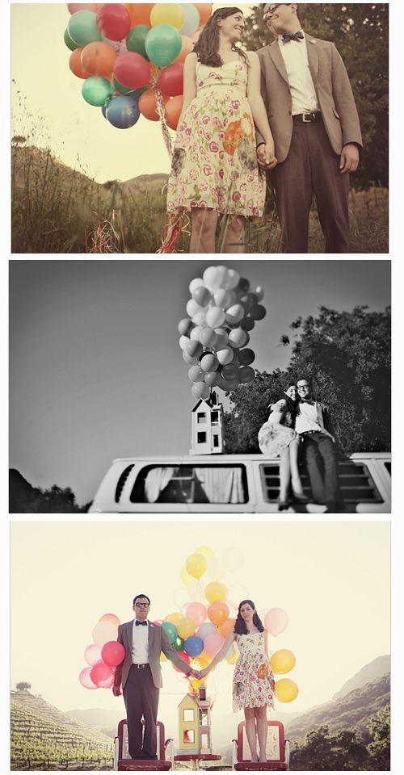
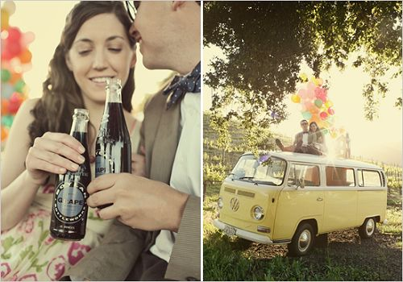
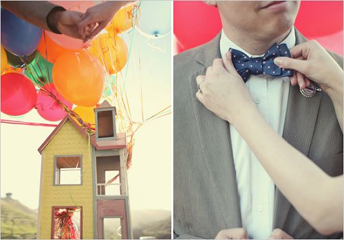

# 每个人都需要一个出口。

昨晚睡前看了2009年美国动画片《Up》，心情好到现在。我已经很少去电影院看电影了，上一次去电影院是为了看《Avatar》，应该是去年下半年的时候，结果河西那个双机3D效果也不咋滴。因为常常在家看片，国外电影上映3个月后，国内的D9版本DVD才会出来，所以我是看电影滞后者。回到《UP》上，故事的想象力真是了得，每个人物都可爱，电影的制作班底专门前往南美洲做实地调查，恩，对，看碟子的另一个原因是可以看到制作花絮等电影背后的介绍。《UP》里的每个角色都有属于自己的梦想，包括那只叫Dug的可卡，它想找到一位喜欢的主人。我很喜欢Dug，喜怒哀乐和我家Luke一样一样的，表情也相似。  
  
《UP》动画导演和三位主角  
  
  
Dug通过项圈上的电子装置可以说人话，呵呵~看完电影我在想，如果能有《UP》里人物的玩具，我倒想买些回来，每位角色创造的都很有喜感。到[**http://www.ourtoys.cn/**](http://www.ourtoys.cn/)里去寻一寻。  
  
  
说到Luke，今早的情形有意思。我家主卧做了8MM的钢化玻璃门和墙，玻璃很结实，昨天挂门的铰链断了，因为门太重，门被搬移到别处。  
  
今早Luke慢悠悠摇着尾巴从餐厅爬上楼，我在主卧卫生间洗漱，它对着原先门缝处哼哼唧唧想进来，一会儿站一会儿坐，等在门外。我拽着它的长耳朵把它拉进来。待我离开，又见它在门内等，一会儿站一会儿坐，抬起一只前爪去推不存在的门。。。哈哈哈哈。。。惯性思维，对吗？  
  
电影表达了每个人都需要一个梦想，经历千辛万苦去感受心中的梦想，无论面对的是不是残酷，都值得一试。而Luke的反应告诉我，**不要进行自我封闭，或许前面的那扇门不过是自己想象出来的，我只需要寻找一个出口**，就这么简单。  
  
国外有人以《UP》电影为主题拍摄的婚纱照，哦，那首钢琴曲伴随男女主角从相识到相爱到一起变老的画面，让人无法不动心。这组结婚照拍的清新自然又轻松，请注意男士西装领上别的那只苏打水的瓶盖，和动画片里的一模一样啊。  
   
   
   

---

## 评论（7）

**Anyayaya** · 2010-09-16

Pixar的传统是影院版的动画开头前都插播一小段额外制作的动画短片，和影片本身可能没什么关系但是想象力很丰富非常有意思。《UP》的叫“暴力云与送子鹤”。DVD里没有，可以到网上下载了看。

**frank** · 2010-09-17

你挺适合到国外生活的，其实国外没你想的那么差，虽然你在国内是白领，但是，在国外当一个普通人生活也不算太差。喜欢安静的人到美国来真的是很好的选择。

**miumiu** · 2010-09-18

來美國不要去大城市還可能會

**[bigtaro](http://www.bigtaro.com)** · 2010-09-18

《up》既温馨又感人，孤独的小男孩和一个古怪的老头，活生生是现实的缩影！也许只有在Pixar的动画中才能寻找到成人世界中缺失的纯真！

**okdata** · 2010-09-20

怀旧的色彩，温馨的世界  
The Matrix 说程序化生活，我们说惯性思维  
所以摸着“Change”命门的奥巴马上位后选择伊战和医改为执政出口

**[gwk](http://ggandalan@126.com)** · 2010-09-21

非常感人的片子。但是美国优秀的动画片前面非常有意思和不拘一格，但是最后都陷入好莱坞式的结尾，此片也如此。也感动于那首钢琴曲伴随男女主角从相识到相爱到一起变老的画面。

**tika1026** · 2010-09-24

亲，能提供下拍这组婚纱照片的网站吗？非常谢谢

