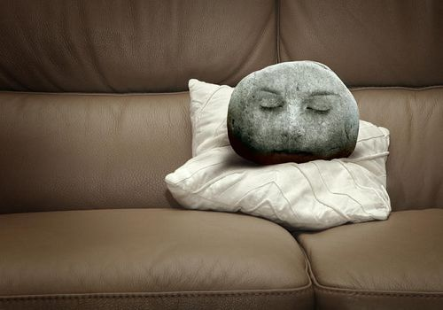

# None

  
  
一个决定就能一了百了了？人性的复杂，永无止境反反复复，被复杂的东西牵绊着。和女友煲电话粥：太追求完美。说得难听点，就是什么都想要，贪婪的本性。不过世上有几人事事顺心？即使事事顺心，还会被周期性荷尔蒙影响时常发作一阵儿。  
  
特别敬佩某些个铁了心过这样、那样生活的人。一个猛子扎进水里，享受也好，呛水也罢，就悬浮在里面了。即使有被淹死的风险也认了。  
  
某些个走着走着失了方向感的人，不管这路走得多么正派体面，仍然存有无法解答的疑问。回头望，这是一条怎样的路？远方又是什么在等待？  
  
那些个小心翼翼躲过世俗标准，分裂精神与生活，是不是会更满足呢？如果满足，是满足于伪生活还是真感受？两者兼顾？还是转换角色、表情，以及谎言。  
  
“你想要什么？”  
“想要美食与欢笑，以及不要反复纠缠在同一个问题上。”

---

## 评论（3）

**michelledou** · 2010-09-17

可以追求和享受自己生命中可以承受之轻。无需在乎一时的波动和打扰。

**okdata** · 2010-09-20

什么都想要 ＝ 不知道要什么  
工作、家务、配偶、孩子、房子、银行债务。。。  
生活已然很累，别再折磨自己了

**richard** · 2010-10-06

钢铁大厦修好了呀

