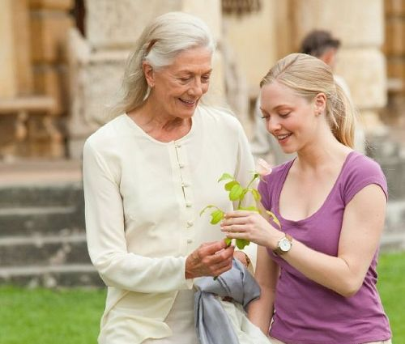
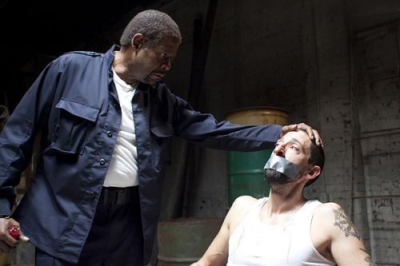
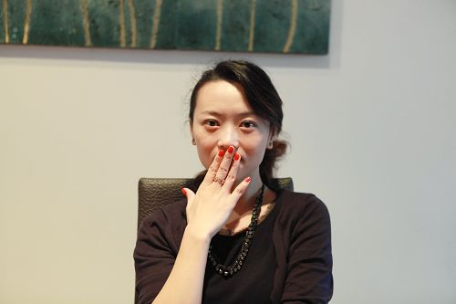

# 假期

假期看了许多电影，印象最深的是《Letters to Juliet 》，由近期非常喜爱的女演员Amanda Seyfried主演。  
  
“罗密欧与朱丽叶”的虚构戏剧上演后，意大利博物馆馆长比较有生意头脑，在30年代按照故事描述仿制了一座朱丽叶居住的房子。人们真的前往意大利朱丽叶住处缅怀，甚至有人贴些手写的文字给她。博物馆馆长当年亲自回信给贴纸条的游客们，署名“朱丽叶的秘书。如今世界各地仍然有慕名而来的女性们，她们将自己的苦恼困惑书写在纸上，朱丽叶的秘书们每天收集起来，一一回复并邮寄回每位游客留下的地址，电影里的这一情形完全来自于现实。基于这么一个背景，女主角发现墙壁中一封写自50年前的信，就是图片中这位银发夫人在她15岁时所写，故事套故事。虽然imdb只给这部电影6.3分的总评，但是因为有Amanda Seyfried，这位天生的尤物还是让人眼睛不够用呐。除了故事之外，令人惊叹的意大利风景、庄园、小镇、古老的石板路，以及FIAT汽车也很吸引人。  
  
  
  
另一部具有讽刺意义的电影《THE EXPERIMENT》，也是由我喜爱的男演员Adrien Brody主演。《The Experiment》改编自2001年德国电影《Das Experiment》，讲述人类行为学实验招募了一群普通人作研究，一组扮囚犯，一组扮狱警，实验的目的是想看看在角色、权利分配后，会对人产生怎样的影响。里面Forest Whitaker扮演的角色，在分得权力后暴露出的本性，与现实中的某些人极其一致。Whitaker那角色平时循规蹈矩老实本份，还是虔诚的基督徒…  
  
豆瓣里有关这部电影的最佳评论，我很认同，摘抄一段：如果把你放回“文革”时期，你会怎么做？还记得张丰毅张国荣演的《霸王别姬》最后霸王是怎么对姬的么？   
　　   
看完本片和津巴多的实验以后，不要单纯惊讶于对人性的失望。实际上津巴多解释这一切发生的原因是：**如果你在没有监督的情况下给人以权利，那就是在给滥用开通行证。**他们明明了解后果，却任其发生。也就是路西法效应。  
  
英雄主义是恶的解药。津巴多在TED的演讲也说，任何时候不要害怕自己作为“异类”，英雄也是平凡人，只是平凡人做了英雄之事。而英雄行为是不平凡的。要做一个英雄有两个条件：一、你要在人们冷漠之时不袖手旁观；二、你要以社会为中心而不是自我为中心。  
  
有一天每个人都会遇到这种情景，这时人们有三条路可以走：1、你服从权威力量，而成为恶人；2、你冷漠袖手旁观，而内疚一辈子；3、你成为一个英雄。每个人在面对时只有一次选择的机会。  
  
不过，我想说Adrien Brody主演的角色表现出的行为，初衷并不是想做英雄，而的的确确是受到正义与人性中善的驱使。  
  
  
  
++++++++++++++++++++++++++++++++++++++++++++++++++++  
  
@9/22 中秋家庭聚餐中  
   
  
  
@9/23  
即使假期，到点儿就醒了，在闹钟响起之前。天气凉爽起来，能让人感觉到秋季的到来，我在阳台上浇花，抬头望见蓝色的天空和白色的云朵。这是大雨过后的天空，大自然显露本来的颜色，对于居住在南京的人来讲，还是挺珍贵的。  
   
   

---

## 评论（6）

**njlh** · 2010-09-25

真高兴南京有这么蓝的天。

应该还有第四条路，估计走的人也最多: 麻木但不内疚。  
生存下去是本能。

我也有英雄主义情节，但危险真正来临的时候我估计我的本能会占上风。道德，善恶，英雄主义都是教化的结果。

**箱子** · 2010-09-26

那天的好云朵就在你家附近，最美。我开车路过时还想，你一定会拍的。果然看到最后，就有了。  
所谓屁股绝对脑袋，大概就是你说的这样。

**JasonChen** · 2010-09-28

没那么简单 一杯红酒陪/配电影

[00:14.35]  
[00:20.53]没那麽简单 就能找到 聊得来的伴   
[00:28.31]尤其是在 看过了那麽多的背叛   
[00:35.15]总是不安 只好强悍   
[00:42.35]谁谋杀了我的浪漫   
[00:47.13]   
[00:48.87]没那麽简单 就能去爱 别的全不看   
[00:56.73]变得实际 也许好也许坏各一半   
[01:03.73]不爱孤单 一久也习惯   
[01:11.13]不用担心谁 也不用被谁管   
[01:16.98]   
[01:17.60]感觉快乐就忙东忙西   
[01:21.27]感觉累了就放空自己   
[01:24.96]别人说的话 随便听一听 自己做决定   
[01:32.06]不想拥有太多情绪   
[01:35.57]一杯红酒配电影   
[01:39.14]在周末晚上 关上了手机 舒服窝在沙发里   
[01:45.38]   
[01:45.85]相爱没有那麽容易 每个人有他的脾气   
[01:53.01]过了爱做梦的年纪 轰轰烈烈不如平静  
[02:00.22]幸福没有那麽容易 才会特别让人着迷  
[02:07.28]什麽都不懂的年纪   
[02:11.13]曾经最掏心 所以最开心 曾经   
[02:18.40]   
[02:24.90]没那麽简单 就能去爱 别的全不看   
[02:32.97]变得实际 也许好也许坏各一半   
[02:39.99]不爱孤单 一久也习惯   
[02:47.29]不用担心谁 也不用被谁管   
[02:52.60]   
[02:53.89]感觉快乐就忙东忙西   
[02:57.31]感觉累了就放空自己   
[03:01.00]别人说的话 随便听一听 自己做决定   
[03:08.39]不想拥有太多情绪   
[03:11.74]**一杯红酒配电影**   
[03:15.55]在周末晚上 关上了手机 舒服窝在沙发里   
[03:21.53]   
[03:22.15]相爱没有那麽容易 每个人有他的脾气   
[03:29.29]过了爱做梦的年纪 轰轰烈烈不如平静  
[03:36.32]幸福没有那麽容易 才会特别让人着迷  
[03:43.52]什麽都不懂的年纪   
[03:47.34]曾经最掏心 所以最开心 曾经   
[03:54.36]   
[03:57.67]相爱没有那麽容易 每个人有他的脾气   
[04:04.98]过了爱做梦的年纪 轰轰烈烈不如平静  
[04:11.99]幸福没有那麽容易 才会特别让人着迷  
[04:19.14]什麽都不懂的年纪   
[04:23.04]曾经最掏心 所以最开心 曾经   
[04:31.24]   
[04:33.32]想念最伤心 但却最动心 的记忆   
[04:47.45]

**[gwk](http://ggandalan@126.com)** · 2010-09-30

非常喜欢《Letters to Juliet 》。可能看得太多惊悚，恐怖，突然看了这么清新的，实在舒服。影调极为舒服，使我联想到中秋在意大利的那个夜晚。意大利所有的建筑似乎都是旧旧的，即使过了那么多年，你还能找到故人，而中国根本不可能了。喜欢女主角的味道，非常特别。不是非常漂亮，却让人难忘。

**Christina** · 2010-09-30

GWK，看来俺们对此电影有着一致的共鸣，握手~

**薇安** · 2010-10-11

我也很喜欢Amanda Seyfried。第二部电影是不是有点恐怖片倾向啊

