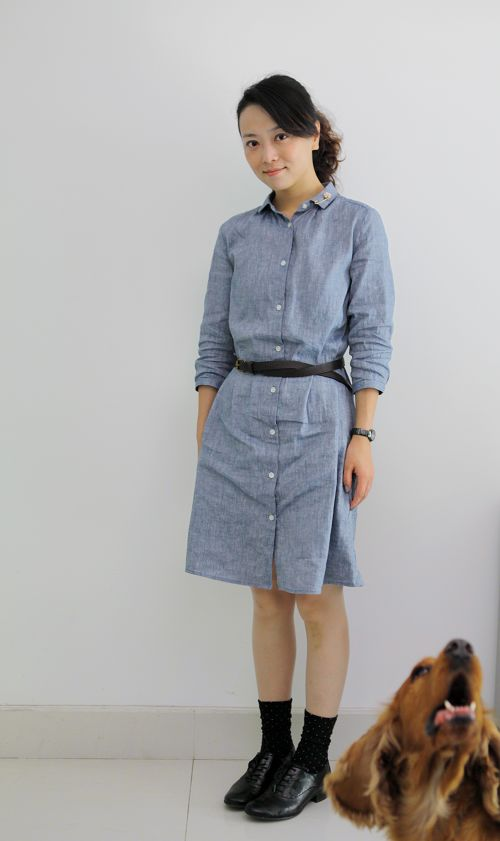
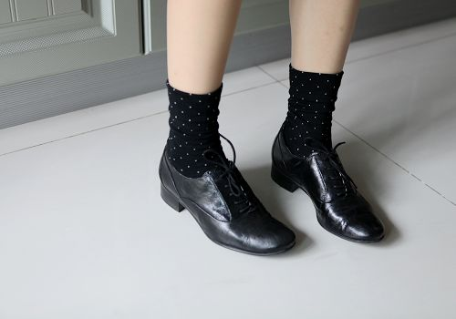

# DRESS BLOG

中秋节期间，白岩松在南京签名售书：《你幸福了吗？》  
10年前他出过一本《痛并快乐着》，那时他30岁。  
10年后40岁的他问自己：你幸福了吗？  
30~40岁之间，人生中转型、思考、成熟的重要阶段。  
当你越走越远，忘记了出发时的初衷是什么？  
你能感受到平和、幸福吗？  
我很享受32岁之后的自己，不过...  
还是想把这个问题留给将来40岁的自己。  
  
++++++++++++++++++++++++++++++++++++++++++++  
  
有人说：逻辑上来讲，如果你现在感到幸福，用不着等待到40岁。  
  
恩，今天我化了妆，心情不错。毕竟休息了三天，身体貌似也恢复了。细想想，大多数时候感到挺幸福的，至少不上班的时候，内心安宁平静，很享受家庭生活。上班时的状况却很糟糕，常常烦躁、易怒、纠结、疲劳、分内泌失调。  
  
上班下班，上班下班，好与坏不断交错穿插，白天被糟蹋，晚上回家调整，构成了目前的现状。（怀疑自己是不是神经太纤细了？）如果两者可以分离感受的的话，在家幸福，上班不幸福。这，算幸福还是不幸福呢？  
  
   

---

## 评论（15）

**JasonChen** · 2010-09-25

第一张中,小L太不配合了.

**Chrisitna** · 2010-09-25

它在等午饭，嘿嘿~

**[barbielady](http://blog.sina.com.cn\barbielady)** · 2010-09-25

很有欧范儿～点点的短袜，喜欢～

**itsmin** · 2010-09-25

嗯。看得出枕头很对付。逻辑上来讲，如果你现在感到幸福，用不着等待，40岁的时候答案同样明显。

**Christina** · 2010-09-25

恩，min，答复见主文。

**itsmin** · 2010-09-25

我想，对很多上班族来说，痛并快乐着是一种工作生活状态。幸不幸福全看个人，但总好过痛并不知所措着之类吧？爱做菜的Julie白天被接线的工作折磨，被春风得意的朋友所刺激，但她还是找到了喜欢的东西做，并因此上班的时候也不那么受折磨了。虽然结果俺们还没有看到，不过估计不会差。这是温水青蛙的另一种生存之道。不完美，但是安全，真实可触摸。

**mandy** · 2010-09-26

袜帮是否压低点更好看？显腿修长~~个人建议啊~~

**Christina** · 2010-09-26

就是想卖个破绽啊，傻傻的样子，嘿嘿~

**苏铁** · 2010-09-26

想问下茶，鞋鞋是什么牌子哩？

**Christina** · 2010-09-27

鞋子是ECCO的。国内不知是否有此款，可以去商场看一下。

**nikita** · 2010-09-27

把袜子和鞋穿得那么漂亮,又赶上了今季的时尚,赞!

**Vodka** · 2010-09-27

小清新范儿

**backhand** · 2010-09-28

有段时间没有来看了，每次来看你的文章，有从纷繁尘世来洗涤一次的感觉。说到上班受罪上班幸福，我有我看法，上班受的罪或下班感觉的幸福，都未必有那么样，其实就是你自己的心态了，有时候我们不能改变结果，那就不妨改变一下规则。在我看来，罪是可以忽略的，而幸福触手可及的，也是眨眼就灰飞烟灭的。

**少爷** · 2010-09-28

这个袜子的小细节很漂亮。茶，工作中就随意点吧，不要太计较。我觉得你还是很幸福的。

**路过** · 2010-10-10

这鞋、这袜不错

