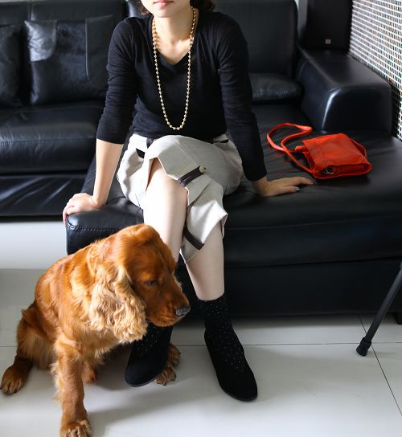
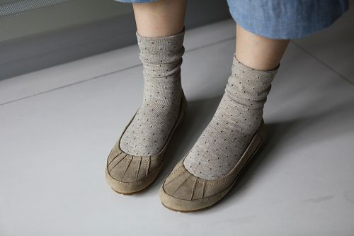
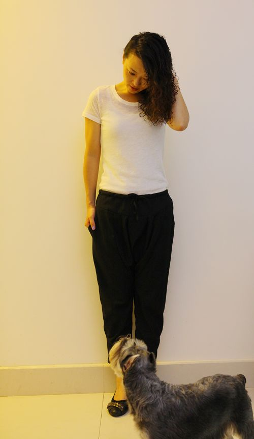

# DRESS BLOG

@9/27  
  
  
@9/28  
  
  
@9/29  

---

## 评论（11）

**箱子** · 2010-09-29

求袜袜地址、、、水洗蓝的裤子很美。是我喜欢的类型。土豆在看，那你低头的温柔啊。

**Chrisitna** · 2010-09-29

不是TB商品，私信你了。

**sofiah** · 2010-09-30

啊呀，可以用鸡蛋+面粉+水，合成的面浆，锅底刷薄薄的一层油，煎出的鸡蛋饼相当美味，还可以加一些切碎的泡菜就是泡菜蛋饼：P

**Sherry** · 2010-09-30

第一张的风格最适合你，酷一点很有神秘感。。

**okdata** · 2010-09-30

沙发不错，大白花镜面砖，80cm的？足见厅不小。  
首张画面丰满，nice

**JasonChen** · 2010-09-30

萌到了,被@9/29…姐给看下这张的全身,因为我觉得这袜子和鞋子巨难配衣服.

**caicai** · 2010-09-30

这个红包就是不错吧，哈哈。我给你HOTMAIL发了一封去清迈的攻略，查看下。

**Vodka** · 2010-09-30

老北京布鞋一穿袜子，韵味全失

**Christina** · 2010-10-01

不好意思，照片里的都是皮鞋。

**[凡六](http://mzai.net)** · 2010-10-08

那个小狗挺好玩的，我原来也有一个，叫旺财的

**喜刷刷** · 2010-10-10

喜欢第一张,那是你的范儿~

