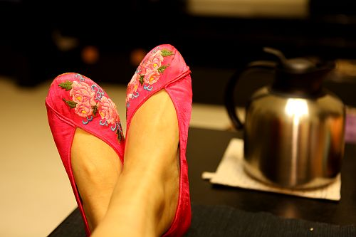

# 世界没变，我变了？

   
  
不工作，似乎对网络毫无依赖感，放假7天没开电脑，没用相机，就这么宅着，懒散却美好。假期里穿着我的绣花鞋在家收拾橱柜，整理家务，看电影，每天蓬头垢面也无所谓，居然也能静下心看起了小说。甚至都没给澳洲回来的朋友打一个电话，就让她在5号回去了。这两年越发留恋家，留恋到想要封闭自己的地步，但这变态的愿望真的对自己起到了作用。  
  
傍晚接到问问电话，网络上毫无我的消息，以为我出远门了。。。计划倒是有，都安排在今年最后两月。假期中朋友们一个一个远行，Sherry去了坝上，shuwua去了柏林和维也纳，扑土去了外地，问问和小原子后天也将行走在日本的小街上。此时，大惊喜两部手机全都关着，真正是毫无消息的人。是否结束曼德勒的行程？平日里相互损着开心，其实大家对她都存着牵挂，毕竟是一个人去旅行。  
  
说说我在假期中看的村上春树的小说《当我谈跑步时我谈些什么》，书名有点儿饶口，对么？他从33岁开始进行长跑锻炼，并参加大小不一的马拉松比赛。跑步不需要对手，可以一个人完成，对喜欢独处的人来讲更是美好。其次也不需要赶往特别的场所，只要有一双适合跑步的鞋，有一条马马虎虎的路，就可以想跑多久就多久。此外因为跑步他还戒了烟。  
  
村上春树人生中第一部小说《且听风吟》上市后，他卖掉了自己的餐馆，和太太搬去千叶县居住，专心写作。彻底改变生活形态。这是他们想象的自然的生活，正经人的生活。今后只见想见的人，不想见的人则尽量不见。这是怎样的一种奢侈？**对于非善于同人交往的人，有必要在某个节点回归原始状态。**  
  
我在9月26日订购的书，今天才收到。孙东纯的《迟到的间隔年》。  
  
在中国“间隔年”还是比较新鲜的概念，但很快将被中国的年轻人所接受。接触到这一名词忘了是在《心理月刊》还是《时尚旅游》杂志上。在欧美，年轻人在升学或者毕业之后工作之前，会作一次为期一年的旅行，在步入社会之前体验不同的背景下的生活。在旅行同时，也会做一些与专业相关的工作或者一些非政府组织的志愿者工作，以便更好地融入社会，这一年就叫做“间隔年”（GAP YEAR）。除了毕业后远行之外，现在也有工作多年后，放弃一切外出流浪的故事。有一位年薪60万的白领，辞去工作，跑到印度一家非政府组织机构，无薪水，自管吃住，做起了义工。  
  
孙东纯的网名叫“远足”，他于2006年12月1日带着一张仅有2万1千元的人民币国际银行卡，离开了自己生活工作多年的城市，带着一个“间隔年”的主题，走出了中国。从原本计划的三个月走到十三个月。相信常常混在磨房的网友对他都会比较熟悉。他在旅途中遇到了他的日本妻子，他们现在生活在日本。  
  
恰恰在这个时候遇到这两本书，书中的故事带给我鼓励与震撼。大多数人无法安静下来思考，更不会放弃现成的一切从头开始，不为名利，无视世俗评判成功的标准，只为做自己喜欢的事儿，跟着自己的心走，这需要怎样的一种勇气？  
  
不上班的7天里，我无比的安静，静到能听见自己的心跳。  
  
给即将远行的问问和小原子，对于你们的旅行我想你们一定做了很充分的准备，毕竟是在非英语国家的自助行，我虽然帮不上忙，但推荐几个网站，教授如何SMART PACKING，算是一点点小心意：  
\*\*\*经营打包旅行产品的网站，从拉杆箱、背包到衣服、整理袋等，品种齐全，并且还能淘到许多有趣的小东西：   
[**www.magellans.com**](http://www.magellans.com)  
  
\*\*\*《SUSAN FOSTER》对行李箱的安全提出了很好的建议，对于为旅行穿衣而苦恼的朋友也很适合。书的作者在她的网站上和旅行者交流任何有关打包整理的问题：  
[**www.smartpacking.com**](http://www.smartpacking.com)  
  
\*\*\*independenttraveler是一个旅游咨询和信息的综合网站，近期推出的这个打包风格小测试可以让你了解自己的旅行打包存在什么问题，并给予合理的建议：  
[**www.independenttraveler.com/packing**](http://www.independenttraveler.com/packing)

---

## 评论（21）

**陈问** · 2010-10-08

也好哇，我们轮番着出门玩，至少本土有人留守等候。  
另，求大惊喜速度现身！

**少爷** · 2010-10-08

原来问问是去日本啊，真羡慕。茶还是位好学的姑娘哇，读了不少呢：）

**Chrisitna** · 2010-10-08

惭愧，平时压根儿静不下心来读小说滴。。。假期也算有点回报了。

**箱子** · 2010-10-09

那天电话你时，也在想会不会你不在南京。。。年底我也出去。真是轮番上阵啊。你穿绣花鞋。我正翻出了个绣花枕头。。。下周貌似也许可以见面的哦！

**zq** · 2010-10-09

假期里几次纠结是否主动打电话约见，想想最终还是归于“想想”，呵呵。嗯，一张充满想象的美图哦！

**caicai** · 2010-10-09

我买的《迟到的间隔年》节前最后一天到了。嘿嘿。前天刚下单《跑步时谈什么》，今天应能送到。有默契啊。

**Alice** · 2010-10-09

每次都从你这边定下自己接下来的要读的小说。。呵呵。我这算不算是茶粉呢？

**不羁之舟** · 2010-10-09

村上的书我全有 茶要看什么我可提供啊 我现在总觉得这个书 也要流通~~跑步 很好看 看了后 我都开始 偶尔 跑步了~间隔年 没看 鞋子颜色很美 我有双紫色的 颜色败了 看来 该再添一双了

**truecolour** · 2010-10-09

也想买双绣花鞋了

**Frank** · 2010-10-09

Family is always my priority.

**[Nio](http://www.nioxiao.com)** · 2010-10-10

有点凑巧，我的假期在看村上春树的1Q84，呵呵。

**喜刷刷** · 2010-10-10

看上去你的假日丰富极了,而且一点都没提到吃的:)

**卉子882** · 2010-10-10

放假7天没开电脑，没用相机，就这么宅着，

真厉害。不在家的话，7天不开电脑不用相机也就罢了，在家居然能做到，你真厉害。需要自制力吗？

**itsmin** · 2010-10-10

村上的这本跑步书没有看过， 但是俺们对他提到的这种感觉很有同感！健身的时候，只有自己和自己对话，自己也是自己的对手，超越不超越，感觉都很好。

**Yanying** · 2010-10-10

“不为名利，无视世俗评判成功的标准，只为做自己喜欢的事儿，跟着自己的心走，这需要怎样的一种勇气？” 很少人能有这样的意识。 赞一个！

**[Christina](http://lifetea.org)** · 2010-10-11

zq:干吗纠结？我也想你来着，但更想赖在家里，所以没打电话联系你哦~  
caicai：你对《迟到的间隔年》有什么感受？  
Alice：哎呀，要是跟着我看书，那可有得等了，难得我能看进去文字啊；  
不羁之舟：颜色败了就再添双新鞋，绣花鞋在家里穿，很特别的感受，你觉得呢？  
truecolour：虽然不再是绣花鞋的时代，但还是建议买一双，不穿出去，在家穿穿也挺美的；  
喜刷刷：对，前三天吃好吃的，后四天吃东西基本没规律，吃零食的多；  
卉子882：宅，如果需要自我或外在强迫，就不好玩了，你说呢？我现在的状态，完全是很自然的宅的状态。从内心120%喜欢。  
Itsmin：读小说的时候我在想，某人也是规律性锻炼的，是不是也和作者一样的体会？这本小说对我蛊惑啊，也想规律性跑步健身了。  
Yanying：有意识与能做到，还有很长的距离：）

**[Christina](http://lifetea.org)** · 2010-10-11

Mandy，两个信箱都确认过了，没有发现你的邮件哦~

**薇安** · 2010-10-11

大多数人无法安静下来思考，更不会放弃现成的一切从头开始，不为名利，无视世俗评判成功的标准，只为做自己喜欢的事儿，跟着自己的心走，这需要怎样的一种勇气？———-说的真好。。。。。说的真好

**mandy** · 2010-10-11

你能先发一句话到我邮箱吗？

**苏铁** · 2010-10-12

茶，问下你是不是在看《时尚旅游》杂志？我在最近一期的这个杂志上看到了smart packing的小册子，里面正好有你推荐的这几个网站哦。

**[Christina](http://lifetea.org)** · 2010-10-12

对呀，很正确。发现新大陆了：P

