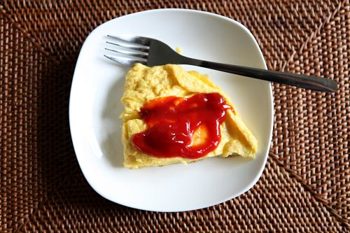
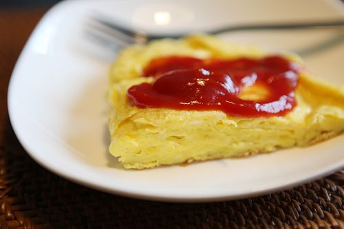

# 还可以再嫩点

受了龙竞“卤茶叶蛋”的影响  
今早做了一份滑蛋  
用了朋友送的土鸡蛋  
  
火稍稍大了些  
[**还可以再嫩点儿**](http://ss12.sinaimg.cn/orignal/631148a9g9276e474b06b&690)  
爱搭配番茄酱吃  
  
   

---

## 评论（9）

**[至清](http://www.yangziqing.net)** · 2010-10-13

视觉冲击很强烈啊。  
不过，这么点我吃不饱……

**[凡六](http://mzai.net)** · 2010-10-13

为什么总是好吃地？

**箱子** · 2010-10-13

是不是类似日本的卵烧？？？我昨天看了一晚寿司什么的做法，正准备上TAOBAO买工具呢。

**[Christina](http://lifetea.org)** · 2010-10-13

卵烧？不懂哎~  
这个不需要什么特别的工具，省时又省力。

**苏铁** · 2010-10-13

日本的卵烧就是鸡蛋搅拌了炒散，很嫩的鸡蛋糊糊，就是我们炒蛋炒得很不熟的那种样子，我不太敢吃，有点太生了。而且他们经常就是整个生鸡蛋放在那里给你拌菜…

**[Christina](http://lifetea.org)** · 2010-10-13

我不是日本的追星族，但对鸡蛋拌…有点儿印象。有部日剧里的男女主角，试婚阶段都不会做饭，于是打个生鸡蛋倒点酱油，拌白米饭吃。

**苏铁** · 2010-10-14

问问小原子她们还在不在日本啊，能不能帮忙带点暖宝宝啊：P让人害怕的冬天又要来了，听说还是极寒….（有点冒昧，汗）

**[Christina](http://lifetea.org)** · 2010-10-14

苏铁，我没有她们的联系电话哦，你知道日本通讯和我们这里不同的。不好意思哈~

**苏铁** · 2010-10-14

哈哈，谢谢：）不过是突发奇想一下，没想到茶真的回复。  
不过上次发现电信的3G机子不用换号换机，漫游很方便哦，推荐一下。

