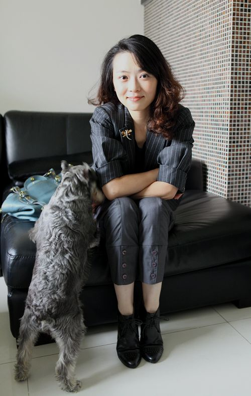

# DRESS BLOG

早晨在水房洗杯子，泡茶。  
有位同事问：“你今天用的什么香水？”  
“Channel。”  
“哦，今天应该配个中性的香水。”  
“恩，如果来得及的话，会花点时间选一下。”  
  
   

---

## 评论（16）

**[小丹佛儿](http://blog.sina.com.cn/dinosaur313)** · 2010-10-14

脸又瘦了？

**[Christina](http://lifetea.org)** · 2010-10-14

脸要真瘦了，灰很开心哒~

**苏铁** · 2010-10-14

职业中又有个性美，衣袖和裤边都漂亮~

**喜刷刷** · 2010-10-14

嘻嘻,偶喜欢袖子和裤腰,很别致.你家土豆在干嘛呢?

**guosan** · 2010-10-14

第一张拍虚了。第二张真好，姿势很亲和；拍摄角度，看起来较专业。狗狗很添景。喜欢。

**[三月四月](http://11)** · 2010-10-14

土豆这样样子，活像一个没穿裤子的小人儿

**Sherry** · 2010-10-14

你每天都很美。。。

**zhongyang** · 2010-10-14

好美。

**[至清](http://www.yangziqing.net)** · 2010-10-15

职业女性有多美？  
看看茶姑娘就明白了。

**mandy** · 2010-10-15

我喜欢的风格~~

**箱子** · 2010-10-15

下巴明显尖了，你是和我比赛减肥么？袖子好看，腰封好看。很飒爽。。。

**[zyz](http://和土豆的衣服一个色系的，很潮的母女装，吼吼)** · 2010-10-15

很潮的母女装，一个色系哦，吼吼

**[Christina](http://lifetea.org)** · 2010-10-15

我哪敢减肥啊，增肥增肥增肥啊~  
土豆是潮人，老早皮草就穿上身啦。

**燕子** · 2010-10-15

我喜欢第二张，个性劲十足，典型的职业女性的魅力，散发无疑。

**[光光](http://gaoguangguang.blogbus.com)** · 2010-10-16

头发放下来好看。

**okdata** · 2010-10-17

朦胧了。。。。平衡Channel

