# @Rea-Style

第一次见到阿呆是去年在古堡酒吧听民谣，其实是众JM一聚，后场被变成茶话会场。后来在皮蛋妈店里见过一两次，夏季绿皮火车活动，阿呆将我叫成树蛙。。。上月在他店里认识了龙竞和她可爱的女儿小满。  
  
Rea-Style是他和他在美国的BF一起开的店，经营咖啡及各种饮品，还有古着及手工原创物品出售。上下两层，面积有限，但足够同时接待两拨各8人左右的客人。我始终认为阿呆朴素的内心和性格让他的店尚处于乐趣阶段，此生活方式是我所向往的。有时我甚至想去宠物店里做一名美容师，每天和各种各样的狗狗打交道，可以到点下班，下了班就不用惦记工作的事儿。  
  
回到Rea主题上，下午Sherry在电话里对我说：“马上带个东西给你看看，很好玩。”一台她父母买的海鸥牌胶片机，在家中存放30多年，30年啊！一次没用过，全新的。这只相机在众人手中传递，它象一枚时光穿梭机，仿佛每个人都可以从里面看到过去的景象。树蛙提议，可以组织一次观片会，使用投影仪将各人的旅行照片播放并分享给大家。期待。  
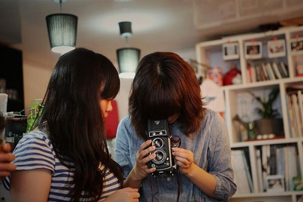  
  
对于大家，聚会好象是从小七介绍如何给海鸥牌相机上卷开始的，而我的下午好象是从一份米线开始的。因为我没吃午饭就带两宠去洗澡，然后直接奔到REA了。事实上周五的晚上我吃的也是米线，一碗米线溶解了周末的孤单，神效啊。不过据说米线吃多了，人会变傻哦。  
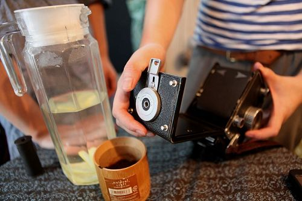  
  
这枚神奇的铃铛，不工作的时候，它可以把Rea-Style收进光影里。  
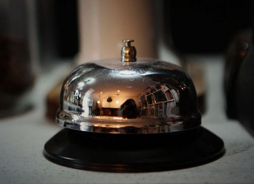  
  
从表情到肢体都太有爱了，看得人毫无抵抗力。感觉这次树蛙旅行归国后，内心荡漾着满满的爱哦。  
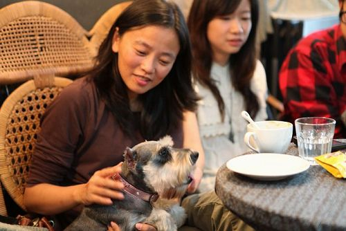  
  
杂乱的一角，但仔细看，却有点点惊叹。中间那款棕色绿底磨毛全皮手工制挎包，是shuwua在维也纳一家创意设计店遇到的，做工精致，尤其那只41码鞋底，颇具匠心。  
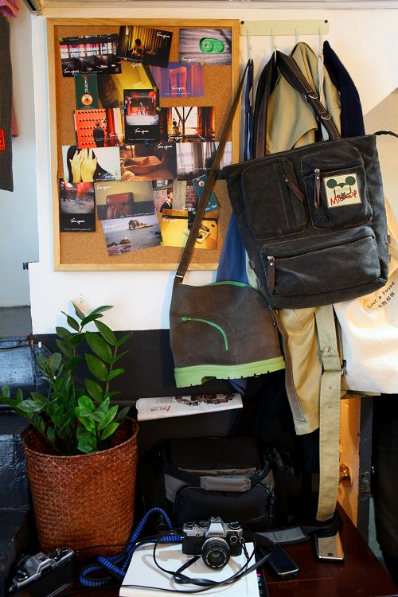  
  
亲睹阿呆用红色烤箱制作土豆泥的过程，里面加了玉米、牛奶和黄油，口感挺棒的！有个声音惊艳四座：“阿呆做土豆泥的样子好性感啊。 ”转换一下，就是“性感的土豆泥”喽？  
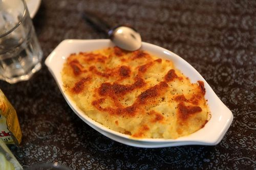   
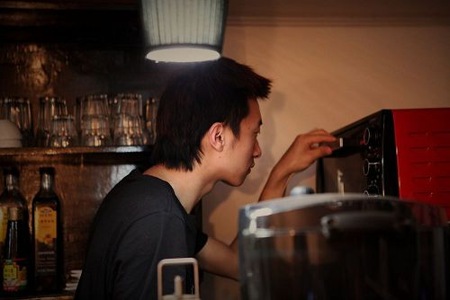  
  
这两人都好有喜感~  
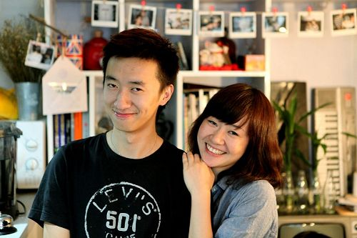  
  
土豆好深情地望着阿呆啊。  
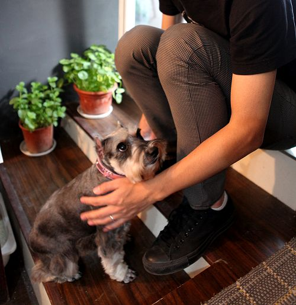   
  
分享了树蛙送给扑土的这袋Mini salamis，来自奥地利。闻起来有臭脚丫的味道，长得象橄榄，咀嚼几下肉肠的味道就出来了。  
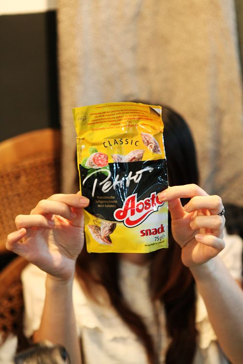  
  
左拥右抱，腿上还坐着一枚乐呵呵甜美的小妞，太和谐了。  
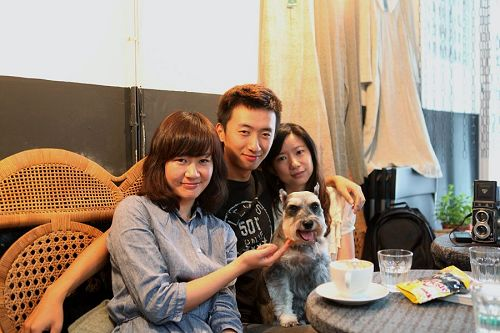  
  
这款名为薄荷清衡茶的饮品，想不想尝尝？  
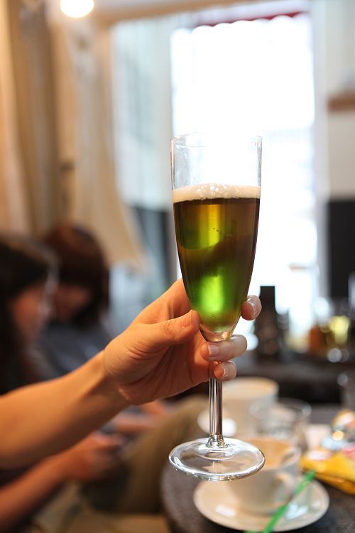

---

## 评论（8）

**喜刷刷** · 2010-10-17

我知道昨天能等到这篇,但还没等到我就趴键盘上睡着了,呵呵~

**不羁之舟** · 2010-10-17

唉 没去 好可惜~茶的照片真有意境啊。

**[至清](http://www.yangziqing.net)** · 2010-10-17

品味非凡啊。  
我对土豆泥比较感兴趣，外焦里嫩不？  
哈哈，食色性也。

**燕子** · 2010-10-17

好惬意

**[光光](http://gaoguangguang.blogbus.com)** · 2010-10-17

土豆好乖啊！

**Chrisitna** · 2010-10-17

是，土豆恨不能时刻粘在我身上，此时它就坐在我的腿上，你要喜欢粘人的狗狗，可以养一只雪纳瑞，此犬种精力旺盛，爱汪汪叫，俺们出门，土豆是一路叫出去的，呵呵~

**truecolour** · 2010-10-18

米线吃多也变笨啊，听说过粉丝吃多会老年痴呆

**Alice** · 2010-10-21

眼里有美丽的人，心是最美的~~茶粉报道哈哈~~

