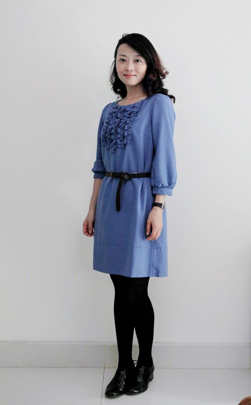

# DRESS BLOG

这种腰带的扎法，不知从哪里流行开来的？  
俺也学会了，得比较柔软的皮带。  

---

## 评论（14）

**没被抓到的贼** · 2010-10-21

一如既往的好看，百看不厌。  
系带鞋，真好看，貌似不止一双，呵。我都想跟风经常去关注ECCO，只是我们这的ECCO男鞋多，女鞋款都很少。

**茶·时光** · 2010-10-21

不知道茶到底有多少漂亮衣衣…不过茶穿什么都好看.

**sususu** · 2010-10-21

你头发放下来了真好看  
你的眼睛并没有因为戴眼镜而看出痕迹呀。

**[Christina](http://lifetea.org)** · 2010-10-21

555555~右眼比左眼视力差，右眼更突出啊，仔细看还是能看出来的。

**Vodka** · 2010-10-21

你是不是有点缺乏安全感？我这么感觉来着……看你的dress blog里面，总是手表啊腰带啊鞋带的，似乎是要把自己捆绑起来才感觉比较安全~顺便推荐你看《Undo》 :P

**喜刷刷** · 2010-10-21

评一朵小红花！

**sophie0927** · 2010-10-22

这张很有韩国MM的风韵, 淡淡的, 贤淑的感觉.  
Christian 终于从女孩成长为女人了, 呵呵.

**[Christina](http://lifetea.org)** · 2010-10-22

Vodka，按照你的逻辑裸体最有安全感了？看来这一天你永远也等不到，基本就没你什么事儿啊，呵呵~

**[三月四月](http://11)** · 2010-10-22

我灰常喜欢你这双鞋，开会时我一直盯着你的鞋子看

**JasonChen** · 2010-10-22

据美国西太大学科研小组调查,图中茶茶的两条腿,如果认为是交叉造型的,基本是男性;认为是在膝盖部位重叠的为女性.你呢?

**mandy** · 2010-10-22

感觉裙子好象See By Chloé风格，天真更好，兰色很静谧

**[Christina](http://lifetea.org)** · 2010-10-22

不是哒，是Green Label的裙子。

**[septulip](http://septulip.wordpress.com)** · 2010-10-22

今年Max大衣就是这腰带。

**chenpu** · 2010-10-24

Lovely!

