# “和果子”茶话会

小原子和问问从日本旅行归来，第一个周末姑娘们便迫切相约着聚一聚，星期六下午在阿呆店里进行一场“和果子”茶话会，吃货与吃货们相聚在一起还是挺幸福的。而且我们每个人都得到了礼物，好好珍惜吧~  
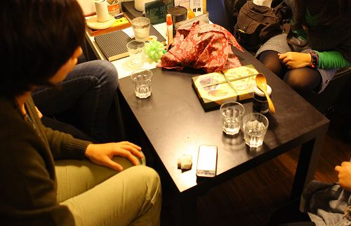  
  
日本点心外面都是用纸包装的，那些好看的设计让人舍不得扔掉。象算盘珠子摸样的抹茶丸子，上面浇上黑糖，边吃边听她两在日本的奇遇记，大家笑作一团。  
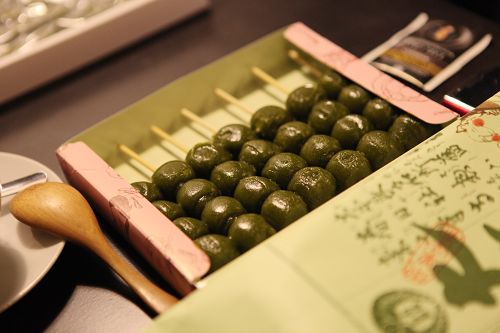   
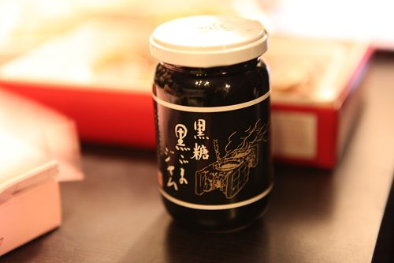   
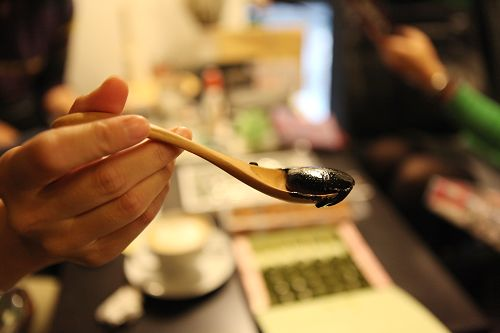   
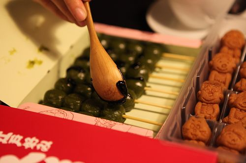   
  
サザエさん蛋糕原型，这些“人形烧”可是有家谱关系哒，比如小原子吃的是她爸爸，可能我吃的是她妈妈，那个谁吃的可能是小姨子。。。天呐，俺们就这样把他们一家子都吃下肚了~  
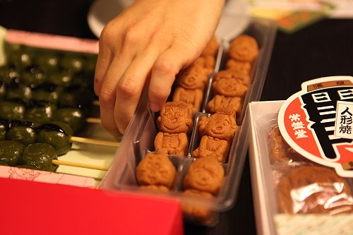   
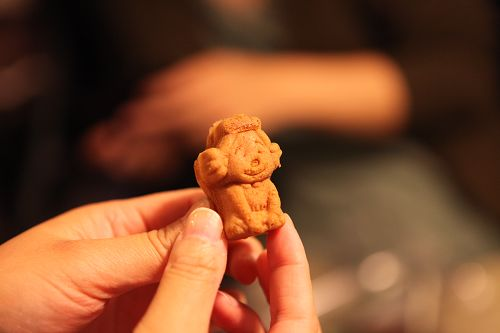   
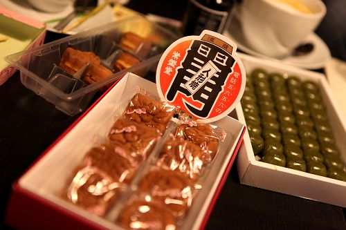  
  
问问在日本入手的富士KLASSE W 28mm F2.8胶片机。外型很复古吧？乍一看有点莱卡的气质。  
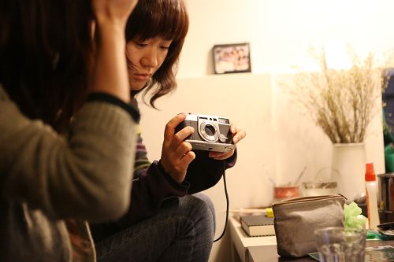  
  
小原子说这个包装盒背后的漫画很有名，长女就是海螺小姐，中间那个穿裙子跳舞滴。  
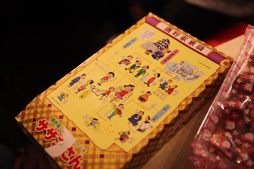   
  
龙竞翻的上海的报纸上，整个版面刊登了问问的摄影作品，不过问问滴头像采用的是俺在杭州蜜桃给她拍的一张侧身照，激动~  
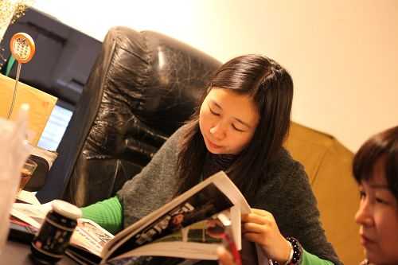  
  
扑土带来的巨峰葡萄，这个深紫色很好看。  
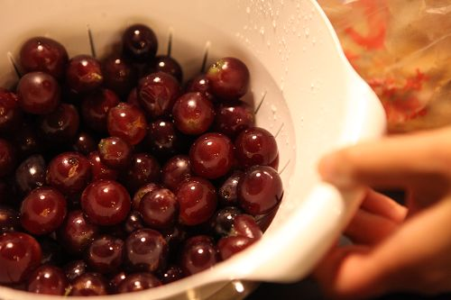  
  
小插曲：阿呆的白展堂（一只猫），挠伤了外外。狗狗如果不一口咬死猫，就一定会被猫眯挠伤滴。当然外外肯定下不了口。  
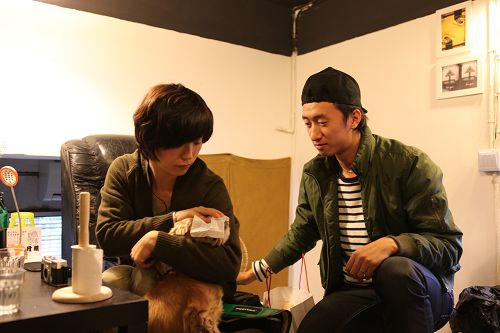  
  
外外小朋友很享受扎小辨的过程，瞧它的表情就能体会到它有多享受了。  
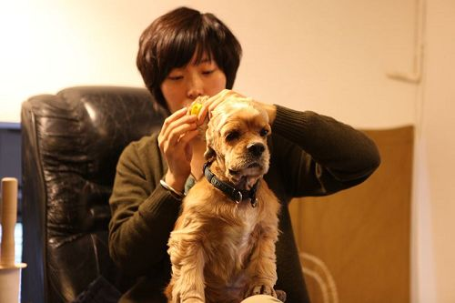

---

## 评论（12）

**喜刷刷** · 2010-10-30

你的相机一贯勤勤恳恳,吃苦耐劳.表扬~

**陈问** · 2010-10-30

长谷川町子。细细。照片拍的美，重温，不断重温中。

**[oldphoebe](http://oldphoebe.spaces.live.com)** · 2010-10-30

人形烧看着就很像漫画 サザエさん  
不过都不知道作者是 长谷川町子。。。= =

**Xiaona W.** · 2010-10-30

第一眼看上去那些抹茶丸子像我吃过的大号乌鸡白凤丸串在了一起，很好奇，那丸子外面浇了黑糖，里面裹着什么呀？

**Sherry** · 2010-10-31

下午茶好丰富，我没吃人人，吃了他家的猫猫，要搜搜长谷川町子

**[至清](http://www.yangziqing.net)** · 2010-10-31

精致生活源于对现世的知足与热爱。

**[Xmbeetle](http://Xmbeetle.blogbus.com)** · 2010-10-31

呀，我对那个相机最感兴趣的说：）

**少爷** · 2010-10-31

看你们在一起吃喝玩乐的照片，真好。外外扎起来，是不是怕被猫抓呢？

**JasonChen** · 2010-10-31

暖!

**lilian** · 2010-11-01

幸福滴画面～

**[三月四月](http://11)** · 2010-11-01

小饼干好可爱~~~小狗认真的表情，像个小姑娘~~~

**[ziboy](http://www.ziboy.com)** · 2010-11-02

真好～

