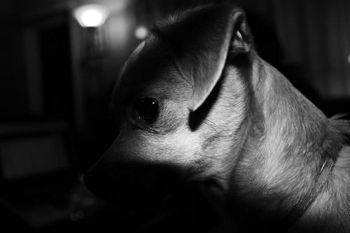

# 谁，偷了你的梦？

梦醒之前是个湿漉漉的世界，下雨，我半夜未到家，我妈来找我…虽是深夜，却如白昼般光亮。有的人好象从未离开，偶尔出现在梦里，毫无预兆。  
  
每每半夜里醒来，不免伤感，到底又是什么搅了我的睡眠？不醒来，不记录，梦会一个接一个的做下去，然后是什么也回忆不了的早晨。忘性再大，有些人依然存在于潜意识里，时不时在深夜浮出梦境，如影随形。  
  
   
  
在围脖上与在“做武侠梦”的小闷蛋不期而遇，她写到：乔峰此生有阿朱，足亦。象是给现实的一个忠告。  
  
我起身穿衣，打开电脑，Luke从温暖的窝里爬出来，伴我到书房，伸了个懒腰，趴在冰凉的地板上继续睡。深夜，仿佛世界只剩下我一人，不管我现在做了什么，这行为也忒文艺了点儿，啊呸。  
  
是现实偷走了我的梦？而我偷走了Luke和土豆的美梦？  
  
深夜醒来的话唠，此时，想来杯毛尖，解解渴。

---

## 评论（17）

**[water](http://www.nature-tea.com)** · 2010-11-02

夜里喝绿茶对身体不好。

**陈问** · 2010-11-02

你想喝毛尖的时候，我正喝饱了粗茶，昏睡过去。不过就算在梦里，我也得跟你说，好好睡觉是正道啊……

**涔伊沁** · 2010-11-02

茶 你微博的链接在哪儿呀

**einsure** · 2010-11-02

“不管我现在做了什么，这行为也忒文艺了点儿，啊呸”——呵，这行为倒是真有点文艺腔调，不过更多体现出来的是——细腻。前半段看着有些忧伤，后半段让人不禁一笑，呵呵

**lilian** · 2010-11-02

茶越来越文艺了

**Xiaona W.** · 2010-11-02

夜深人静，独享属于自己的世界，有时会有很暇意的意境。

**[Christina](http://lifetea.org)** · 2010-11-02

千万不要用文艺两字形容我，以前我对此还有好感，可是现在却恰恰相反。失眠谁都有，如果这也是文艺的话，世界上每个人都很文艺。

**[water](http://www.nature-tea.com)** · 2010-11-02

失眠因为喝绿茶了，据说绿茶有提高人脑兴奋度。所以晚上尽可能少喝绿茶。选择红茶就不错了。

**[Xmbeetle](http://Xmbeetle.blogbus.com)** · 2010-11-02

你试试固定的时间关灯睡觉，可能开始会比较不习惯，过阵子后，会睡的很甜蜜嗒。

**[三月四月](http://11)** · 2010-11-02

我每天睡眠都好准时，10点，只会提早不会推迟，现在有一点不好，就是半夜会醒一会。有时候我会睡24小时，中间就爬起来吃饭而已

**[Christina](http://lifetea.org)** · 2010-11-02

俺们最后那段无非是表达了想喝茶的愿望，事实上压根滴茶未尽啊，诸位。也就最近睡眠不好，过段时间可能会好，这个也有周期性的吧？

祝各位都有好睡眠。

**[燕子](http://blog.sina.com.cn/s/blog_5366d3310100mi2w.html)** · 2010-11-02

数羊，就很不错。

**[光光](http://gaoguangguang.blogbus.com)** · 2010-11-02

欢迎加入失眠者阵线联盟。当然我也不希望你加入，但是世界皆睡唯我独醒的感觉偶尔为之也是不错的。

**okdata** · 2010-11-03

“有的人好象从未离开，偶尔出现在梦里，毫无预兆。”  
同感。离去数年的祖母时常在梦里走入我的生活和我交流，自己确毫无非理性的知觉。  
想来应是自我暗示的体现。  
夜半梦醒是睡眠质量下降。试试晚上做些耗费精力的活动，睡前避免大量喝水

**mandy** · 2010-11-03

也许是秋天多梦，人也多愁~~

**JasonChen** · 2010-11-03

对“燕子“说:数羊不可,在老美那里,数羊是“one sheep…”,与sleep谐音,故有催眠效果,国人照搬则误眠亦无眠…

生亦何哀,死亦何求…觉亦何眠,醒来则逛之,困则睡去…不肆意蹂躏自己的健康,但也无需非得为第二天看似多精神而强制去睡…我偶尔半夜醒来,先在冰箱大肆搜掠一番,然后在床上摆个不一般的造型睡去…四仰八叉的,ho~

**bigtaro** · 2010-11-03

The dream is the reflection of reality, decode it and you can learn more about yourself.

