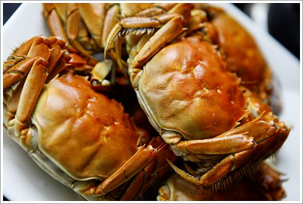
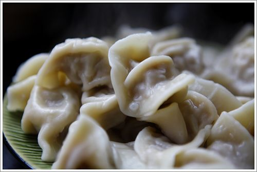
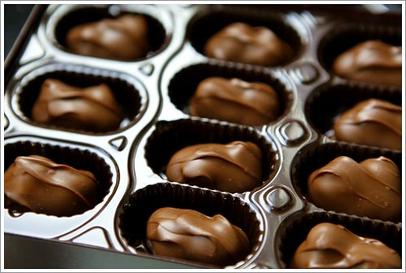

# 立 冬

立冬这天上午匆忙起床，在家人到来前一个多小时时间，奔去菜场。赖在被窝里的时候就开始寻思：如何能迅速准备好体面的午餐？将狗狗们送到宠物店洗澡，几秒钟决定买些螃蟹回去清蒸，俗语说：“秋风起，蟹脚痒，九月圆脐十月尖。”11月的雄蟹膏肥肉美，令人垂涎。备了菜根发青的青菜和鲜香菇，豆干、玉米、土豆和豆角，称了些卤菜回去可直接上桌。午餐准备好比我想象的要快，末了为立冬这一天上了一份大娘素三鲜水饺。餐后，喝茶吃巧克力，一起看了部名为《无人驾驶》的电影。  
  
如果不和他们度过这样的一个下午，我会做什么？应该很轻松吧，随便做点吃的打发肠胃，看看书上上网看看电影晒晒太阳...耳根清净。但没有被需要的这种价值感，过去在我眼中婆婆妈妈琐碎的家庭生活，现在却有一种亲密又难舍地温暖，忙忙碌碌，地面脏了又如何？时光在琐碎又平凡的生活中渗出幸福感，我想说内心成熟起来，真好。  
   
  
   
  

---

## 评论（11）

**扑土** · 2010-11-07

其实这样，内心也从容了~~  
立冬啊，我才知道。  
觉得用这个色彩模式，鲜艳了许多，很诱人~

**Chrisitna** · 2010-11-07

相机里用户自定义模式我重新设置了对比度稍强的色彩，不用P，真好！明后天有大风，白天温度尚可，晚上可要稍微冷一些，宝贝儿，保暖啊~

**陈问** · 2010-11-07

家庭生活是秋冬最贴心的小棉袄。

**喜刷刷** · 2010-11-08

今天光记得吃八腿王,忘记吃水饺了:(

**mandy** · 2010-11-08

团聚就是幸福~~

**lilian** · 2010-11-08

拍得诱人,学习~

**箱子** · 2010-11-08

面食里我最爱吃的就是饺子啦，最近迷上我老婆婆做的胡萝卜饺子。

**[Xmbeetle](http://Xmbeetle.blogbus.com)** · 2010-11-08

没错，能从内心里成熟起来，真好~~

**frank** · 2010-11-10

成熟？ 如果安于现状，就是老了，IT IS TOO BAD.

**[Christina](http://lifetea.org)** · 2010-11-11

对于你是too bad，对于我是too great.

**灰子** · 2010-11-14

受不了啦～尽发些令人无比垂涎的照片。

