# 吃下这一锅秋色

到了星期日晚上才记录这一篇，周末两天都忙着吃喝了。和友人们吃喝与家人吃喝完全不同的感受，神经感官满足时，不时有人大喊“好吃哦....哦依希...”，恩，外文冒出来了。  
  
就快告别这年的秋季，周末老天爷特给面子，一律明媚阳光照耀我心。在问问家朝南的大阳台上吃火锅做烧烤，只有真正的吃货们才能做到。从中午一点吃到天黑，大胃王们继而转战室内喝粗茶品甜点....就这样迎来立冬节气了。  
  
彼时看了北京友人拍摄银杏叶子的灿黄，此时沉淀在我们的火锅里，连同暖阳一同进入我们的食道，不能留下秋色，就出下它。  
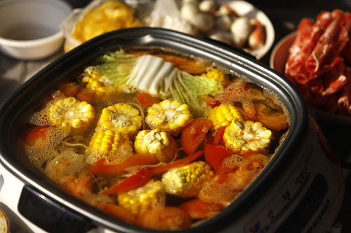   
  
外外：“无论如何俺们要先抢个座儿。”  
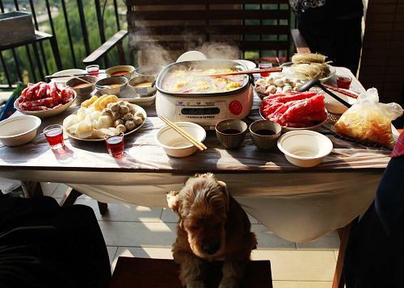  
  
入味，有弹性，赶脚比外面的烧鸡翅更胜一筹。俺们刚刚就着惬意的阳光灌下一杯澳洲啤酒，鸡翅就端上桌了，再怎么样也要来一只。  
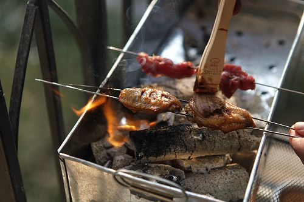  
  
轮番上阵烧烤，一顶烧烤大师帽传到她这儿，怎么看都象在跳芭蕾、敲扬琴的架势；  
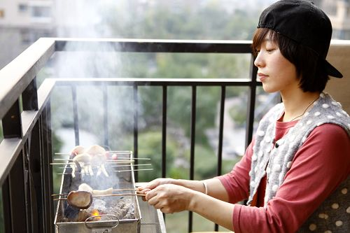  
  
龙竞送来自酿葡萄酒，上面贴着自己设计的标签，中间那行毛泽东字体被俺几个文盲份子读成“新约私酿”、“龙竞私酿”....其实是“龙的私酿”.....这字体也忒拉风了，把俺们吹成了文盲。私酿好喝，酒不醉人人自醉；  
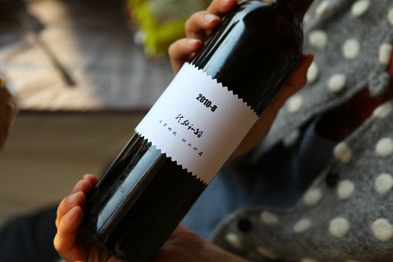  
  
细腻又周到的女仆，侧影如此让人陶醉；（上传后发现居然损失了一些细节，NND，谁说网络是万能的？我跟谁急！）  
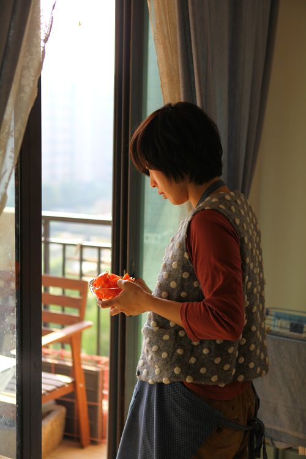   
  
大惊喜电话里说：“你再不来只剩蔬菜了...”俺们那时候在加油站里排队，这路上撞翻多少昆虫啊，赶到问问家，几个人忙得炭火还没生起来，嘿嘿，老天真眷顾我；  
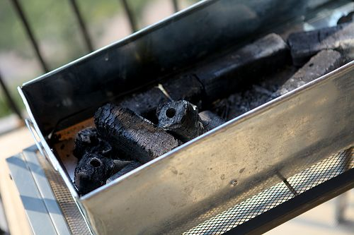  
  
女仆调制的火锅调料，就以往吃火锅的体验，调料最关键，我们下午吃火锅吃得那么爽，多亏了这些调料，能猜出来都有哪些料吗？  
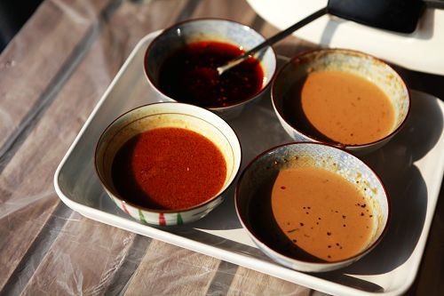  
  
在餐桌周围打游击战的外外；  
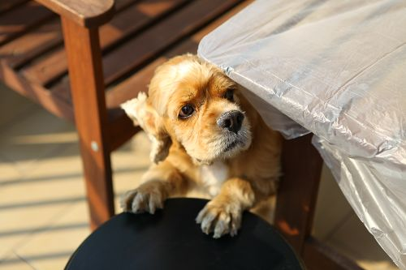   
  
每个物件都耐人寻味，餐后泡一把从日本带回来的粗茶，这时候怎么可以没有甜点呢？  
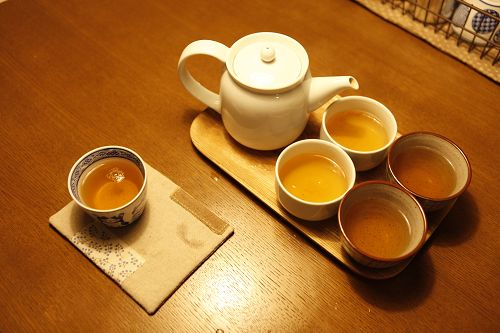   
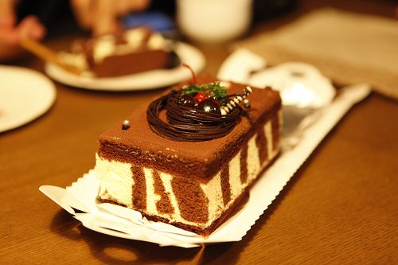

---

## 评论（14）

**扑土** · 2010-11-08

用你的相机拍红叶应该不错~！  
谢谢你这尽职的现场记录者，那么重相机是不离身~才捕捉下了好看的美图

**喜刷刷** · 2010-11-08

那个下午,秋天的暖阳将我们一起包裹起来,裹成了一个多味大水饺献给了冬.

**[三月四月](http://11)** · 2010-11-08

这样的生活……太享受啦！喜欢那个精致的小火锅

**mandy** · 2010-11-08

用眼睛吃下了一锅秋色

**lilian** · 2010-11-08

看了心情真舒畅~

**Annie** · 2010-11-08

真让人望尘莫及啊，羡慕！

**[Xmbeetle](http://Xmbeetle.blogbus.com)** · 2010-11-08

从问问那转过来，有这样一群志同道合的人真是人生的乐事

**bigtaro** · 2010-11-09

口水。。。

**Xiaona W.** · 2010-11-09

图文并茂，很有看头。恕我孤陋寡闻，请问，什么是粗茶？类似麦茶吗？

**陈问** · 2010-11-09

类似红茶，大红袍。

**[燕子](http://blog.sina.com.cn/s/blog_5366d3310100mi2w.html)** · 2010-11-10

我觉得女仆太辛苦。

**少爷** · 2010-11-12

那个龙竞酿的是红葡萄酒么？我尝试着酿过酒，弄了十几瓶，花了好多时间，又等了半年，结果全倒进了下水道：（

**[Christina](http://lifetea.org)** · 2010-11-12

是红葡萄酒，扑土也酿的，两个人酿的口味也不同，应该是原料用的葡萄品种不同。好可惜啊，自酿的葡萄酒可以等那么久吗？没有特别温度湿度的储藏条件，会不会容易变质？龙竞的标签上是建议俺们快点喝完的~

**灰子** · 2010-11-14

Wow, yummy

