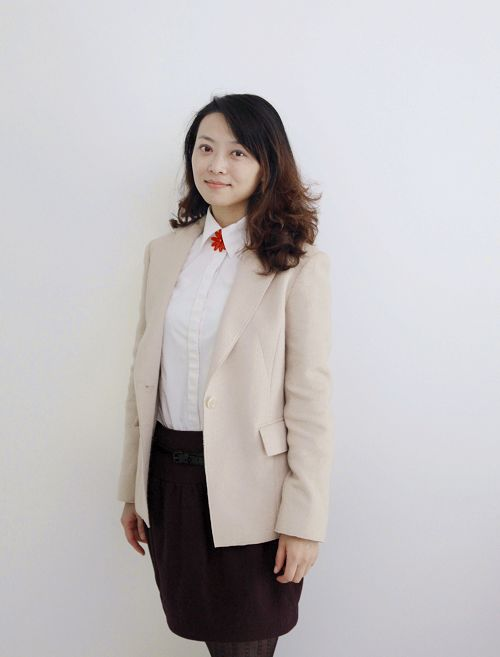
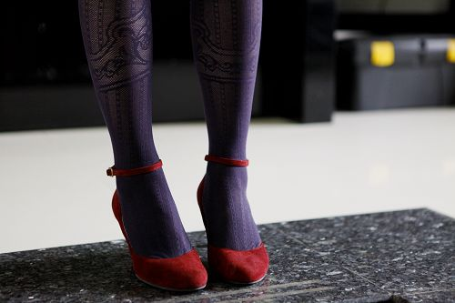
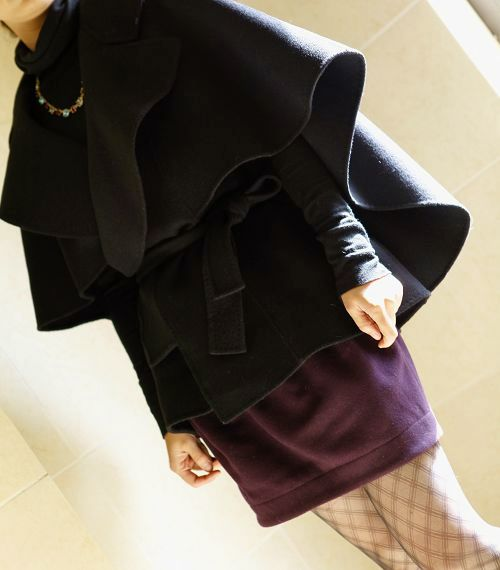

# DRESS BLOG

近期，一切都是干燥的，从皮肤到头发，包括嘴唇。用问问的话讲：“一边微笑，一边舔血。”用了新买的姿生堂润唇膏，洗澡后一定涂抹上body lotion，干燥的头发象刺猬生气的样子，不得不用上了Rene Furterer的牛油果精油，象只落汤鸡一样对抗坏天气。此时的我们，唯有食欲是满足的。  
  
@11/11 米色羊毛西服+深紫色羊毛裙+白色衬衣  
   
  
  
@11/12 黑色羊毛披肩式短外套+黑色棉高领衫+深紫色羊毛裙+低跟短靴  

---

## 评论（10）

**mandy** · 2010-11-12

这是我第一次说不喜欢的搭配~~：（还是喜欢你把头发扎起来

**Chrisitna** · 2010-11-12

今天俺们头发就是扎着的，太干燥了，都不适合披发。

**[三月四月](http://11)** · 2010-11-12

这套白西装的实际效果比图上好太多倍，那天我从洗手间一出来，看到你穿着这个迎面走过，实在被震撼到~~~~

**茶·时光** · 2010-11-12

紫色的袜子好漂亮。

**喜刷刷** · 2010-11-12

呀,这个披肩好唉~

**[凡六](http://mzai.net)** · 2010-11-13

很漂亮，嘿嘿

**[凡六](http://mzai.net)** · 2010-11-13

许多年前就关注Chinese Tea，不过貌似是个偷窥者，没留下什么痕迹；那时是当做偶像来崇拜的，现在也如此。人如茶，文字也如茶。

**Cindy** · 2010-11-14

REMEMBRANCE DAY~有爱心哈~

**不羁之舟** · 2010-11-15

袜子妖！披风帅！小花嗲:)

**Vodka** · 2010-11-15

上面那身像是给下面那身开车门的

