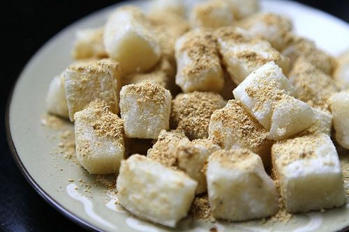

# 很香哒~

和外甥女把两块粑粑都吃光了，切成小块放在平底锅里干煎至微微焦黄，盛盘。略微翻炒后的黄豆粉香味四溢，撒在粑粑上，配了蜂蜜和蓝莓酱吃，很香哒。朋友间时常交换美食，就这样一起吃吃喝喝到老，多好。  
  

---

## 评论（4）

**陈问** · 2010-11-14

不过中午光吃这个不干么？连个汤都没烧啊？

**Chrisitna** · 2010-11-14

煮了红茶，嘿嘿~

**喜刷刷** · 2010-11-14

这文章和午餐一样精练,不过,我还是闻到了香~~

**mandy** · 2010-11-16

什么东东？：）好吃的MANDY

