# @香港

去港几次，几乎没刻意跑跑景点，如果不是Sherry，这一次我可能还是睡懒觉，毫无目的的闲逛，第一次去海洋公园，印象特别好。适合情侣，适合母子，适合伙伴们一起游玩一天的地方。  
  
彩色气球上是海洋公园的吉祥物？一只长了腿的帅海豹？  
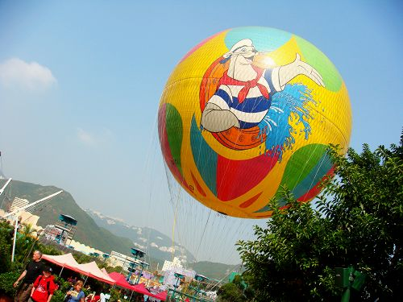  
  
海底列车，开起来时车厢里昏暗下来，车顶上播放各种海洋动物的画面。成年人也招架不住这般奇妙的景象。  
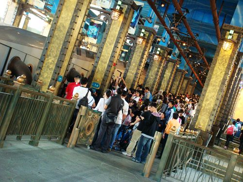  
  
梦幻的水母馆，虽然它们危险到足以杀死人类，但在各种色彩的灯光照射下，让人无法忽视它们奇异的美。  
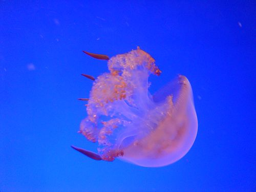   
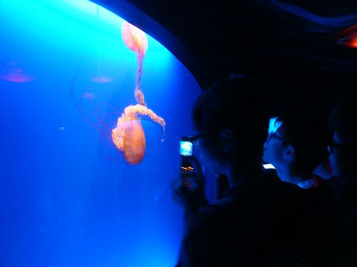   
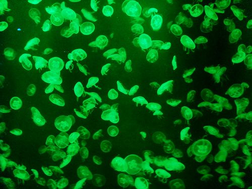   
  
不仅海洋剧场里的解说分中英粤语三种，地铁也这样了。  
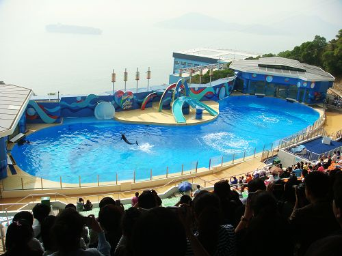  
  
一池火烈鸟，似乎它们从不跨越到池子的外面来，羽毛最红的应该是成年火烈鸟，再往下有粉色和白色，我们坐在石阶上边休息边观赏它们，有三只红色的鸟打起架来，两打一，好象只是象征性相互啄对方，倒还没有到鸡飞狗跳的程度，鸟也有鸟的社会矛盾啊~被圈起来的火烈鸟，完全失去了在非洲湿地上的自在。  
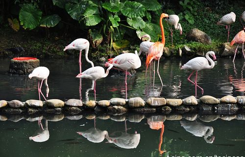  
  
喜欢香港海洋公园的原因是可观赏到之前在电视上才能看到的动物，海洋馆的透明“鱼缸”上下三四层高，游客环绕鱼缸盘旋上下，不同楼层不同景致，那些海鱼体型硕大，且那么多不同品种的鱼在一起，着实壮观。视觉与好奇心被满足的同时，也会产生一丝丝心酸感，它们本可以生活在属于它们的世界里。  
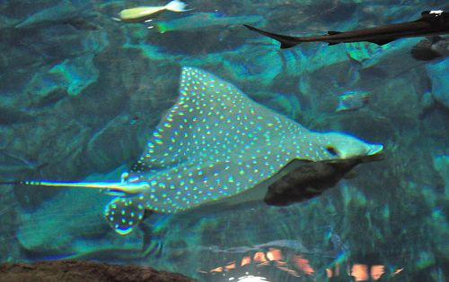  
  
百雀园里的黑天鹅，很落寞地浮游在人工水池里，没有水草，没有任何自然的景观，干粑粑的水泥池子，看着让人心疼。那么美丽的动物，不知从哪里运到这里的？  
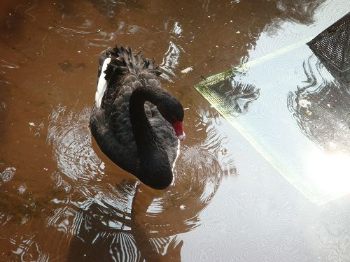  
  
各种颇具观赏性的彩色小鱼，旁边总有一块牌子上写着请勿用闪光灯，小朋友举着照相机到处拍，闪光灯噼里啪啦的闪，家长的素质直接反映在孩子身上，从小培养公德意识，也不早了。  
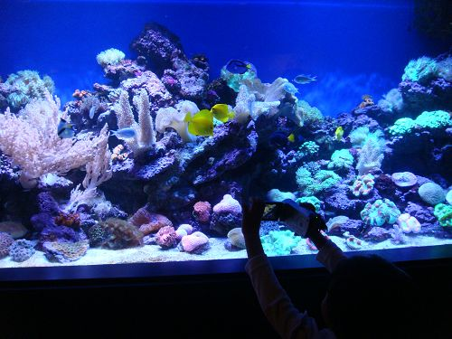  
  
站在树干上吃水果的小鸟们，俺们从树下走过，举着包当伞用，生怕天上随时投下的炸弹。  
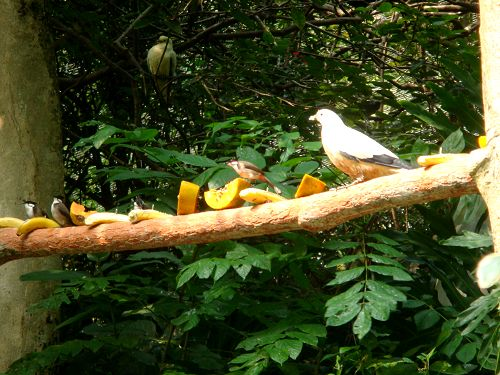  
  
通往百雀园的路，sherry很喜欢路边高耸入天的树木，叫俺们摆拍一张，并要求把脸伸进那一片光线下。  
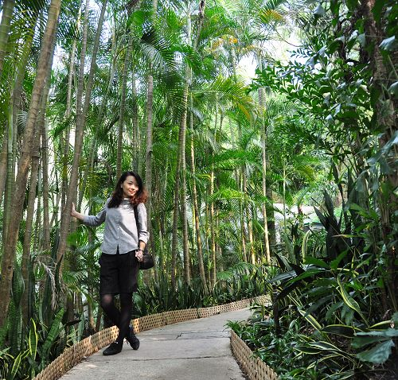  
  
浅水湾路遇这只英国可卡，毛色体型和Luke几乎一致，俺们就象安全特工似的尾随其后，左看看右瞧瞧，以解对俺家狗狗们的相思之苦。一位菲律宾妇女推着童车，牵着它，缓慢悠闲的行走在浅水湾幽静的人行道上，路边的老榕树，不知被人行走过多少遍的小街道，静谧的氛围，一切似乎都在沉淀的同时衍生出另一种更有韧性的生命力。  
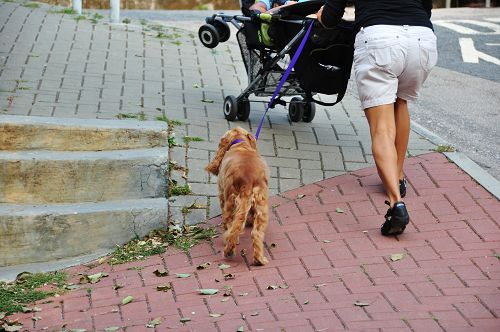   
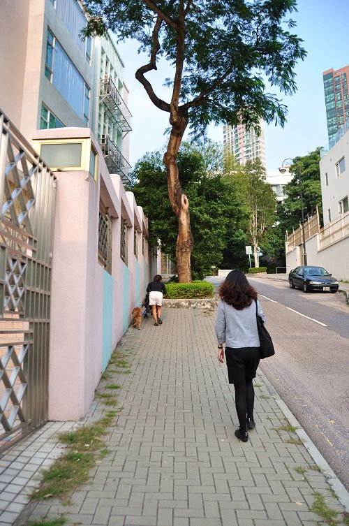  
  
俺们还是搭讪去了，哎呀，它居然是只漂亮又温柔的小女生哎，恨不能直接抢回来给Luke做老婆啊。   
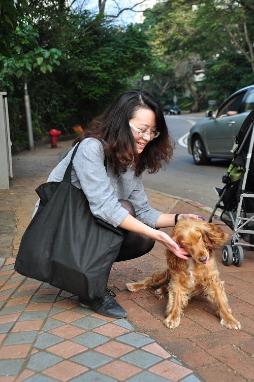  
  
这只英卡叫Maggie，它笑得比俺们矜持，好象俺们只有对狗才会笑得这么欢，呵呵~可卡喜于与人亲近，我摸摸它，她就开心地倒地上四脚朝天了，跟LUKE一样一样的。   
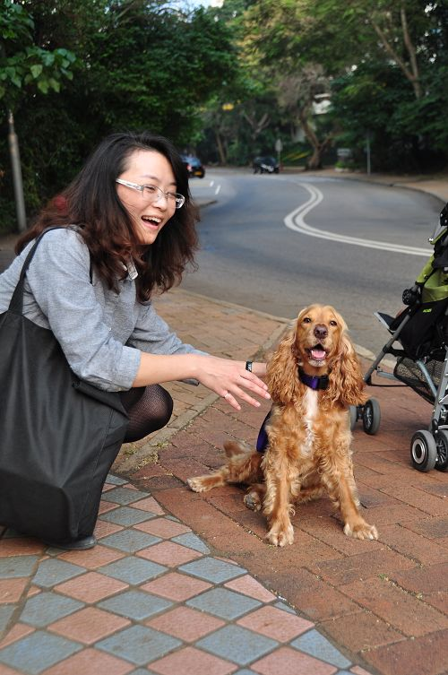  
  
弹丸之地的香港，去了总要买些东西回来。了解了同品牌在香港的价格，感觉内地的商场简直是在打劫！有一次购物累了，坐在椅子上休息，和身边的本地人闲侃，我说你们香港女孩子没见着几个漂亮的，气质也很一般。人家说的确是，好看的都是外地来的。我才知道熊黛林是南京大厂人？！走在香港的大街上，脑子里忽然冒出一句“去TNND的街拍”......街拍让全世界妇女都穿成一个样儿了，那些毫无悬念与惊喜的时髦打扮，让人杀心四起，腻味极了。能不能给点新意呢？在香港，你会发现大街上的妇女们，很难找到衣饰一致的，各有各的搭配，各有各的穿衣想法，混搭风居多，在中环CBD遇到两位既美丽又精致端装的职业妇女，养眼。人家甭管多时尚，甭管多雷人，就是能自信地穿着自己喜欢的衣服，很享受的出门了。这就是个性吧？要知道，模仿永不能超越。不如穿出自己的审美与品位。  
  
内地各大城市几乎一色“新”，路是新的，房子也是新的，旧的东西几乎都被拆了，或计划被拆中。香港的路和房子虽然旧，可旧得有味道，让人感到塌实。港人能买得起车的人不比内地少，为何街上的车却没有内地多？除了用车费用之外，香港交通工具的确发达，从地铁巴士到百年之物“叮当车”，极其方便出行。以及，街上的车几乎没有低于时速60的，和欧洲感觉差不多，开得快，到红灯必然停，规矩地开在自己的行车道上。回头想想俺们这儿，常常遇见时速30以下在马路上散步的开车人，这样能省几个钱？你们怎么就不想想好狗不挡道呢？要不就别开车，直接散步去得了。香港的车那叫一个干净，在南京，俺们没得肺病前估计车已经病得不轻了，政府为了减少灰尘，定时在马路上洒水，更TNND让人生气，才洗干净的车，溅了一身泥水...据说国外的工程车必须冲洗成新车摸样才能再次上路，俺们这里的工程车开过去都带烟儿的，走一路撒一路，同一个地球，差距咋就那么大呢...  
  
**有人说“爱香港不爱新加坡。香港有一种人间烟火气，人们也都成熟得体...”握手，与香港相比新加坡太“新”了，不象香港那般沉淀下来，老物与新景融合在一起，彼此牵扯着时光，那种韧性让人感觉塌实。并且，香港节奏和俺们很合适。**  
  
有关排队，俺们还有废话要说，上周六晚上从赤柱返回港岛路过CBD，见一列人排队等车，人与人之间隔那么大空挡。换了俺们，后面人非得贴着你的后背才快活，什么身体舒适的距离，什么包啊挂件的碰了你，完全没有意识，有时感觉内地人享有更大的个人自由主义，若无其事象螃蟹一样横着走路，肆无忌惮毫无礼貌地打量陌生人，随地吐痰甚至随地大小便的...生活在这样的环境下，绅士淑女都是装的吧？果真能心平气和面对夹塞排队？熟视无睹从车里往外倒垃圾，垃圾飘你一车？当然，即便如此，俺们还是得装装绅士淑女，俺们还是很爱自己的家园，希望明天会更好。  
  
近期海关针对IPAD IPHONE4的新规叫嚣得厉害，貌似俺们买了些东西，走得头一天晚上在酒店里拆包装，剪吊牌，帮同事带的项链也准备挂脖子上入境。很犯罪，东西装不下，又买了只箱子，把买的东西分散到两个箱子里，尽管顺利入境，在深圳机场安检时被拦下，说随身的箱子里有一瓶水.....完全记不起来是什么水了？自从干了这份鸟工作，俺们的各种机能都下降不少，尤其是记忆力，大大降低，人的脑子就那么大，工作的事多到要记录下来才行，当然还是会忘，再往里面塞点别的，难度很大。我就觉得自己脑子不够用了，尤其下班时神情近似恍惚，常忘记自己的车停放的位置....就见安检人员搜出瓶香水，我的心立马凉了半截儿，看电脑那厮说不是这个，还有一瓶.....接着搜出一瓶400ML倩碧的水，人家让扔垃圾桶或找瓶子分装......最终俺们还是留在了安检的柜子里。坐飞机上俺们讨论着，往脸上使劲儿扑一些，不行头发上再来点儿，或者倒掉一部分，带走剩下的。帮朋友带的，270港币，千心万苦拎了一大圈，末了给扔了.....就当俺们行李超重被罚款好了。  
  
有关每台入境的IPAD征1000元税的问题，开始商务部发函抗议，现在又和海关穿上一条裤子了。据说近期入境携带IPAD被查验200多起，有50几起是水客携带，有的水客每天往返罗湖口岸多次，每台IPAD可赚取400元左右的辛苦费。有一水客被查验到身上绑满了IPHONE 4......事实上境外IPAD不比内地的价格便宜多少，现在行货还比水货便宜啊。  
  
纠结后还是没有带单反相机去，拿了小卡片机，半天电就用完了，也没兴致充。感觉这次不象是出远门，实际离家还是挺远的，尤其往返深圳与香港之间乘巴士的路程，很象出远门，晃得我五脏六腑似乎都颠倒了位置。是不是年纪大了，越来越离不开家似的，往机场的路上心里就退却了。不知以后还能走多远？

---

## 评论（10）

**小丹佛儿** · 2010-11-24

水留个满瓶给安检真是亏了，要我直接倒完也不给它瓶整的，个狗日的~！

**Chrisitna** · 2010-11-24

俺们下不了手，毕竟还没开封过的化妆品，被人用了，总比糟蹋了好啊~

**少爷** · 2010-11-25

我说怎么几天不见，原来上香港耍去了：）

**Chrisitna** · 2010-11-25

想我啦，嘻嘻~

**[光光](http://gaoguangguang.blogbus.com)** · 2010-11-25

如果托运是可以的吧？美国国内航线托运行李都要收费，一件25美金，所以国内旅行都带小箱子。而且安检全部要脱鞋。

**喜刷刷** · 2010-11-25

你那个放液体瓶子的行李没有托运,是吗?马大哈!

**Christina** · 2010-11-25

国内托运20KG以内免费的，我这个马大哈忘记把水放托运箱子里了…忘性大…

**Anyayaya** · 2010-11-25

黑天鹅是珀斯的特产。有一种现象就叫“黑天鹅效应”—在澳大利亚被发现之前，生活在十七世纪欧洲的人们都相信一件事——所有的天鹅都是白色的。直到1697年，探险家在澳大利亚发现了黑天鹅，人们才知道以前的结论是片面的——并非所有的天鹅都是白色的。见到第一只黑天鹅，对于鸟类学者而言或许是个很有意思的惊喜，但这并不是发现黑天鹅这一事件的重要意义之所在。这是一个证明，证明了我们的认知是多么的具有局限性——虽然你是在观察了几百万只天鹅之后才得出了“所有的天鹅都是白色的”结论，但只需要另一个发现就能将它彻底推翻。用另一句话说：“we don’t know what we don’t know”.

**Anyayaya** · 2010-11-25

住在在北京的时候，有洒水车经过我们就开车跟在后面免费洗车。节水环保。反正专门去洗车也是白洗，一天就面目全非了。

**Christina** · 2010-11-25

“黑天鹅效应”无处不在，除了亲眼看到的，也有主观产生的，因为人们更乐于“惯性思维”。这个“黑天鹅效应”还蛮需要仔细琢磨一下呢~

洒水车通过时，最好路面没有泥沙，以前会刻意跟在旁边冲一冲，现在会飞快开到洒水车前面去，宁愿吃浮灰，也不愿溅上泥水，太阳一晒，车身上都是泥渍。

