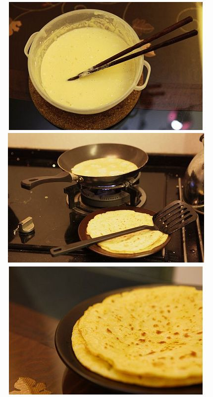

# 第三次烙饼。

  
  
对呀，失败是成功之母，从[**第一次烙饼的狼狈**](http://lifetea.org/article/2756/-)，到第三次烙饼的游刃有余，开心！用了樱桃妈妈的方子，作为主食吃的饼，所以没加奶，打了鸡蛋加了凉白开，双手不沾面粉真爽，筷子搅拌均匀，不粘锅里刷上一层食用油，勺子挖起面汤铺撒在锅底。有时午饭剩的米饭不够吃，或者晚餐做了稀饭，可以烙两三张饼。加了鸡蛋的饼，狗狗们也爱吃。当俺们烙饼一次比一次手脚麻利，想焦一点还是嫩一些，完全看自己喜欢。俺们开始妄想神马时候是不是能搞个批萨出来？  
  
旅行真是对工作和生活有所调节，回来第二天上班，自己都感叹这工作电话温柔了许多，以及天天午饭、晚饭必然有新菜上桌，创意才思云涌啊，中午也有心情跑去菜场拎些新鲜蔬菜回家，做个两菜一汤的效率大大提高。  
  
爱上做饭，或者说渐渐习惯了做饭的生活，没有好吃好喝的日子仿佛缺少了什么似的。俺们干完家务，洗手，涂护手霜，照样擦上新的指甲油。有人说地好：“这一滋一味就在平常的白水日子里。”

---

## 评论（16）

**陈问** · 2010-11-30

这个饼，真是圆满到家啦。

**Chrisitna** · 2010-11-30

可能还是方子的问题，第一次那个擀面的过程真是折磨死人鸟~

**shuwua** · 2010-11-30

不沾平底锅比我的锅好用呢。

**喜刷刷** · 2010-11-30

游刃有余啦,这进步,神速~

**Chrisitna** · 2010-11-30

我准备送只这样的平底锅给外甥女，让她出国前学习如何烹饪。哈哈~把阿姨们的方子都教给她~

**陈问** · 2010-11-30

这个摊饼，是不用擀面的吧。

**Chrisitna** · 2010-11-30

对，这是关键，双手不接触面粉，倒入水和鸡蛋，搅拌均匀，锅里的用刷子刷一层油，面汤倒入少许，厚薄看自己需要，厚的话就多倒些，薄的饼就少倒些，小火烙，四边其翘，用铲子翻转过来继续烙。比那个擀面方便不知道多少倍啊，你上次也是擀面的吧？来，试试这个方法，以后咱们随时都可以烙饼吃了，里面还能加调料，不过我没加，因为就着菜吃的。

**小闷蛋** · 2010-11-30

夜了。我又馋又饿，只想做只天狗，偷吃你家盘子里皎洁的月亮之饼……

**[oldphoebe](http://oldphoebe.spaces.live.com)** · 2010-12-01

如果要做馅饼就只有和面擀面了哈  
而且两种饼，面吃起来口感不同  
推荐两个我喜欢的饼食谱：  
http://www.beckyblog.com/read.php?227#reply  
http://www.beckyblog.com/read.php?212#reply

**箱子** · 2010-12-01

饼的确是美了很多。我习惯就是面粉加鸡蛋加水，加葱花虾皮，和好以后就入锅，锅转一圈，饼子型就出来了。。。

**lilian** · 2010-12-01

这生活质量。。

**[uggbootsclearance](http://www.bestuggbootsonsales.com)** · 2010-12-01

博主好勤快，看着那饼我就流口水了

**mandy** · 2010-12-01

我喜欢吃咸口味的，包点橄榄菜，卷起来吃~~香 (ˇˍˇ）

**默默** · 2010-12-02

感觉你越来越谈定了，真像茶——观之赏心，品之爽心。

**frank** · 2010-12-02

which school will your niece go to? Your sister is a Hai Gui? It is hard for teens to study abroad. Your sister’s family should stay in the USA.

**[xmbeetle](http://xmbeetle.blogbus.com)** · 2010-12-03

平底锅有讲究么，还是超市随便一个就好？我也要烙饼吃，太诱人了。。。

