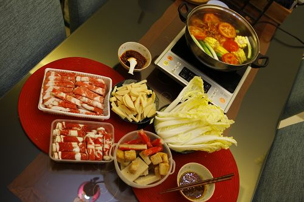
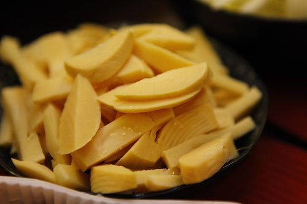
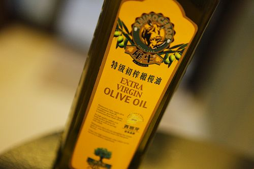
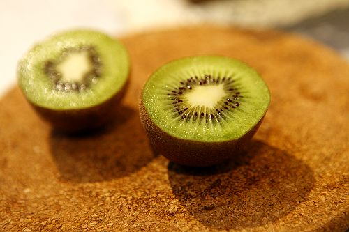

# 怀念那一锅秋色

晚上打算喊朋友一起去外面吃涮羊肉，刚过下班时间打电话给她，人家已经炒着菜了。俺们下班后直奔麦德龙采购，回家自己搞火锅吃。那次[**在问问家吃的火锅**](http://lifetea.org/article/2777/-)印象深刻，照着丢了一根水果玉米，几段肉葱，两只西红柿（爱吃西红柿汤），一堆冬笋到白水里，倒了几滴橄榄油，撒了些细盐，不要作料其实也很美味。俺们想以后还是换成圆餐桌，符合中国人用餐习惯。  
  
麦德龙采购就是好啊，这次买到了嫩得有弹性的千叶豆腐，当然还有别的，例如鱼豆腐，蟹肉棒，香菇贡丸，年糕片，肥牛羊肉，娃娃菜，哎呀，冰箱里的鲜蘑菇忘记拿出来吃了，备了沙茶酱和辣椒油。年纪大的标志之一就是越来越爱不去外面吃饭，是吗？末了，切了猕猴桃挖着吃，酸酸甜甜结束一顿晚餐。  
   
   
   

---

## 评论（12）

**陈问** · 2010-12-02

哇，调味酱是神仙，看到你的辣子了。

**Chrisitna** · 2010-12-02

还有你给的沙茶酱，口水啊~真的很好吃~

**箱子** · 2010-12-02

我今天在江宁哎。。。猕猴桃凉性，冷天少吃。

**Chrisitna** · 2010-12-02

补充维生素啊，今年我瘦了许多，要在冬天补回来，嘿嘿~

**bigsurprise** · 2010-12-02

我也看到辣椒酱了,少了太阳但多了猕猴~

**扑土** · 2010-12-02

西红柿汤 +1  
爱吃  
摆满菜肴的家也很温暖~

**JasonChen** · 2010-12-03

吃火锅瘦身拉~~~

**itsmin** · 2010-12-03

不错不错。橄榄油，还是以用在凉拌菜，色拉为主，高温会把奥米加破坏殆尽的。还是特级初榨的，奢侈哦。

**truecolour** · 2010-12-03

就是少了点绿色的蔬菜

**mandy** · 2010-12-03

再来个茼蒿就完美了~~

**[xmbeetle](http://xmbeetle.blogbus.com)** · 2010-12-03

看你最近的文章和围脖后，我开始迸发出下橱的热情～～

**Xiaona W.** · 2010-12-04

图片很诱人，我也要照猫画虎自制一顿这样的火锅餐。

