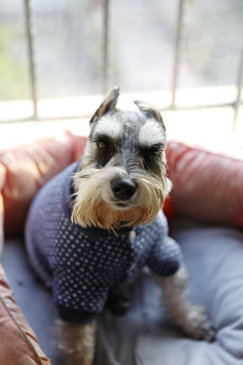
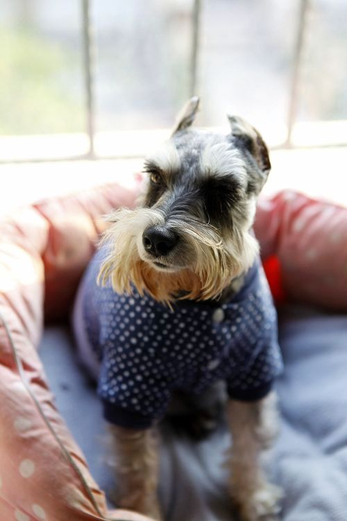

# 挤眉弄眼

   
   
  
前天晚上从宠物店接回两狗狗，一直到晚饭，土豆两眼睛还是又圆又黑的葡萄，待我洗完碗，土豆左眼就闭起来了，扒开来看，里面红红的，好象眼皮也肿了，以为进了毛发刺激的，于是用狗狗专用的眼药水频繁冲洗。晚上看完一部电影，再一看，眼睛还是闭着，且有许多污物堆积，继续用眼药水冲洗。第二天一早带它去原来收养它的那家宠物医院，医生说没啥大碍，开了眼药膏，嘱咐一天点两次，眼药膏的好处在于不容易被眼泪带走。  
  
今天土豆的左眼已经可以正常睁开了，松了一口气。之前各种猜想也都不重要了。不过这两天它睁只眼闭只眼，总有挤眉弄眼的滑稽效果。人性中同情弱者的本性再次应验，因为土豆的眼睛，这两天好吃好喝的伺候，在家做了错事，也不惩罚了，Luke神马的都靠边站。再次想起我姐姐曾对我说过的那句话：做一个弱者，没神马不好。

---

## 评论（10）

**扑土** · 2010-12-07

土豆妞早点好起来哟~

**Chrisitna** · 2010-12-07

差不多好了耶，这会儿坐我腿上呢：P

**箱子** · 2010-12-07

绝了，这表情，来，给箱子阿姨亲一个。

**Chrisitna** · 2010-12-07

哎呦喂，这会儿隔得远，不怕啦？神起来了，哈哈哈~

**bigsurprise** · 2010-12-07

土豆可能是眼睛发炎了,眼药膏确实比眼药水更适合她,金霉素就可以啦.土豆乖乖,快快好起来啊~

**Chrisitna** · 2010-12-07

大姐，好歹给土豆“嘣”一个撒：D

**喜刷刷** · 2010-12-07

嘣~嘣~~嘣~~~土豆乖~~~~

**少爷** · 2010-12-08

哈哈，真的，弱的得多照顾，我可是深有体会啊：）

**mandy** · 2010-12-08

怎么这么巧啊？我家嘟嘟也是同样的症状，前天看了医生说是角膜炎，开了药，先用洗眼水清洗，再擦眼药膏。要是土豆需要我回家把药名告诉你。替我亲亲土豆啊~~

**Christina** · 2010-12-08

我们也有药水药膏的，谢谢你啦~

