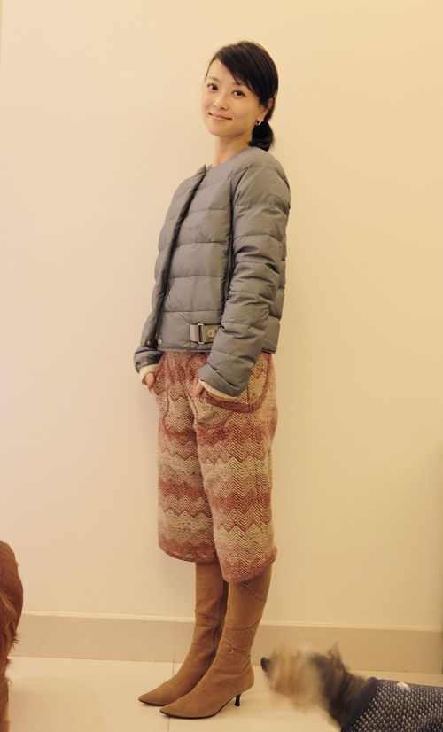

# DRESS BLOG

早晨如果来得及，会花时间仔细的抹上眼影。最近爱上深烟灰色眼影，香港女孩子说亚洲人肿眼泡多，建议用深一点的冷色调。以前我一直用白色或蓝色略带荧光的眼影。。。我是个不爱听劝的人，但这次却听了人家的劝，用了后效果还不错，推荐Channel的深烟灰色眼影哦。涂眼影最好的方式是用手指，完全个人体会哈~  
  
好多年前的靴子，庆幸没有淘汰给别人，现在穿一点也不难看了，为什么为什么？以前总是无法适应它的形状和颜色，可是，又为什么会入手呢？以及俺们几周前被剪残了的头发。。。又是一段扎小辫的漫长等待期。  
  
照片是晚上在家拍的，暖暖的橘色光线，无论如何都处理不好，这效果已经是力所能及的了，将就点儿吧，筒子们。无论如何，都有爱抢镜的狗狗出现。  
  
   
   

---

## 评论（18）

**me** · 2010-12-08

很像十五年前的倪萍啊。

**Chrisitna** · 2010-12-08

您真抬举我。

**喜刷刷** · 2010-12-08

以前主要观赏好看衣服,现在喜欢你的表情.

**sunnydzdz** · 2010-12-08

so beautiful

**sunny曾曾** · 2010-12-08

漂亮+可爱，漂亮的是主人，可爱的是：狗狗，狗狗，狗狗，我喜欢！

**大湖** · 2010-12-09

您已准备好再次抗美援朝?

**[Christina](http://Lifetea.org)** · 2010-12-09

就当是对您的审美扫盲，哈哈哈～

**[三月四月](http://11)** · 2010-12-09

以前我喜欢用紫色的，后来听说亚洲人适合用咖啡的，试了咖啡的，就再也没换过

**zyz** · 2010-12-09

的确很出彩，保持！

**[光光](http://gaoguangguang.blogbus.com)** · 2010-12-09

你怎么瘦了好多似的。

**Christina** · 2010-12-09

命苦，今年工作太忙了。

**mandy** · 2010-12-09

瘦的有点显憔悴，多吃点，工作上别太拼命了。不过我今年也瘦了不少~~

**Jasonchen** · 2010-12-09

上眼睑有改进.  
下眼袋着力过重,不如从前.  
Channel的深烟灰色眼影适合香港人,但个人认为并不适合内地人,他的目标人群是把脸蛋涂成苹果红的那种…换句话说是肤色偏dark一点的人群.  
外行男WS的飘过…

**Christina** · 2010-12-09

香港人和内地人都是中国人，以及，下眼睑压根没涂，是眼袋，前一天晚上晾指甲油，快两点才睡。

我们两的审美不同，你甭挽救我了~

**Jasonchen** · 2010-12-09

俺就是绕着弯弯赞你皮肤白,香港人皮肤偏黑,哈~

**卉子882** · 2010-12-09

是深烟灰色眼影的效果，还是瘦了的原因？看起来好骨感，好知性哦，以前照片所未有的。这样超好看。

**[风信子](http://blog.sina.com.cn/lixuelei)** · 2010-12-11

其实很甜美

**sususu** · 2010-12-11

和尚领（也就是无领）的衣服你穿得也这么好看~~~ 羡慕。。。。

我穿这类衣服，必须穿个高领在里面，不然狂难看。

