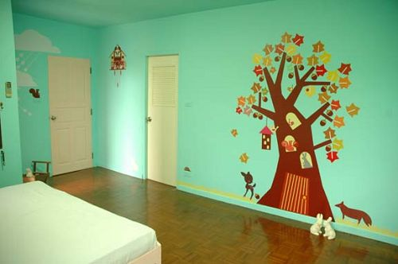
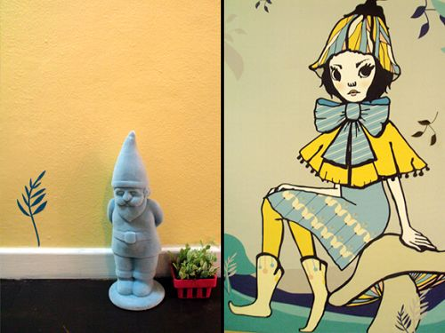
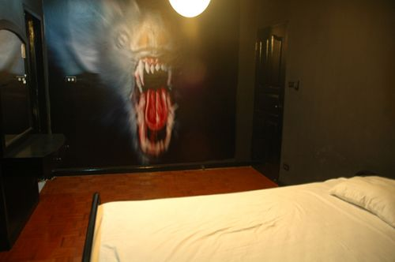
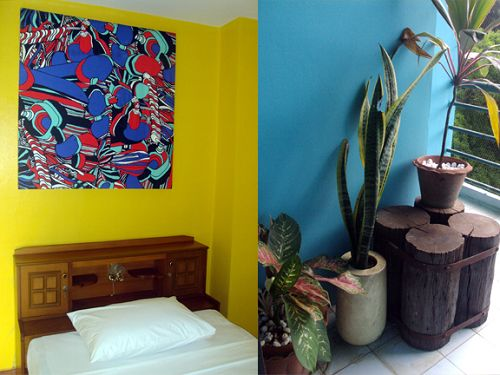
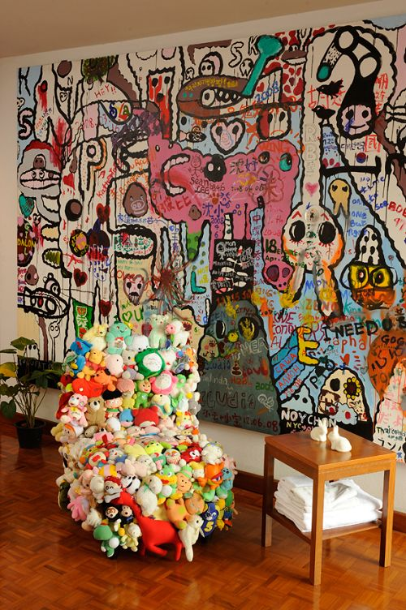
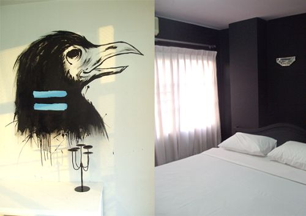
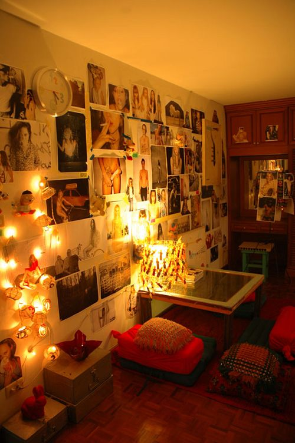

# *Reflections*

还有两周即将出发去泰国，每日被工作搅得焦虑不堪，出发前还没准备好舒缓与兴奋的心情。之前去泰国两次，对曼谷仍然念念不忘，泰国是个值得多次旅行的地方，既多元化又颇具特色人文，并且飞两小时就到了，不象去欧洲，飞行十几个小时，很折磨人。同行的蔡蔡说：“你定酒店吧，我去泰国就两件事，SPA和泰丝。”一直到今天我还没预订下最终的酒店，因为曼谷和清迈可选择的住宿酒店实在太多，难怪旅行杂志上会出现以“酒店”为体验主线的旅行文章，形形色色的酒店，让人眼花缭乱，既要考虑交通的方便性，又要考虑到上网住宿的舒适性，最主要的是要考虑到安全性。家人说订那些国际连锁酒店，比较放心，但那些酒店缺乏特色，可能你在南京香格里拉和在泰国的香格里拉不会有太大的区别。  
  
目前最中意曼谷[**Reflections**](http://www.reflections-thai.com/)酒店，在Ari站的phahon Yothin路上，路人很难会错过这座粉红色建筑，它的餐厅也是粉红色的，大厅的墙壁是鹅黄色，粉蓝色石柱，五颜六色的家具，巨大的人偶，绘着玫瑰的天花板，想象一下都觉得香魅。  
  
Reflections 32间living room都具有不同风格，来自世界各地30位艺术家的创作，设计者将自己的创作理念实现在墙壁的绘画、床饰、以及装饰品的材质中。据说有些忠实的客人每次去都会挑选同一个房间，也有换着不同房间预订的。这间的老板本身也是设计师，尤其爱粉红色和玫瑰，店内四处可见老板手绘的玫瑰图案，还可以买到在店内买到[**老板设计的**](http://www.reflections-thai.com/export&import-fabricbag1.html)玩偶和用品。  
  
Reflections所在的Ari区域意外的安静，是曼谷闹市里老式的高级住宅区，有台北天母的气氛？深长的窄巷两侧透着贵气的豪宅，庭院里有茂盛的花草，附近隐藏着精巧别致的小店铺。不同于观光区的热闹招摇，是曼谷的秘密花园。  
  
   
   
   
   
   
   
   

---

## 评论（7）

**[三月四月](http://11)** · 2010-12-13

这是你们要住的酒店吗？太可爱了！

**Christina** · 2010-12-13

还没最终决定，有意思的酒店很多啊，要考虑交通的方便性。

**sususu** · 2010-12-13

还没去过泰国呢，等你回来，看你的攻略或者是旅行游记。

**Jonathan** · 2010-12-13

可能我去泰国基本都是工作和培训，所以没感受到很吸引的地方。下次再去要留意一下。

**Sherry** · 2010-12-13

哇哦，很便宜的酒店~ 看起来很超值！哪儿找到的？

**Chrisitna** · 2010-12-13

www.hotelthailand.com  
www.thaihotels.org

**HANK** · 2010-12-14

TVB有个节目，潮游泰国， 主持叫胡慧冲  
节目还不错，这是他的网站。  
www.thailandfans.com  
泰国之后，还有计划吗？AUSTRALIA?

