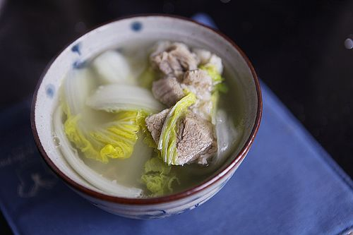
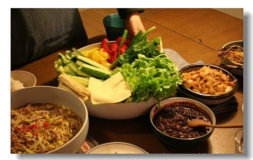

# 羊肉汤

星期六跑去超市，有个女孩子抢先买了我中意的羊前腿，我只好搞了个大的，95块多钱的羊腿肉被切割成小块装在塑料袋里，今天炖了1/4，剩余冻起来，哇，从形式上看这就过冬。大雪节气后我家第一次吃羊肉，往年不是红烧就是辣汤炖。可是前一夜肚子疼得要死，所以还是来点清淡的羊肉汤，撒了些白胡椒粉，就着烙饼吃。  
  
   
  
这是在问问家拍的，尝了酸汤肥牛里面的那个辣感，好爱。索要了信息也买了两瓶回来，那个辣不是一般爱吃辣的人能承受的，星期六在家炒肉片加了许多进去，结果肚子说：“这辣椒不用这么给力吧？抗议！抗议！”周末还如法炮制小原子的东北大爆炸，吃得爽。那一大盆蔬菜就是东北大爆炸，用豆皮裹着“生菜、黄瓜条、葱、黄红水果椒、东北的酱”，裹在一起吃，清爽的口感。做一名吃货，很幸福。  

---

## 评论（11）

**陈问** · 2010-12-12

哈我那破相机，这唯一一张能看清楚菜的。。。  
羊肉好清爽的。

**[凡六](http://mzai.net)** · 2010-12-12

最喜欢那个东北大爆炸，其实应该叫蘸酱菜，少了红色的水萝卜；酱用鸡蛋、毛葱炸过味道更好。想家了。

**sususu** · 2010-12-13

羊肉这么做，看着一点都不膻腻耶。求方子

**[三月四月](http://11)** · 2010-12-13

这个周六中午在妈妈那里吃的，吃到撑，晚上又和朋友在红杏吃，吃到要吐，结果半夜我饱得睡不着，花了4个小时打扫房间，凌晨2点总算消化掉了。周日下雨，就一整天拿前一天从妈妈家挂来的肴猪手和红烧鲫鱼做零食吃，窝在沙发上看了一天的《泡沫之夏》……堕落的日子啊

**Sherry** · 2010-12-13

冬天应该多吃羊肉

**[三月四月](http://11)** · 2010-12-13

老公每次买，都近百元的量，然后我做出一大锅，他就吃一次，剩下的全是我来打发，要命，经常我得吃一周……才吃完

**Christina** · 2010-12-13

去年我也是烧好了吃好几天，这次冻在冰箱里，要吃的时候提前拿出来解冻，也挺方便的。

**喜刷刷** · 2010-12-14

羊及牛我从来不请回家弄,你这两样都搞得蛮好的.

**Chrisitna** · 2010-12-14

归归，你这话乍一看，被理解成把羊和牛牵回家呢….哈哈哈哈 ~

**[三月四月](http://11)** · 2010-12-14

可是在家搞过后，你就觉得外面真的没自己做的好，水饺也是

**Chrisitna** · 2010-12-14

晕，你会捏水饺？仰视一下！有关擀面的技术俺们还是很崇拜的。

