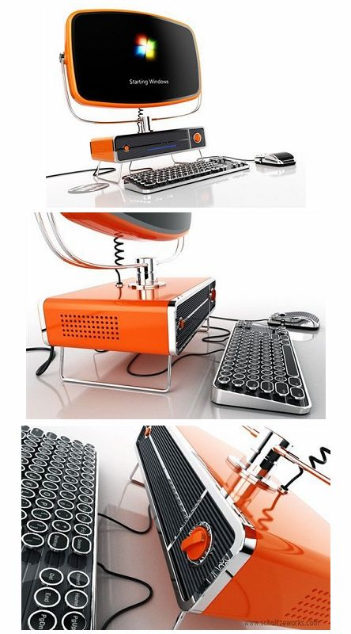
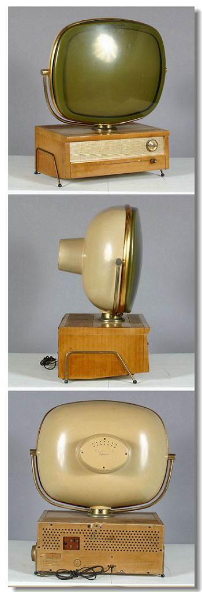

# 销魂的复古机

Schultzeworks工作室设计的一体机Philco PC。灵感来自于1954问世的经典Philco电视机，金属质感，仿老式收音机的机箱，老式打字机的键盘和鼠标，固定在支架上可来回翻转的LCD显示器，如果性能配置能达到PC的中流水平，还是有卖点的。按照我的审美，橘色换成银灰、不锈钢、橡木纹或黑色，是不是更好？  
  
  
\*\*\*Philco电视机原型\*\*\*  
Vintage Philco Predicta television; metal grill, wooden base; branded and raised labels. 27"H x 20"W x 14"D. Good condition; some surface, missing knob. Not in working order.  
*(Thanks for Visitor)*  
  

---

## 评论（3）

**visitor** · 2010-12-17

原来的Philco电视可以在这里看到，颜色大概是想和原来的一致一点。

**贺奕** · 2010-12-17

看着像太空舱里摘出来的

**okdata** · 2010-12-20

Nice。  
最近一直在找老式物品，现在的无绳电话、计算机、电视机和FFDM都不怎么答调。  
比如床上用品，只选了深色调的欧式花，只为与家具相配，弄得太太极为郁闷。  
前天淘了一只三五旧钟，原来一直嫌它沉闷，这个自儿时不喜好的物件，不知为什么就买了。看来喜好是不断演变的。而且非收藏性成本低娱乐，好对付。

