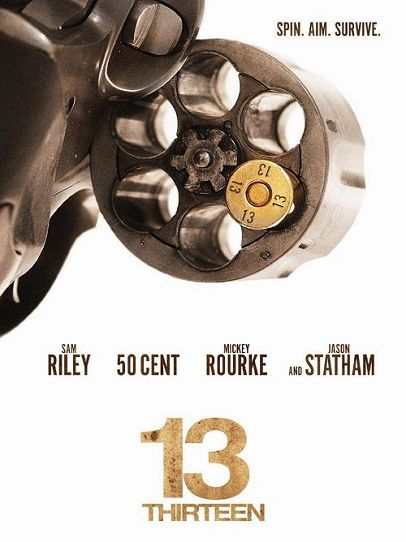
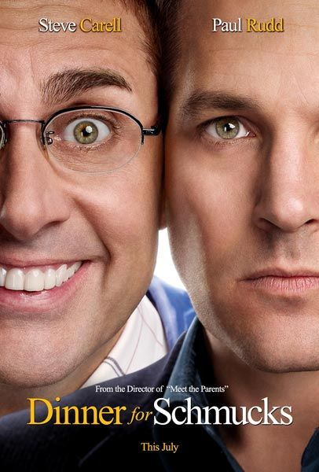

# 富豪们的游戏

接连看了两部有关富豪们的游戏，一部《Thirteen》（13），一部《Dinner For Schmucks》（笨人晚餐）。  
  
  
  
  
  
《Thirteen》讲述困难家庭的男孩，为帮助家庭误入一场富豪们的游戏：拿命赌运。也是豪赌，但赌的是人命。下注的赌家会各带一个人前往，约是十多个人站成一圈，第一次发一颗子弹，装在左轮手枪里，旋转无数次瞄准前面人的脑袋，灯亮，人亡.....以此类推，一直到最后活下来的那个人会获得不小的奖励，赌家按压注分钱。这个男孩是13号，幸运地活到最后，获得185万美元，最终被人枪杀在回家的火车上。看这部电影除了肾上腺素急剧增加外，也让人见到了现实中不可能见到的黑暗。看完后挺难过的，但又找不到具体难过的根源，那种无助的难过。  
  
  
   
  
  
后一部《Dinner For Schmucks》几次看不下去了，这电影想煽情，但看着让人摸不着头脑，居然位居北美票房第二名。大致讲一个投资公司的高管有举办笨人晚餐的“传统”，每人带一个笨人前往，看哪个笨人最终获胜。6楼的TIM为顺利升职，准备将偶遇到的笨人Barry带去参加晚宴。之后发生了一系列的倒霉事。唯一让人看懂的是你愚弄他人，其实你才是最大的傻瓜。以及为所谓的成功可能需要不择手段，舍弃人间真善美？美国人的自嘲精神在于，他们承认自己对世界无知。笑点虽然低俗，但也有值得思考之处。  
  
  
因为这两部电影我居然当晚就作了一个奇异的梦，有关对《盗梦空间》呈现的几度空间的理解，虽然这部电影我也没兴趣认真看完它。我的梦可以这么形容，第一个梦是1楼，从1楼上到2楼是第二个梦，第三个梦仿佛在3楼上...就是梦里有梦。在梦里我居然思维异常清晰，对自己说：“恩，你在梦里还在做梦，就象俄罗斯套娃，用来理解《盗梦空间》里的空间感是不是正确呢？在你醒来的时候你得记清楚了...”  
  
  
其实这个晚上，我睡得很沉。

---

## 评论（4）

**okdata** · 2011-01-26

深奥，不懂

**alexli** · 2011-02-19

你看电影都在哪个网站，是下载吗?

**[chrisitna](http://lifetea.org)** · 2011-02-21

全部都是看碟,从来没下载过.

**alexli** · 2011-02-21

哈哈，挺好的一个习惯。

