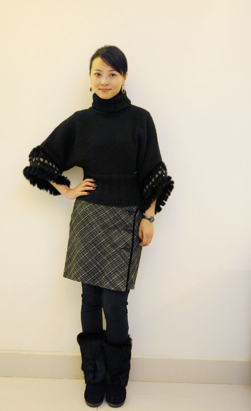

# DRESS BLOG

今天穿了宽大袖子的毛衣，袖子上的细节很美，加了皮草和丝绒的丝带编制在毛线里，因为袖子的原因，除了披肩式外套似乎没有衣服能顺利罩在外面。雪才化，天气还冷，所以每天裹着羽绒服。好不容易找了件袖子大的，穿进去还是有点儿拥挤。以及，现在想买件厚的羊毛衫，是真的羊毛成分的羊毛衫，似乎比较难。多的是化纤成分的所谓毛衣，款式稍微好一些，价格卖得如打劫。  
  
  
遇见一位带着孩子的优雅母亲，里面是真丝背心，外面套着在店里摇的长款羊绒衫，外面一件羽绒服。虽然没多么时髦，但她身上样样精致，也很柔美的摸样，让人忍不住要多看几眼。看来以后俺们得学会织毛衣才好啊。  
  
  

---

## 评论（9）

**Summer** · 2011-01-24

宽袖子的毛衣也可以穿出这般精致，并且与裙子靴子（以及炭黑眼影？）搭配得浑然一体，大爱~

**[Chrisitna](http://lifetea.org)** · 2011-01-24

为你而拍啊，嘻嘻~

**Summer** · 2011-01-25

感动ing，我把论文弄完也想研究一下织毛衣，小时候会织很多图案呢。不想煽情，又忍不住，在枯燥的写论文中有你的博客&照片的陪伴，享受了很多的愉悦，该如何感谢？

**[高光光](http://gaoguangguang.blogbus.com)** · 2011-01-25

我下次回国可以帮你在美国买，你告诉我你的号。

**[chrisitna](http://lifetea.org)** · 2011-01-25

是帮我带毛衣吗？太好了，不过每个品牌的尺码大小好象均有差异，一般欧码36或38的，或者是2号的。

**Sherry** · 2011-01-25

去店里摇羊绒衫是不错的主意，今天这身很不错，不过期待你的装扮有所突破，再给一点风情，一点色彩，一点尺度，给寒冷的冬天一点醉人的阳光。

**okdata** · 2011-01-26

嗯，很潮，不过下面有点不搭

**[三月四月](http://11)** · 2011-01-26

宽袖子的厚感毛衣确实蛮难配的，能穿出这样的效果，挺好的，毛脚套和鞋是分开的吗？嘿嘿，我今年也买了脚套，还蛮实用的，但没敢买这么长的，买了个短的

**喜刷刷** · 2011-01-28

你…..也穿高脖子?颈脖子,脚脖子全是高领啊~~~

