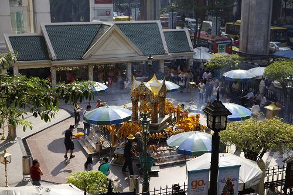
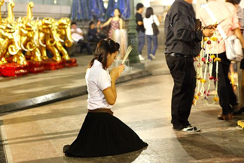
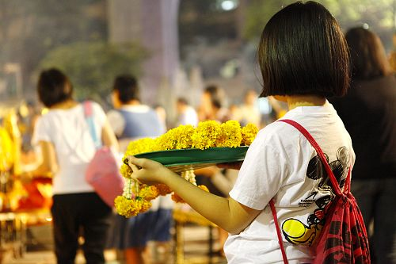
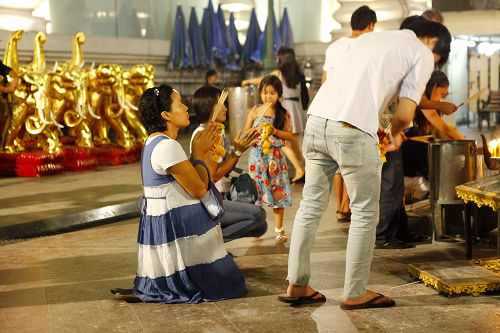
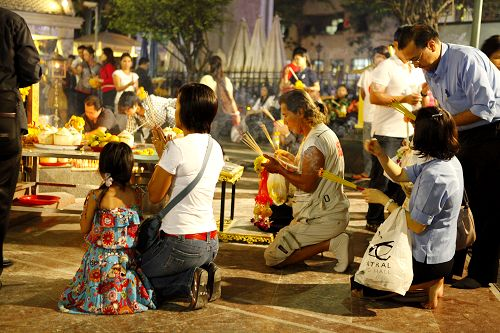
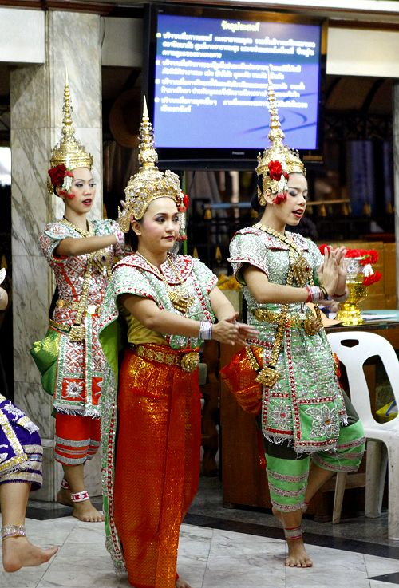
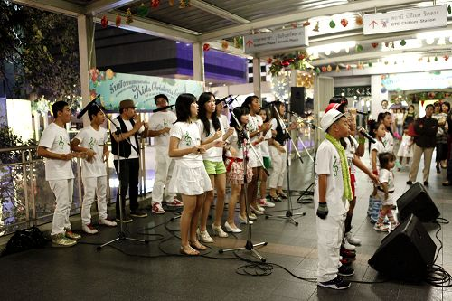
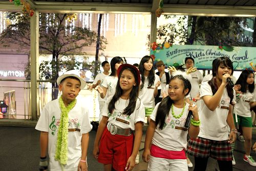

# 四面佛@曼谷

对四面佛（梵天大帝）的信仰，最初是来自婆罗门。婆罗门相信人类与世界示梵天大帝所创造，帝王高阶层者，来自梵天大帝的首部；战士、主管阶级，来自梵天大帝的肩部；中阶层者来自腹部；贫穷者来自脚部。每个人出生后便被梵天大帝在额头上画下未来一道生命运，凭是何人都无法改变已注定的一生。  
  
  
拜佛注意：拜四面佛要顺时针方向逐面拜。  
  
  
小拜：每面3根香，1根蜡烛，1串花，将花挂在蜡烛上。  
  
  
还愿：每面佛7根、花瓶一对、不同色花7枝、蜡台1队、香炉1个、清水1杯、香米1小碗。要请舞者献艺给佛观赏；要常捐款给寺庙和慈善机构。  
*（上述文字来自网易）*  
  
  
  
曼谷四面佛位于泰国曼谷市中心爱侣湾大酒店前面，是泰国香火最旺的佛像之一。据说谢庭锋的母亲多次到这里跪拜。奇怪的是这尊佛像居然在市中心地带。  
  
  
  
  
据说傍晚的时候去拜，比较灵。当夜幕降临，香火越来越旺。  
  
   
  
  
  
   
  
  
  
  
旁边还有跳舞的女孩子们，不知道是否从早跳到晚，不是跳给游客看的，是跳给黄金宝座上、主宰世人命运的梵天大帝“四面佛”的。  
  
  
  
附近天桥过道上的公益表演。  
  
  
  

---

## 评论（4）

**[三月四月](http://11)** · 2011-01-25

啊……第二张照片真有感觉！

**[chrisitna](http://lifetea.org)** · 2011-01-25

你知道吗？当我看到最后一张照片中第一排右数第二个小女孩时，就想到了“三月四月”，眉眼间与你有几分相似哎~

**[三月四月](http://11)** · 2011-01-25

真的有点像，而且我小时候脑门子就是这个样子梳上去的

**okdata** · 2011-01-26

展示佛的景点，很好

