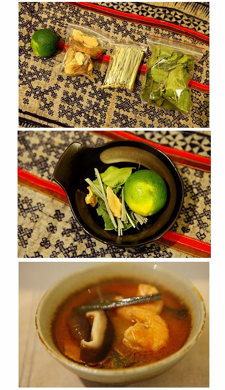

# 自制“冬阴宫汤”

自己做了冬阴宫汤，有那么点意思。遗憾的是对虾太小，椰奶是椰奶粉冲的，盐有点儿多，其他基本相似。香料的味道十足，来自右边两袋，不知道如何称呼，事实上这三袋佐料都不知道，请高人赐教。  
  
  

---

## 评论（12）

**itsmin** · 2011-01-27

是香茅片和薄荷叶么？

**Anyayaya** · 2011-01-27

第二、三袋分别是香茅(lemon grass)和卡菲尔青柠叶(Kaffir lime leaf)。 第一袋看不清，不过我所知道的冬阴功汤食谱也没有这个样子的香料。烹饪用椰奶应该有罐头的，好很多，你找找看。

**[chrisitna](http://lifetea.org)** · 2011-01-27

俺们这个是泰国滴的香料呀,配好的,不过右边两袋的味道很“冬阴宫汤“哇.

**Sherry** · 2011-01-27

最左边是啥？青橘子？

**[chrisitna](http://lifetea.org)** · 2011-01-28

青柠檬。

**sheryl** · 2011-01-28

那三袋香料从右到左分别是：柠檬叶、柠檬香茅、黄姜

**喜刷刷** · 2011-01-28

台布蛮好看的~

**薇安** · 2011-01-30

你是买的现成的配料吗，我上次做了次不是特别好，想求更地道的做法。特别爱吃冬阴功

**okdata** · 2011-01-31

六楼正解，良姜、香茅、柠檬叶

**陈问** · 2011-02-01

天赋异禀，非常有感觉了。

**陈问** · 2011-02-01

天赋异禀，非常有感觉了。麦德龙有椰浆卖。

**Okdata** · 2011-02-08

麦德龙里这些外来的东西很全，价格比苏果便宜。  
干果还是东麒路的市场实惠，不过630一箱的开心果至少要四家人分才行。

