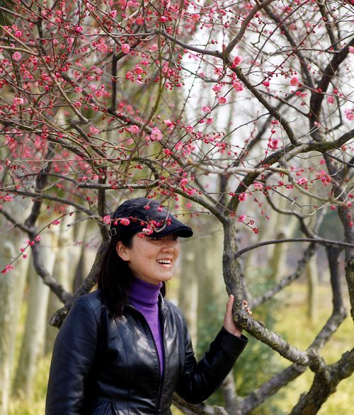
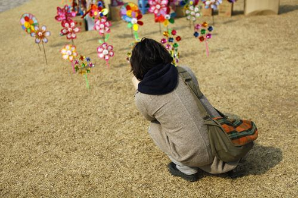
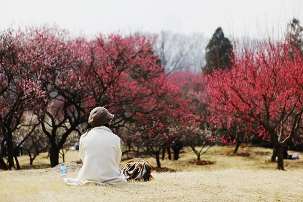
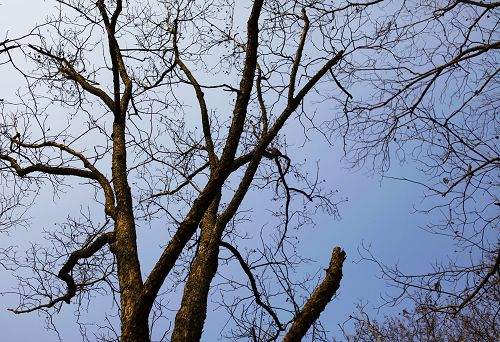
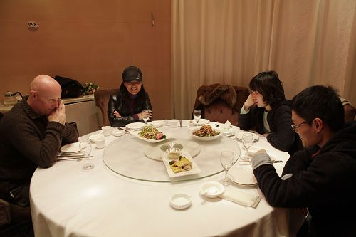
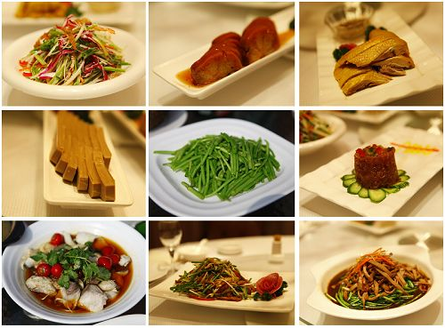

# 有朋自远方来

这是第二次见JENNY，[**第一次在2009年深秋的布拉格**](http://lifetea.org/article/2487/praha-2)。她从英国飞到布拉格，我从南京前往，在布拉格的古城里相见。若是一对男女，为这样的浪漫多少也会擦出些火花吧。给我印象深刻的是她爽朗的笑声，双子座的开朗健谈。有她在，怎会有冷场的境遇。  
  
  
为见她，比平时上班起得早，可还是迟到了。。。我这拖拉的习惯什么时候才能消失？到酒店院子里不见其人，打电话给总台：“我要找一位英国男人和一位中国女人。”问问在我身边笑起来，我自己也觉得有趣，我怎么就那么严肃又认真地说出了这样一句话。  
  
  
边走边聊，有讲不完的话题，哪还有心思琢磨拍照的事儿，笑不完讲不完。Steve一直默默跟在我们身后，或听音乐或拍照，总是让女士们先行，一副英国绅士做派。  
  
  
好多年没去梅花山，居然要向路人打听。春天的阳光照在身上暖洋洋的，心情好过天天挣扎在办公桌前。无心赏景，只是和喜欢的人儿一起走走，就很快乐。在国际青年旅馆吃完午饭，在中山陵陵寝前几百个石阶上四人比赛，在Steve一路领先下结束。有人说：西方人的业余时间热衷于健身、户外运动，中国人的剩余时间喜于坐在麻将桌前。Jenny夫妇仍然坚持到健身房，这对我触动很大，俺们大部分的剩余时间多用在了睡觉、上网、吃饭上了。向坚持健身的先生女士们致敬。  
  
  
在问问家的下午茶，有趣，这里先不写，留点念想~下午茶时间，我乐坏了，也更加喜欢外外。大伙儿都是爱狗之人，晚上又一起到我家去看Luke和土豆。这一天过得很棒，好久没那么开心了。  
  
  
悄悄尾随其后的春天。  
  
  
  
这种颜色的梅花，我最爱。  
  
  
  
她在丛中笑。  
  
  
  
童话世界里的问问。  
  
  
  
赏梅当如此悠闲，找块高地坐下，对面一片花海。  
“人低一点，梅花就是云朵，人高一点，就似在云间游荡。”（by问问）  
  
  
  
在国际青年旅馆用午餐。  
  
  
  
  
  
  
  
  
  
晚饭订了个包间，之前有人在这家酒店请吃饭，对这里的菜品印象极好。但这次我被自己点的“凉拌五毒”给折磨了，里面有香菜、芹菜和洋葱，全是生的，吃下几秒钟就全吐出来了。泪流满面地从卫生间回来。这些菜平时都不爱吃，总觉得香菜有股子花大姐的气味。  
  
  
以及，早晨接问问，见胡子拉茬的wanze骑着自行车驮着问问慢悠悠地出来，下午再见他，整张脸那个干净啊，仔细一瞧，胡子全没了，还是觉得有胡子的他更范儿。  
  
  
  
  
考虑到西方人的口味，特地点了鹅肝冻，还有黑椒牛仔骨。Steve却最爱现榨的花生核桃汁。Jenny夫妇吃鸡肉会将鸡皮撕掉，除了英国人其他国家有这样的习惯吗？（要知道我妈妈一个女同事特爱吃鸡皮鸭皮，据说对皮肤好。）Steve说：“这是我在中国吃的最好的一次餐。”恩，得意一下总可以吧。  
  
  
  
留影一张。我想我们还会重游一次春天，当阳春三月来临时。  

---

## 评论（13）

**[凡六](http://mzai.net)** · 2011-02-25

朋友如老酒，愈久弥香；再见如新茶，清新淡雅

**HANK** · 2011-02-25

口水哗哗的，不仅是对菜，更是对梅花，和友谊。  
有点想念南京了。

**[Justblue](http://www.http://hi.baidu.com/oneblue)** · 2011-02-25

呵呵，在饭店里吃饭每上一道菜都用相机把它拍下来，这样会不会感觉有点怪怪的，特别是有客人在的时候～

**少爷** · 2011-02-25

被你拍得不好意思，只好低头猛吃啊：）这一天太开心。但愿下次的见面，不会太久才来。

**[Christina](http://Lifetea.org)** · 2011-02-25

jenny:英国已经在我们的旅行计划里了，想亲手抚摸麦克和梅西，和它们玩耍！不久会见面的。

just blue:商务应酬的饭桌上这样拍照当然很怪，和朋友吃饭这样没什么，正说明关系亲密不见外啊。

hank:有时间就回国转转，朋友们都等着你呢～

**陈问** · 2011-02-25

少爷的下巴弧度很好看啊。女人味十足。另外我觉得布鲁鲁是一种甜蜜的绅士范。好像和少爷在一起就开心。

**alexli** · 2011-02-25

上新浪微博，想想christina可能有开通，用：christina，chinatea,teachina,中国茶搜索无果，突然灵光一现，输入TECINESE，找到组织。

**okdata** · 2011-02-25

青旅的菜两年前就退步了，不过与其价格渐近。  
环境比城里好，不过更好夕阳西下时在它的庭院水边就餐

**雯子** · 2011-02-26

南京的梅花一般开到几月凋谢啊.也想去梅花山看看.

**喜刷刷** · 2011-02-26

这最后一张,\_

**喜刷刷** · 2011-02-26

哈哈,人家是花儿笑上枝头,你是俩包压在肩头,太让人感动了~~~

**frank** · 2011-03-02

和异性，同性关系都不能太密切，尤其在美国别人会把你当GAY.

**lilian** · 2011-03-02

刚从南京回来。。

