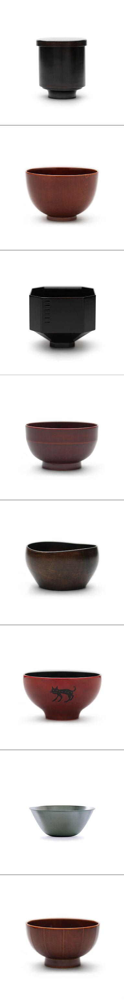

# 松屋．陶作

弱设计。  
  
  
何谓“弱”？答曰：以一种谦虚低调的方式，将东方美学、禅意的意念贯穿在整个设计中，看似柔弱，其实有内在的高调，需要心去体会，而不是简单的视觉形式冲击，从而留给人与自然、美学更多的对话及留白空间。  
  
  
  
  
*via happy老小儿*

---

## 评论（2）

**simplelife** · 2011-04-18

顺数第六只小猫图案很有爱。

**caicai** · 2011-04-20

这个美需静心体会。确实很美。

