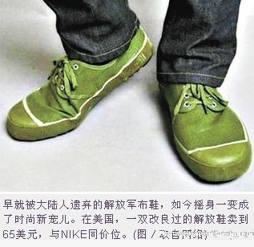

# 解放鞋

如果在日本街头看到一位帅哥穿着土得掉渣的绿军鞋逛街，千万别诧异，这种早就被国人遗弃的解放军布鞋，摇身一变已成了时尚新宠儿。在美国，一双改良过的解放鞋甚至卖到了65美元，跟国际知名品牌NIKE同等价位。  
  
  
自己用的时候没觉得好，人家一流行土包子们又患得患失。无论什么用品自己喜欢最重要，不是因为品牌，价格，以及别人如何看待才入手。你说这东西如何好，如何贵，人家表情茫然，不以为然。没有共鸣，何来爱呢。当然很多人即使没有共鸣，也会跟着人家屁股后面团团转，人以群分，物以类聚，有些崇尚的是他人眼光，有人追求的是自己的乐趣。多数人还是随大流，就这么回事，生怕流行里惟独少了一个自己。  
  
  
记得去年几乎半成以上的文艺小青年都穿双回力鞋，那么多人一起穿，也就不特别了，再说了那小白鞋一出脚汗，鞋四周泛黄，而特容易臭脚，小时候都有体会。流行一旦身处中国，最终都会让人杀心四起，腻味到翻胃。今年会不会许多小青年一起穿老解放鞋呢？  
  
  

---

## 评论（3）

**黑色之一** · 2011-04-25

yes,great!

**frank** · 2011-04-25

Cool. I wanna buy one.

**[mian](http://mianchen.com)** · 2011-06-19

@Frank you only need the one?

