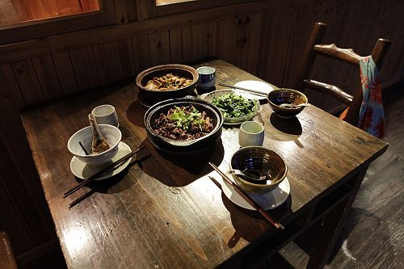
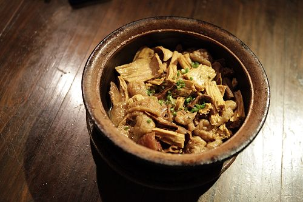
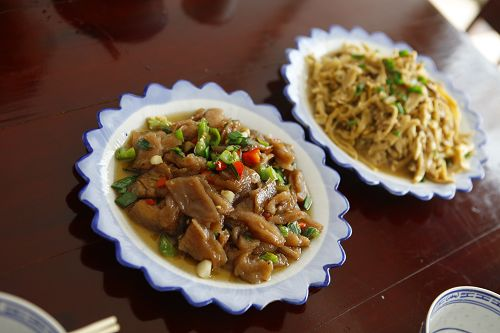
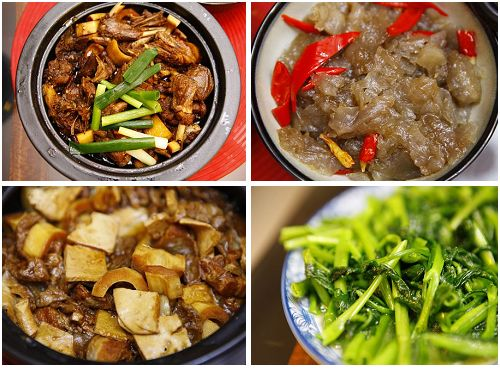

# 学做旅行中品尝到的美食。

在“三宝国际陶艺村”的晚饭，每样菜基本都是厨师花了时间和精力做的。红烧鸭子、腐竹+豆皮+鲜笋、一份当地的土青菜。样样可口。  
  
  
  
腐竹+豆皮+鲜笋。用了红烧五花肉的汤料。  
  
  
  
景德镇瑶里的苦株豆腐，是山里苦株树上结的果子，摘下来磨成粉制成的。临走前，我们每个人都买了几袋，味道确实不一样。  
  
  
  
在景德镇几日，对那里的菜肴印象深刻。回到家立刻就做上了。在菜场里幸运地买到了长条状的鲜笋，剥去一层笋衣，用刀轻轻地削一层，里面的笋肉异常鲜嫩。用它与红烧五花肉炖了油面筋、白豆干，五花肉成了配角。  

---

## 评论（3）

**陈问** · 2011-05-25

你做的菜也很像样子啊，馋~

**[Christina](http://lifetea.org)** · 2011-05-26

你也可以的，学着做三宝的菜，为了解馋啊~

**薇安** · 2011-05-30

烹饪也是对生命的赏识

