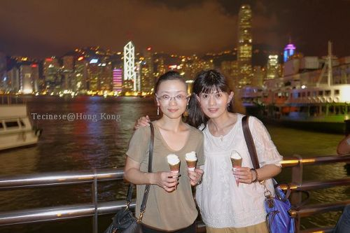
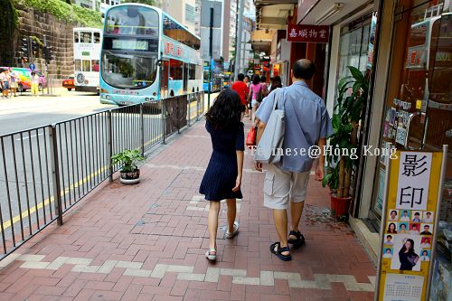
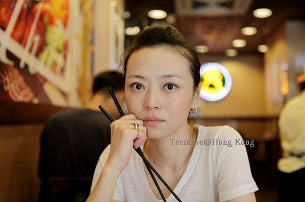
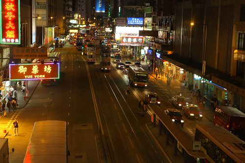
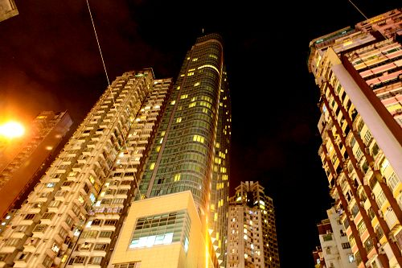

# 百转千回

中午下班路上，电台105.8正在播放梅艳芳的[**“交出我的心”**](http://www.tudou.com/programs/view/wXX6uxqfmyo/)，恰好从香港回来两天，听得我心里惆怅啊，眼泪差点掉出来。末了，主持人说：“如果你知道这首歌是什么电视剧的主题曲，那么将透露出你的年龄，因为这部电视剧是30年前的，如果你小时候看过，那么现在也是年近四十...”你知道它是哪部电视剧的主题曲吗？  
  
  
中国茶陪伴我度过9年光阴，想到这个倒有几许怀旧的味道。怀旧意味着衰老，欣慰地是俺们完全接受现在的自己，以及自己所处的生活。从年轻逐渐衰老的过程，体味着内心一点一滴的成长，积极的“活”着，有时也会精疲力尽，爱也爱过，痛也痛过，放肆过叛逆过，也曾年轻过，也曾如歌中所唱“不顾后果前因”。“无须更多言语，我必与你相忘于江湖，以沧桑为饮，年华果腹，岁月做衣锦华服，于百转千回后，悄然转身，然后，离去。 ”在这首歌的作用下回想起来有几分唏嘘，欣喜与坦然。如今，“逐渐衰老”谓之不可多得的财富，以其珍也。更喜欢＂老去＂的自己。  
  
  
仅以此歌送给我与JESSICA在港偶遇的那个浪漫之夜，两个人没有预约，尽然在港联系上，到达的当晚一起去天星码头吃着冰淇淋乘轮渡看夜景，从中环看尖沙咀，再从尖沙咀看中环。此歌一并送予大清早放下工作从深圳赶来见面的蔡蔡。外甥女问：＂是那位涂红指甲的阿姨吗？＂正是去年一起去泰国涂红指甲的阿姨，与我同年。我们在时代广场楼上的越南餐厅一起吃了午饭，即匆匆告别。这次见面，感觉更象是家人。  
  
  
来吧，让我们沉浸地听这首老歌吧。  
  
  
  
  
香港掠影：  
   
   
   
   
   
   
   
   
   
   
   
   
   
   

---

## 评论（25）

**Ladult** · 2011-07-14

你写了9年，我看了8年，从一个十几岁的小丫头，到如今同样体会过爱或痛的女青年。  
希望一直这样，虽然只是茫茫网络上不知名的一个小符号，却能感受到时间带给你、我、他（她）的改变和共鸣。谢谢茶。

**箱子** · 2011-07-14

我娘中午问我，茶是不是去玩了，我说是啊，去香港了。。。她说，博客上我才看到景德镇，我赶快去看看新的。。。哈哈。。。你看你好有吸引力。

**Jessica** · 2011-07-14

如今懷舊已經不是偶有為之了，而是幾乎天天為之。警花出更，交出我的心，這答案確實準確地反映了年齡。可是又如何呢？懷舊並不意味著傷感，因為至少有舊可懷。真正難過的，是本以為刻骨銘心的愛與痛，懷想起來卻似浮雲飄過。覺得已經錯過了能夠全情投入的年代 如今想傾全心去愛都有心無力啦想傾全心去愛都有心無力啦

**Yanying** · 2011-07-14

写得不错的一篇。（看上去很年轻漂亮吗，不用总说自己老。）

**[christina](http://Lifetea.org)** · 2011-07-14

因为更喜欢＂老去＂的自己，呵呵。

**caicai** · 2011-07-15

交出我的心，愿交出我的心。。心情澎湃，这两天我在听阿梅的《STAND BY ME》!

**mandy** · 2011-07-15

我上周6-8在香港，你是几时去的？住在时代附近？

**[Christina](http://lifetea.org)** · 2011-07-15

八号到的，正好是你离开的日期。

**Anyayaya** · 2011-07-15

《警花出更》主题曲！郑裕玲主演的。

**frank** · 2011-07-15

这次回国的感受是国内真太有钱了，朋友住的别墅区每栋都在2000万以上，大家都开卡宴，大奔，BMWX5, Z4. 最低调的开AUDI A6L, 人家国企的害怕开好车有麻烦，连国企低薪都是100万RMB. 看来国内精英阶层生活不错呀。

**大湖** · 2011-07-15

Frank, Why don’t you go back to join them?

**Annie** · 2011-07-15

怀念香港，尤其天星小轮，希望不要停航。无论是港岛还是九龙的夜色都很美。

**frank** · 2011-07-15

现在回去喝西北风呀，在国外是温水煮青蛙，我打算和国内的朋友合作迎头赶上，发挥自己的优势不要赶时髦。

**lilian** · 2011-07-16

也是过来人，感怀，共勉！

**njlh** · 2011-07-16

不听都不记得曾经还有这首歌了。确实会有些小伤感。

**angie** · 2011-07-17

因为《警花出更》喜欢上了郑裕玲，现在感觉不再。人会随着年龄和环境不断地变换着自己喜好。对于自己曾经刻骨铭心、爱恨交加的人若干年后面对的那种坦然是否自己都会觉得伤感，不是对人，而是对自己的心境。怀旧那是因为放不下，虽然自己一再认为已经放下。若是快乐的，又何必放下；若是感伤，又何足留恋。

**fs-kitty** · 2011-07-17

第二张水果，广东叫“番鬼荔枝”，超甜！  
9年，人生还有很多个9年呢！您还非常年轻，美丽的呀！  
有这麽多人陪伴渡过，幸运呢。

**Anyayaya** · 2011-07-17

最后两张照片让人想起一部叫《August Rush》的电影（当然两者没什么联系，只是August这个词放在哪里都很出感觉），讲述两个热爱音乐却背景迥异的年轻人邂逅并度过美丽的一夜，之后阴差阳错没能再相聚。女的后来生下一个儿子，却由于父亲的介入以为这个孩子出生就死了，而小孩被送到孤儿院，后来流落街头有了个新名字August Rush。血管里流着音乐的血液，小孩August展露出非凡音乐天赋且天性纯良，偶然的机会被高等音乐学府发现并破格吸收。在音乐学院的露天音乐会上，August用音乐神奇地召唤回了偶然路过此地的父母，三人终得团聚。

**[christina](http://Lifetea.org)** · 2011-07-17

kelvin，这段耳熟能详的话，当然不是出自我手，所以用了双引号。

helen，薛凯琪这身造型很酷吧？如果再引用这部电影故事来诠释标题，会更有说服力。

**[Christina](http://lifetea.org)** · 2011-07-18

fs-kitty，番鬼荔枝的果肉是不是和我们平时吃的小荔枝果肉一样，是半透明状的？现在知道是这样的水果，还蛮遗憾当时没买个尝尝，吃起来应该很过瘾，好大的荔枝哦。

**mandy** · 2011-07-18

番鬼荔枝又叫佛头果.释迦~~ 大点.成熟的更好吃。

**雯子** · 2011-07-18

中国茶也伴随了我渡过了6年的光阴啦。

**Anyayaya** · 2011-07-18

愣没看出来是薛凯琪，太不像了！

**fs-kitty** · 2011-07-18

番鬼荔枝的肉不透明，粘粘的，里面还有很多果籽，所以很多男士都不喜欢吃！买的时候要挑闻到有香味的，轻按有点软的才是熟透的。  
番鬼荔枝最特别是它的果籽（核），黑棕色，很光滑，硬硬的。  
吃完果肉，把玩果籽，会很奇怪，感叹在软绵绵下面会有如斯的刚硬。  
将其放在小陶器上绝对是艺术品。

**[山树](http://shanshu.blogbus.com/)** · 2011-08-04

真的真的很久没来看你了。我来享受一下视觉盛宴。

