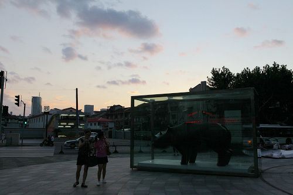
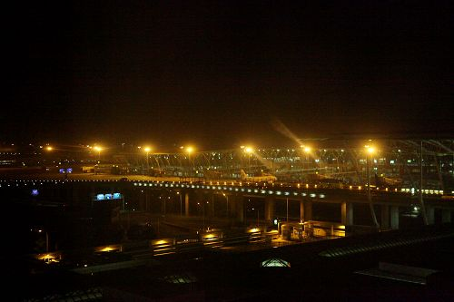
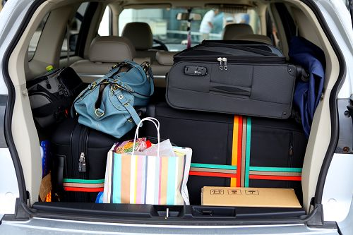
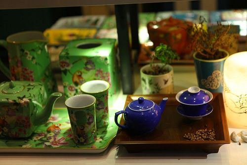
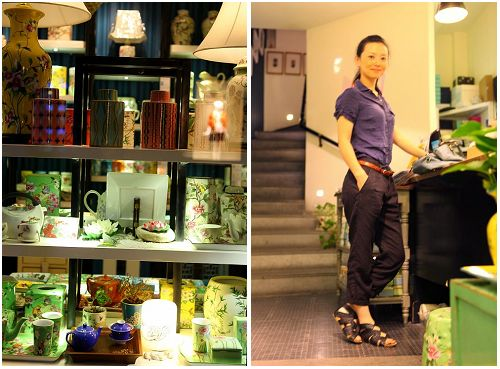
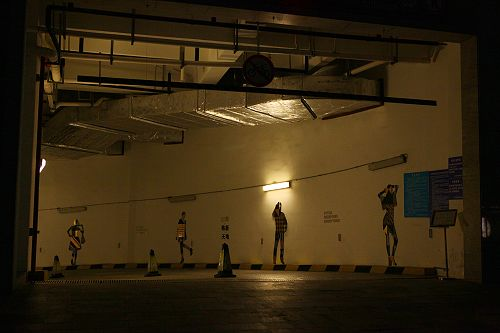
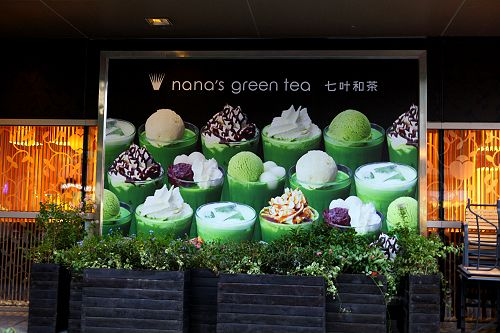

# shanghai @钲艺廊

周日到达上海的下午是晴天，台风擦边而过去了山东。  
   
  
  
从我们住的酒店窗户能看到浦东机场，夜晚，一切都是静止的。  
   
  
  
  
除了外甥女的两大一小，三个箱子之外，还有她老爸一个小箱子，后备箱的空间很强大。所谓“儿行千里，母担忧。”机场出关门前，多少洒泪的亲人，父亲背过身去偷偷擦泪，母亲透过透明玻璃门牵挂地遥望排队出关的孩子。不是一副画面，还是一副又一副催人泪下的画面。和我家可爱的小朋友就此告别，明天凌晨1点到达美国。圣诞节再见，愿你比现在更加独立，坚强。  
   
  
  
傍晚利用有限的三个多小时去新天地找[**“钲艺廊”**](http://www.zenlifestore.com/)，入手香魅瓷器若干。关注这家店有一段时间了，这次去才知道他们还经营家具、沙发、字画。这家店将古老的瓷器注入了时尚元素，看上它家一副画，有点小贵，要四千多，如果能给个优惠价就好了。我身后的二楼是个下午茶的好地方，遗憾时间太紧，逛完这家店即急急匆匆地乘地铁返回浦东机场。“钲艺廊”在上海有两间店：1、东平路7号；2、兴业路118号。提供给有兴趣的朋友。  
   
  
  
  
车库入口的创意。  
   
  
  
路过这间”七叶和茶“，好想进去悠闲地挑一个冰淇淋吃，可惜没有时间流连于此。暂且记录下来，待日后有机会再去。  

---

## 评论（6）

**[灰色蘿蔔](http://blog.sina.com.cn/huiseluobo)** · 2011-08-08

看看。。

**玛德琳** · 2011-08-09

车后箱那个蓝色的包包太好看了，啥牌子呢？好想拥有啊

**tian** · 2011-08-09

我也喜欢那个蓝色的包……

**frank** · 2011-08-09

小留学生挺不容易的， 我一个亲戚家的小孩在美国上高中， 她妈妈爸爸每年都来美国陪读三四个月， 已经一年了小孩还不是太适应， 结果不小心还在美国生了个儿子， 也算是意外收获， 家里特高兴。

**[christina](http://Lifetea.org)** · 2011-08-10

蓝包包多年前在hk买的，意大利的什么牌子。

**雯子** · 2011-08-12

时间过的好快啊，外甥女都考出去读书啦。以前看博她还是个上初中的小朋友。你姐姐肯定舍不得哦。不过你家外甥女好有才哦，考出去啦。你姐姐的女儿经值得我学习哦

