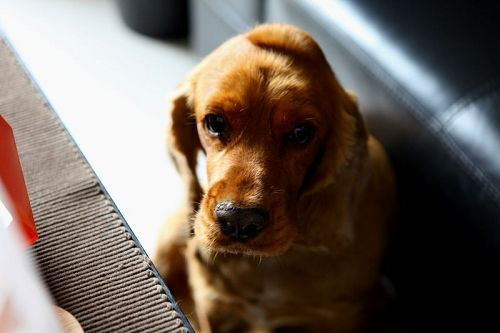
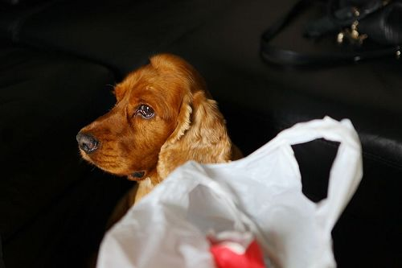
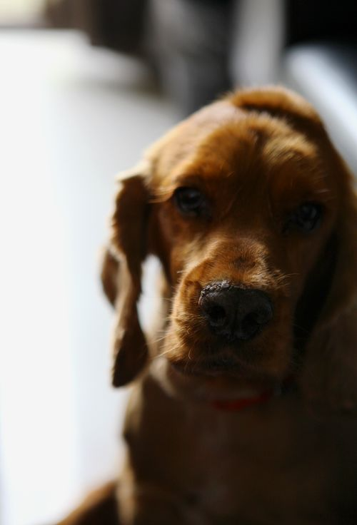

# 开饭前。

LUKE：“象所有小朋友一样爱吃肯德基，尤其是吮指原味鸡块，虽然俺嘴角挂着口水，但是开饭前俺还是很有耐心与克制力的，况且吃饭这件事马虎不得，值得严肃对待。”  
  
   
   

---

## 评论（7）

**Cassandra** · 2011-08-24

可爱的LUKE肯定在想：妈嘛，看我多乖，口水留下来都不擦的，快给口饭吃吧。。。

**[Chrisitna](http://lifetea.org)** · 2011-08-24

哈哈哈哈哈，它的确很憨厚的性格。

**Anyayaya** · 2011-08-24

今天这么勤快！跟小学时候快开学前一天赶四、五篇儿作文似的。不过这个有意思多啦，爱写啥写啥爱怎么写怎么写。追忆当年，游记作文总是“今天天气格外晴朗，万里晴空飘着朵朵白云”，读后感总是“今天我读了一本《XXX》，读后心潮澎湃，久久不能平静”。还有啥当年经典generic作文开头？在这里顺便征集一下开开心！

**[Chrisitna](http://lifetea.org)** · 2011-08-24

有的看，你不是挺开心的吗？呵呵~有时想写会有写不出来的情况，整个儿纠结呢。啥时候外出旅行啊？

**Xiaona W.** · 2011-08-25

瞧Luke这眼神，真想疾步冲进KFC给Luke买一大桶原汁原味的炸鸡好好让他解解馋。

**winglin139** · 2011-08-27

luke有种憨厚的气质

**Anyayaya** · 2011-08-29

争取年底吧。

