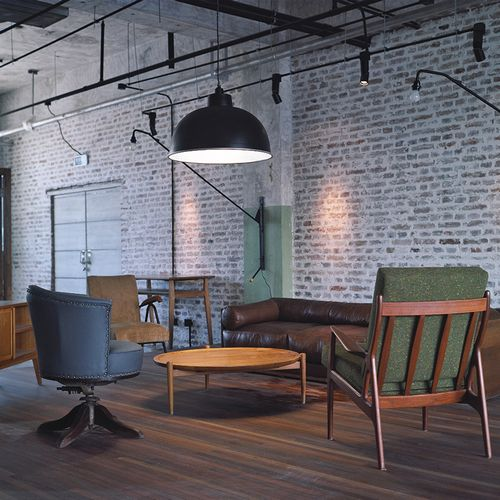
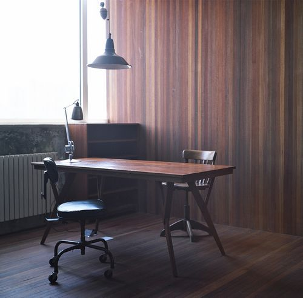
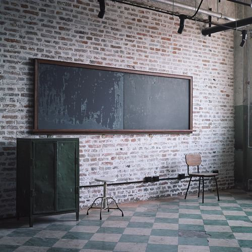
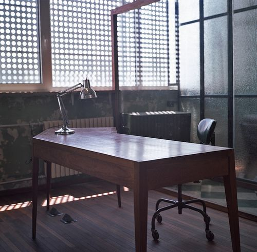
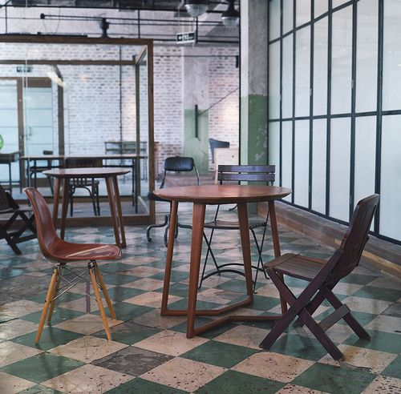
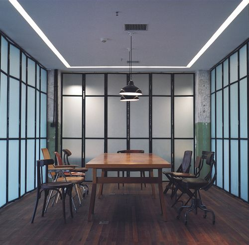

# @古奇高设计

这组胶片拍摄的古奇高室内设计，是香港导演[“陈可辛在北京的工作室”](http://caotieou.com/?p=4615)。我家那把[圈椅](http://lifetea.org/article/2865/%25e5%259c%2588%25e6%25a4%2585%2540%25e5%258f%25a4%25e5%25a5%2587%25e9%25ab%2598%25c2%25b7%25e8%25ae%25be%25e8%25ae%25a1)也是古奇高作品。他不仅设计制作家具，同时也是前途无量的室内设计师。古奇高设计的家具，已开展外地销售，线上预订网站：<http://www.fnji.net/>  
  
  
设计师：[古奇](http://www.guqi.asia/)  
摄影师：Autorun  
   
   
   
   
   

---

## 评论（4）

**michelle** · 2011-09-01

喜欢，很喜欢。

**高光光** · 2011-09-02

挺有型的，但是觉得不舒服，太硬和冷。

**[Christina](http://lifetea.org)** · 2011-09-02

我个人认为再稍微精致一点点，细节上还可以斟酌一下，就是一点点而已，就更好了。不过东西进来了，挂上装饰画，铺些柔软的地毯，可能更好些。

**appletears** · 2011-09-22

他原来在厦门开过一家“抽屉”的咖啡馆，也很有特色。

