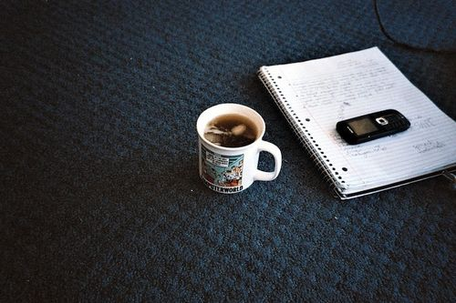

# 全职与非全职

网上有这样一段文字：每天在小区里，看见一群群带孩子的年轻妈妈，觉得她们的眼神好荒芜。好多不到30岁就下岗了，专职带娃。一天之中，起床，做早餐，等老公出门上班，带娃下楼散散步，做午饭，午睡，出门买菜，回家做饭，等老公回家吃饭，带娃下楼散步，回家看电视，洗洗睡。  
  
  
理智地分析，上述这段文字过于偏执，对生活体验有限。  
  
  
  
  
  
事实上，上班族不过比全职主妇多了一份工作而已，你怎么知道人家全职主妇除了带孩子做饭之外，没有其他的追求和兴趣爱好？要知道，选择全职在家是需要能力的，尤其是独立的财力。而且人家有大把的时间去追求自己的兴趣所在，家庭生活是人生重要的组成部分。  
  
  
上班族除了工作，同样要买菜做饭忙家务带孩子照顾老人，连看部电影都得占用睡眠时间。除非你还是单身，如果你已经拥有了家庭，且不靠“啃老”维持日常家庭生活的话，剩下还有多少时间去做自己喜欢的事？公司每年给你多少天年假？你的收入的百分之几用在交通、工作置装、无谓的社交与排解压力的浪费上？失去自我是必然，假设落下个身心健康问题，挣那点小钱有毛用？哦，你说为了理想而工作，刚工作的人谈谈理想还成，都工作十几年的人了，谈理想未免奢侈，咱这年纪都不好意思谈理想了。  
  
  
如今的上班族还真没什么好得瑟的，多数人不过是将生命消耗在求生存这一无奈的过程中而已。如果兴趣爱好恰好与挣钱结合在一起，那才是人生一大幸事。不过那是属于极少数人的幸运。  
  
  
没准儿家庭全职的人们还在嘲笑你们这些“即将变态，或正在变态，或已经变态”的上班族呢，你们有在享受生活，追求自己的兴趣所在吗？你们每天都在吃快餐，走疾步，消耗大量的能源在交通上，花大把的钞票去解决心理压力，你们过着趋炎附势、勾心斗角、假面人的日子，有什么好得意的？要不你也全职一把看看？你有那个能力吗？

---

## 评论（24）

**DIANA** · 2011-09-01

chris，真心谢谢你的这篇文字。

**Jennifer** · 2011-09-01

说的好，我也想当全职太太，可惜，木有钱让我做全职。

**[Chrisitna](http://lifetea.org)** · 2011-09-01

Jennifer，你木有米谁有米，你完全可以享受生活去了。在这精神病院耗着，真是无厘头啊。

**Anyayaya** · 2011-09-01

嚯呀呀！这下赖着不上班就更有底气啦。呵呵，我将毫不客气地继续下去！

**玛德琳** · 2011-09-01

常说什么全职太太脱离社会节奏，搞笑，谁知道社会节奏是慢四还是快三。适合自己的就好了，没有啥好骄傲鄙视的。

**michelle** · 2011-09-01

姐妹们说得真好。家庭主妇的形式多样，不管哪一样，都是个人的生活选择，别人本不该妄加评判。最主要的是，很多现代式的“家庭主妇”其实也属于soho一族，除了做好家务，享受生活，自己的爱好和特长也能更自由舒展的发挥。多理想啊。

**[Cindy](http://no)** · 2011-09-01

这一篇写得很在理！同意！渴望成为全职主妇。。。

**[confus](http://blog.sina.com.cn/mengleshui)** · 2011-09-02

说得很好。我就是已经做了将近三年的全职妈妈。并没有觉得自己就脱离社会什么的。而且享受与孩子在一起的点点滴滴，亲身参与孩子的成长过程不知自己有多幸运，因为在这其间不但能深切体会生命成长的神奇，更重要的是自己的心灵也获得成长。如果可以，就做全职妈妈吧。不过在中国，全职妈妈的价值没有被普遍认可，并且还有一定的风险。

**Amy** · 2011-09-02

你这句如今的上班族还真没什么好得瑟的说得真好，对于自己没有经历的生活和经验真的没什么好评头论足的。经历过全职与非全职，我觉得只是一个阶段生活状态的选择，没有什么好鄙视、嘲笑、羡慕或者妒忌的，仅仅都是于生活的各种条件来说，现阶段最适合和只能做的选择而已而已。

**[会议系统](http://www.qituo.org)** · 2011-09-02

http://www.qituo.org 路过，感觉不错 谢谢你的分享，以后我会常来的

**Isabella** · 2011-09-02

自身的感受是带孩子做家务，打理家里的大小事，好累，上班对我来说却是休息。

**Theresa** · 2011-09-02

不羡慕全职妈妈, 因为知道自己适应不来. 最合适自己的就是最好的生活方式.

**Yanying** · 2011-09-03

全职或主妇，各有各的苦。

**frank** · 2011-09-03

网上有个叫陈晚的全职妈妈，三个孩子，生物 博士，业余时间写博客， 现在人家都出了好几本书了， 现在是留学咨询专家，人家不差钱， 她老公是专科医生， 不过， 据她讲自己写书做咨询可以养活自己了。

**伴我成长** · 2011-09-03

每一种生活方式都是一种选择，适合自己的就是最好的。如果能选择什么，能接纳不认同，并能偷偷的自我享受，躲起来美出鼻涕泡，那么一切就是如愿的。  
就像是对于一日三餐，享受着吃，喜欢吃，将就着吃，不得不吃，吃也不得…..同样是吃，却千差万别。  
如果能在什么境遇下都能认同它的好，接纳它的不好，并能不为其所累，那就是相对好的。

**frank** · 2011-09-03

做全职也是没办法的选择， 比如孩子多，上preschool, 找人看，一个月1500美元， 三个就是4500美元，相当一个人税后的工资了， 加上小孩课外活动多， 接送，一方工作太忙， 只能一方在家照顾家里， 我朋友他老婆是医生开诊所他三孩子就差一岁, 他在家全职照顾孩子老婆， 每天也挺忙挺充实的，他也是博士， 一直做博士后， 因为工资不高，而高工资就得到外州。

**bing** · 2011-09-04

哈哈，看来你也很关注木老师的微博啊

**[诺米佳](http://miawhome.blogbus.com)** · 2011-09-04

失去自我是必然的，小孩一岁的妈妈，带孩子比上班辛苦多了。

**stella820809** · 2011-09-04

我全职了2年，看了这篇，第一段的观念根本就是生活经验不足够的人的片面观念，如果不结婚没有孩子没有家庭，是无法理解全职人的心情的。有是因为没有父母辈可以帮忙带而被迫全职的，有是因为全职了很久很难再就业的，当然也有家庭经济条件好不需要担心经济喜欢孩子而全职的，家庭毕竟是生活中最重要的部分，否则何必要上班呢？中国人的经济普遍都好了，以后全职主妇的趋势会越来越多。再说了，挣的多了又如何呢，花不完的。

**[识字](http://www.thsz.cn)** · 2011-09-05

你通不通过我的留言，我就在那里，不悲不喜

**septulip** · 2011-09-05

这篇说的非常好，句句在理。我原以为只有我们这样为人母的才能相互理解彼此的处境，想不到茶的领悟力、洞察力是超群的，可叹可敬！

**雯子** · 2011-09-09

在家照顾小孩子，真是比上班还累啊。上班才是休息，下班回家才是真正工作的开始。在家照顾小孩一年多后我又回到工作单位，觉得还是上班轻松啊！茶这篇文章里有些话写的很精辟哦。赞一个！

**虹蝶碧苓** · 2011-09-09

我感觉这个是时间问题，不管是什么身份，你都需要属于自我的时间，有木有啊？

**sylvia** · 2011-09-09

人生是越练越熟,越熟越醇.没有历练的人生是不完整也不成熟的.茶的分析和评价中肯平实.过了4年我儿子3岁了,自己也为了孩子在家痛并快乐着,孩子的一点一滴变化都能在第一时间感受到应该是一件奢侈的事情.

