# 迟来的胶片

Shot by Chen wenwen  
FUJI Klasse-W+FUJI Film  
  
  
在网上搜了下FUJI Klasse-W，发现评测少，出片少。Klasse-W国内用的人不多吗？看了问问拍摄的景德镇胶片的效果，激动+兴奋，促使我向胶片领域迈进了一步。看那些胶片的照片，虽然有些只是简单的静物照，但那种沉着的色彩与层次感还是会感染到我。这是在Flickr上所有人用[**Klasse-W**](http://www.flickr.com/search/?q=KLASSE%20W)拍摄的照片，有些还蛮惊艳的。  
  
  
  
@June,2011  
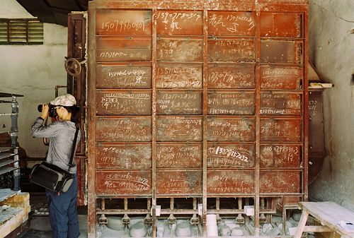   
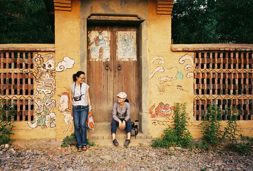   
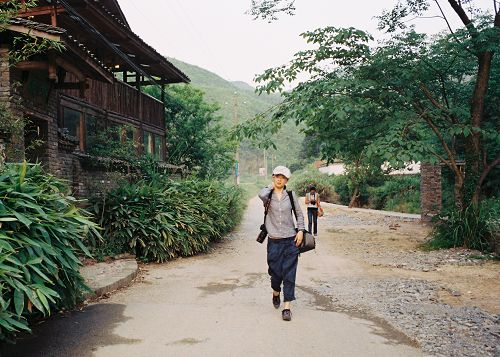   
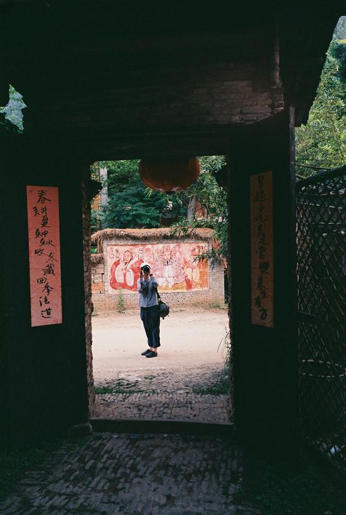   
  
  
@Nov.,2010  
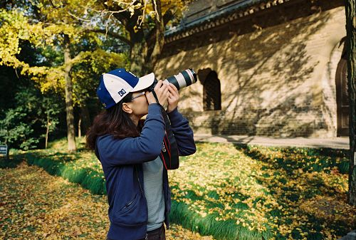   
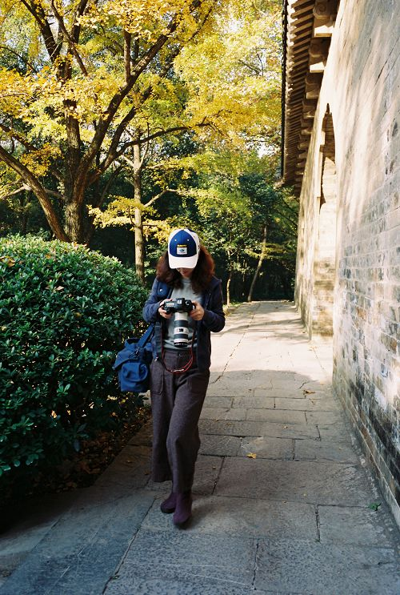  
  
  
以下照片为CONTAX T2拍摄，她已出售这款相机。  
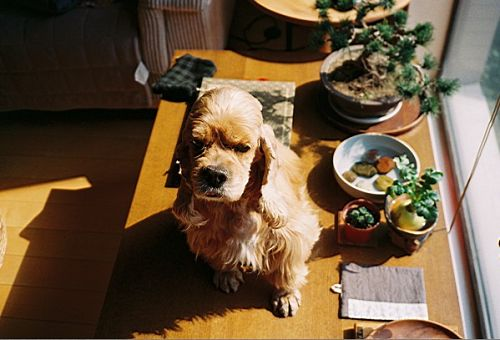   
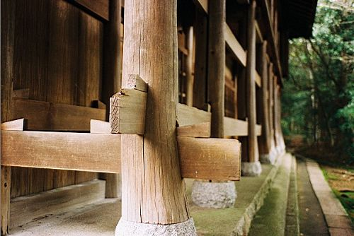   
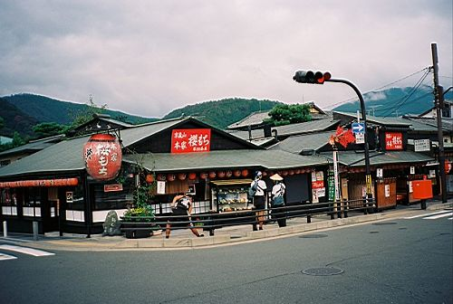   
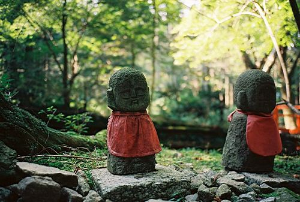   
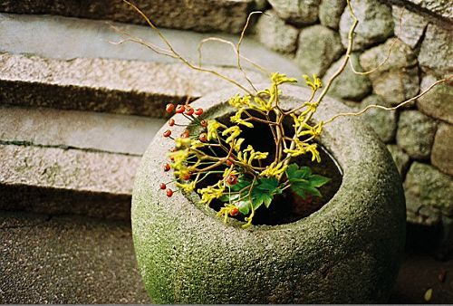

---

## 评论（13）

**问问** · 2011-09-11

好看啊，我说人。那张门口收费的呢？

**[Chrisitna](http://lifetea.org)** · 2011-09-11

我更喜欢在门外拍摄的那张~

**zhang** · 2011-09-12

看到京都的岚山！

**HANK** · 2011-09-12

拍的很是不错。而且，冲洗的技术也不赖！想起抽屉里还有十几卷胶片，彩色黑白的都有，还是出来之前的储备。不知道还能被咔嚓不？改天翻出来试试。

**[christina](http://Lifetea.org)** · 2011-09-13

出来之前。。。出国前好吧，不知道的没准儿误会了。那胶卷是不是要过期了？话说我也整了一台胶片机，等你以后鉴定，呵呵，祝中秋快乐。

**Sherry** · 2011-09-15

胶片对光线的包容宽泛，色彩比数码的好。

**frank** · 2011-09-16

搞的跟专业的似的

**Isabella** · 2011-09-18

frank，有病呀！

**[Chrisitna](http://lifetea.org)** · 2011-09-18

我很幸运，不靠这个专业吃饭，哈哈哈哈哈~

**[yuuco](http://yuuco.blogspot.com)** · 2011-09-19

Nice photos! I like your point of view! :)

**greenfeel** · 2011-09-20

第一张照片中穿的衣服好喜欢呐！真心想知道是什么牌子的

**[Chrisitna](http://lifetea.org)** · 2011-09-20

MUJI的衬衫。

**大姜炖去** · 2011-09-21

最后几张让我感觉有种沉静的力量

