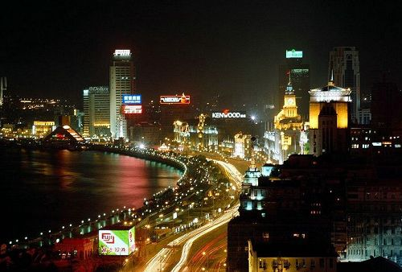

# 欲望就象爬楼梯。

   
  
  
坐在上海的出租车上，司机师傅很健谈，他说：“生活在上海，幸福感不高。”晚饭和朋友们讨论这个话题，有朋友说：“那就不出门呗，自己烧饭吃，没钱买房子可以租房子住。”我想幸福感取决于个人欲望的多寡，欲望多且难以实现时，自然没有幸福感可言。但是“知足常乐”，不是多数人能做到的，欲望就象爬楼梯，楼层越高爬得越辛苦。*（如果你是富二代官二代星二代，你可以直接乘电梯上去了。）*每一层的风景不同，你想看到更多风景，自然得不停地爬楼梯。  
  
  
每次去上海，行走在上海的街道上，都有一种要被淹没的感觉。无形的快节奏，无形的生活压力，从西装革履到人字拖，从CBD的窗明几净到一间房的足疗店，放眼望去每个人都在这座城市中为了生存吸取需要的养分。也有不一样的街景，傍晚三五个老人悠闲地坐在巷弄里聊天，观望来来往往穿梭地人群，他们处于社会的边缘，“观望”或许意味着他们与这个社会还存有一丝联系。  
  
  
据说上海郊区的房价全线上涨，市中心房价稳定，全市均价在CNY2.5万/平米，你信吗？从二线三线城市迁居上海，所有人的资产会缩水2/3？

---

## 评论（7）

**wingalin** · 2011-09-23

是啊，我在上海第4个年头了，每天都有种莫名的危机感，担心失业、担心金融危机、担心通胀、担心疾病。惶恐的生活，但还是无法离开这座城市

**Anyayaya** · 2011-09-24

上海不算是我心仪的城市，只适合路过的时候调戏一下。

**frank** · 2011-09-24

上海很摩登， 北京很古典， 我特别喜欢这两个城市， 消费也还可以接受， 我看国内只有上海北京深圳广州比较适合海龟生活， 其实，家居生活都不是很贵。

**[oldphoebe](http://oldphoebe.blogbus.com)** · 2011-09-24

我毕业之前从杭州来上海考试，出租车司机说“上海是有钱人的天堂”  
后来来工作了四年，上两年班，在家做了两年自由职业。感觉挺愉快的，虽然不是有钱人。上海足够大，能够一直给我新鲜感。那时候赶在大涨前买房子的朋友，现在都成有钱人了  
读书时代的杭州，文化活动还很不发达，跟上海不能比，不过近年来杭州在这方面也很有提升

**Michelle** · 2011-09-25

满国尽是绣花枕头。钟伟说的1000万养老可能都不够，没准真能成现实。另可读带三个表的《上海惊奇》http://www.wangxiaofeng.net/?p=7921

**雯子** · 2011-09-26

在上海生活工作了10年，谈不上喜欢还是不喜欢上海这个城市。不过老家成都现在也节奏快了，出行也拥堵了。消费也高了，房价也上万了，听同学说奢侈品消费不必上海弱，哎，大城市生活哪都一样啦。

**lilian** · 2011-09-27

除了生活成本高，在上海衣食住行还是十分便利。。

