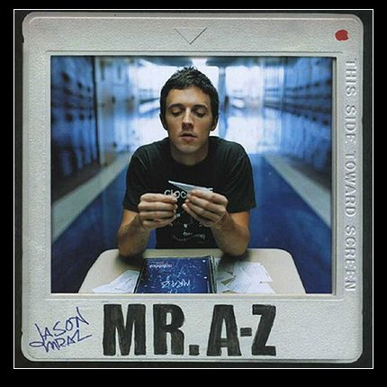

# Bella Luna@《MR. A-Z》

[Bella Luna](http://www.tudou.com/programs/view/m1chTq-QzNE/isRenhe=1)收录在Jason Mraz[《MR. A-Z》](http://mp3.baidu.com/albumlist/jason%20mraz;;;;;;mr%2E%20a%2Dz.html)专辑中，来自美国歌手的这种曲风（ROCK）还蛮少听到，Jason Mraz从小在弗吉尼亚州列治文郊区的梅卡尼克斯维尔长大。《I'm Yours》是他最著名的歌曲。且能演唱多种音乐类型，包括：流行音乐，摇滚，民族音乐，爵士乐，乡村音乐、Hip Hop等。他曾与多位著名歌手合作。  
  
  
  
  
  
  
Mystery the moon  
A hole in the sky  
A supernatural nightlight  
So full but often right  
A pair of eyes a closin' one  
A chosen child of golden sun  
A marble dog that chases cars  
To farthest reaches of the beach  
and far beyond into the swimming sea of stars  
  
  
A cosmic fish they love to kiss  
They're giving birth to constellation  
No riffs and oh no reservation  
If they should fall you get a wish or dedication  
May I suggest you get the best  
For nothing less than you and i  
Let's take a chance as this romance  
is rising over before we lose the lighting  
Oh bella bella please  
Bella you beautiful luna  
Oh bella do you do  
  
  
You are an illuminated anchor  
Of leads to infinite number  
Crashing waves and breaking thunder  
Tiding the evenflows of hunger  
You're dancing naked there for me  
You expose all memory  
You make the most of boundary  
You're the ghost of royalty imposing love  
You are the queen and king combining everything  
Into twining like a ring around the finger of a girl  
i'm just a singer, you're the world  
all i can bring ya  
is the language of a lover  
bella luna, my beautiful beautiful moon  
how you swoon me like no other  
  
  
may i suggest you get the best  
of your wish may i insist  
that no contest for little you or smaller i  
a larger chance happened, all them they lie  
on the rise, on the brink of our lives  
  
  
bella please  
bella you beautiful luna  
oh bella do you do  
bella luna, my beautiful beautiful moon  
how you swoon me like no other, oh oh oh

---

## 评论（3）

**Michelle** · 2011-09-26

like him very much, as always…

**[Christina](http://lifetea.org)** · 2011-09-26

真的么？好激动，最近车上放的正是他的A-Z专辑，遇见知音啦~

**njlh** · 2011-09-26

KT Tunstall的歌也是类似的，欢快明朗的旋律，很好听，推荐http://www.xiami.com/artist/23839。

