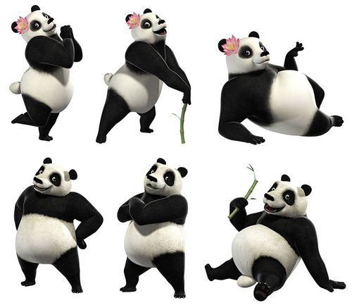

# 亦或，直接疯了。

新同事来送传真，头发凌乱，表情迟缓。忽然心生酸楚，刚工作没多久，本来青春无限活泼开朗，工作后渐渐就变了。公司让群众针对彼此的工作相互打分，有些分数垫底的年轻孩子应该挺受打击的吧？这种方式无非是将上下矛盾，转嫁于群众之间。鲜嫩的心灵在各种打击下终有一天也会粗糙，你我的心路历程，也会是别人的。谁也逃不过。  
  
  
  
  
  
年轻时我喜欢问“为什么”，现在想问“凭什么”？“凭什么”要委屈自己去得到大家的认可？“凭什么”这些孩子不能做喜欢的自己？呃，冷静想想，成年后的我们多的是取悦他人委屈自己的片段。从工作到生活，总是间断性发生，从未真正摆脱过这种境遇。这一切永远无法推翻？最有实力的人也会被某些东西牵制着。当然你也可以非主流，亦或，直接疯了。

---

## 评论（18）

**haohao** · 2011-09-28

这种互相测评，是很多傻B领导喜欢干的

**Xiaona W.** · 2011-09-28

哎，“人在江湖，身不由己“，想做自己，谈何容易。

**michelle** · 2011-09-28

这种方式是典型的“继承革命英雄的光荣传统”。有多少数不清的有良知识份子曾经选择正常，选择非主流，选择“直接疯”或者直接死。

**Sherry** · 2011-09-28

还要相互打分啊，真受不了。

**Cindy** · 2011-09-28

“成年后的我们多的是取悦他人委屈自己的片段” 一直以为茶MM是活得比较真实敢于做自己的人呢，看来有时候也会人在江湖身不由己呀~

**njlh** · 2011-09-28

全是商鞅惹得祸吧。中国传统文化继承下来了，老毛尤其继承的彻底。有个做老板的朋友说他一名员工主动向他提出让员工之间窝里斗，这样员工们就不可能一条心和老板斗了。

**tian** · 2011-09-29

额，也有可能他是看了通宵美剧才这么憔悴……

**Yanying** · 2011-09-29

有感触，大家都是过来人。谁都逃不过如来佛的手掌心。

**Yanying** · 2011-09-29

Sigmund Freud: “文明是一个民族压抑的潜意识下的表现.” 我觉得这句话在中国文明上表现得非常鲜明. 推荐Civilization and Its Discontent by Sigmund Freud.

**[Christina](http://lifetea.org)** · 2011-09-29

njlh，那个提议的员工除了狗腿子之外，也没什么利用价值了，明天也有可能会搞起老板呢。

无论哪个阶层，都担负着无形的沉甸甸地东西。

**frank** · 2011-09-29

出国前我在中科院读研究生， 我发现在那里混的好的 不是才华出众的， 而是那些学术平平会拍马溜須的， 很多很有才华的不得不出国，下海自己干， 现在好几个在美国都是教授， 还有公司里的高级别的工程师， 而这些人都个性太强而不太受重用

**[Christina](http://lifetea.org)** · 2011-09-29

个性强不受重用，是在中国还是在米国？

**haohao** · 2011-09-30

个性太强而不太受重用  
显然不会是米国的啊

**frank** · 2011-09-30

我说的是在中国。很多有才华的学生都不得不去海外发展， 我们研究所几乎90%以上的研究生毕业选择出国， 经济是一方面， 不能施展自己的才华也是很重要的原因。

**mandy** · 2011-09-30

员工之间有的只是点头之交，更谈不上相互了解，怎么对彼此的工作打分？怎么有点阶级斗争的味道~~~哎~~~

**[Chrisitna](http://lifetea.org)** · 2011-09-30

有些人我们一年都说不上一句话，有些工作接触也少，以及工作量多的人出镜率相对多，所谓做的多错的多，做的少人家没什么“坏”记忆。有次我对某助理说：“你分数高，是因为你们工作量少，接触少也就没有摩擦。”估计挺尴尬的这话。

**frank** · 2011-10-01

知足者常乐， 其实到那里都不能逃避烦恼， 我现在除了经营自己的店， 周末还要去做part time, 虽然人际关系不像国内花心思， 但是其它事务一样操心。

**Isabella** · 2011-10-02

鄙视那些挑逗群众斗群众的领导，  
不做正式，工作的重点就是寻思着搞人。  
类似这类领导不是太多了。  
在这类环境下，新同事的表现是最得人心，收拾的光亮反而招致羡慕嫉妒恨，领导会忽略你的工作业绩达到整人的目的，这种考核更多的是领导针对他心里不爽的被他惦记人。

