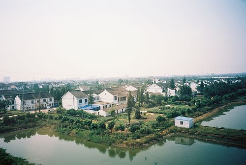
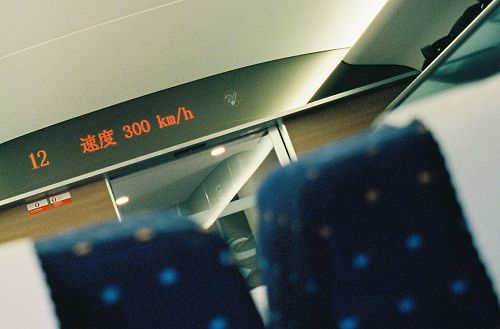
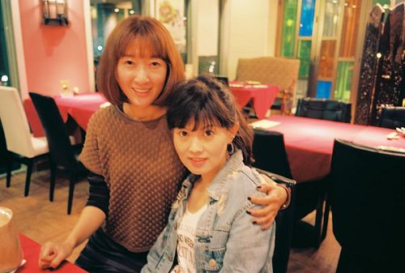
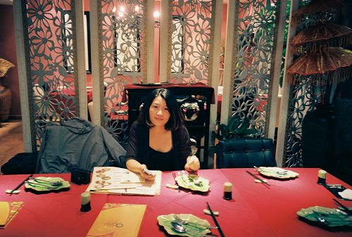
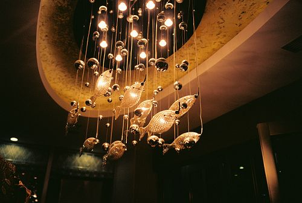

# 九月·上海

9月去上海出差，为机动出发时间，决定早晨临时去南京火车站买车票。问有没有动车？窗口的大婶气急败坏地答：“早就没有动车了，只有高铁，你要在这里能买到动车的票，我免费送给你。。。”火车站的服务堪称古墓级，仿佛还在80年代的国营单位，说到底没有竞争就没有压力，服务意识与火车站的新设施不搭调。每每身处火车站总有种逃难的感觉。  
  
  
晚上和女友们在泰国料理店吃饭，关键的人物照都糊了，关键时刻还是数码保险些。无论胶片机还是数码机，都需要一双稳稳地铁手。有时可能还需要一些稳定的情绪，深深呼口气，屏住呼吸，斟酌一番，方能拍出小鱼灯的清晰照啊。  
  
  
高铁驶过江南的农村，照片下还有一丝文艺气息，肉眼望去却逊色许多。  
  
  
  
最高时速了吗？  
   
  
  
大律师和她的表妹都是气质很好的美人儿，表妹在北京做形象设计。这糊了的照片让人恼火。据说当天有某网站街拍找她们俩拍照，看手机里的效果很是惊人，我还需要努力才能拍好人像。这些天买了德国人写的《在照片中学习人像摄影》，希望阅读后能有所收获。  
  
  
  
晚上与Angie同居，深更半夜地居然一起收拾满屋子的衣服。她比往年忙碌许多，但依然还是那副满不在乎的摸样。见到久违的TOBY，瘦了，半夜两人带它去散步，因为到家晚，其它小盆友早已回家，它趴在花坛边有点失落，不过终于还是遇到了一只剔成光猪状的古牧，可惜TOBY对它没兴趣。呵呵~希望Angie搬家后，我能帮忙布置屋子。  
   
  
  
餐厅入门处好看的鱼灯，大图非常美，[**点击这里**](http://ww4.sinaimg.cn/large/631148a9gw1dm2eidvhn6j.jpg)，胶片表现出来的画面远远比数码要丰富许多。  

---

## 评论（3）

**Anyayaya** · 2011-10-14

围脖不好用呵，动不动就什么都打不开或者出错。是不是因为在海外的原因啊？

**[Christina](http://lifetea.org)** · 2011-10-14

海外华人用的多呢，没听说有这样的问题啊？你的电脑设置什么的要不要看看？

**扑土** · 2011-11-02

最后一张真是美的～

