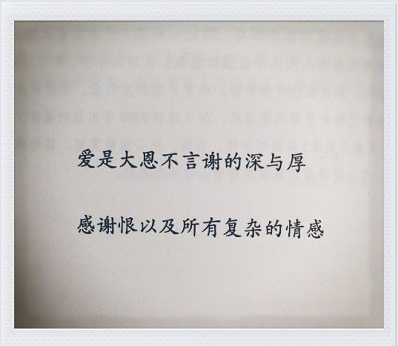

# 所以

“人只要活着，就必须对付绝望，只要对付绝望，生命就会呈现真实和美的生动姿态。只要生命能够生动的真实和美，那么一起都有可能性...”  
--《池莉 . 所以》  
  
  
When the pain of holding on is greater than the pain of letting go, it's time to let go.  
   
*（照片来自凤凰卫视“沈星”）*

---

## 评论（4）

**[Steph](http://stephcupoftea.blogspot.com)** · 2011-10-14

Hello, what lovely photos! I can’t read the text but I will return for the visual treat (and feature you on my blog today.) I’m not sure if you can get to mine, as it is on Blogger, restricted in China.

**frank** · 2011-10-15

太悲观了， 不过， 文人和艺术家都很悲观， 活的太累

**[Robinu L.](http://www.robinu.com)** · 2011-10-15

Just attitude…

**JasonChen** · 2011-10-24

这种句子下的状态,看出美来,池莉必定是个心态极好的人.(俺没有读过任何她的完整作品).

